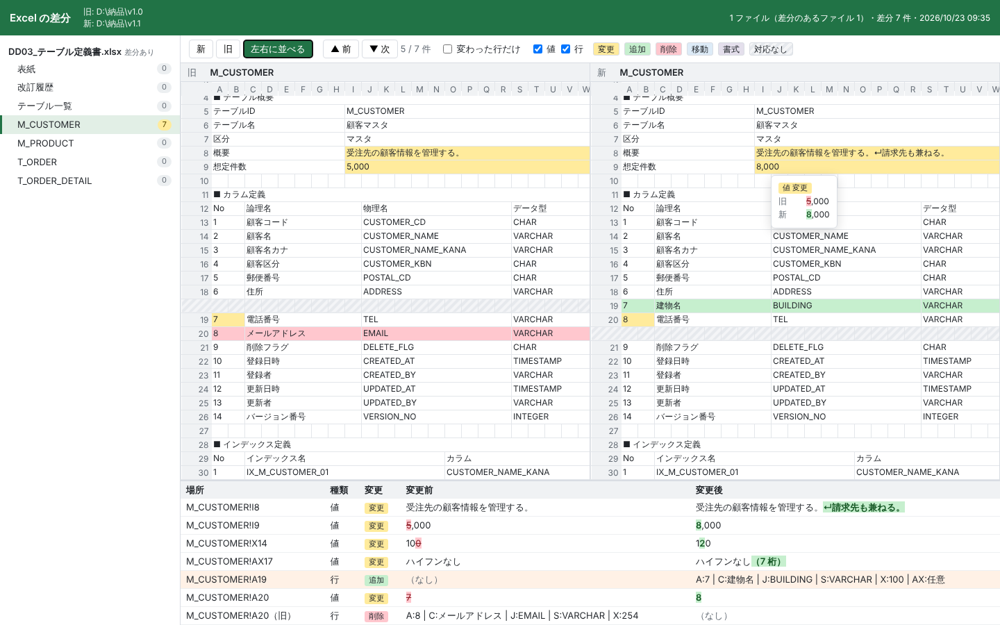

# tools

工程ごとの使い方（どの工程で、どのツールを、どの順に使うか）は [工程別ガイド](../docs/工程別ガイド.md) を見てください。

担当者向け・管理者向けは、主に使う人の目安です（どのツールも誰が使ってもかまいません）。

**担当者向け（設計書・テスト仕様書を作る・直す・レビューする）**

| スクリプト | 内容 |
| --- | --- |
| [New-DesignDocument.ps1](#new-designdocumentps1) | 画面一覧などの一覧から、雛形の差し込み欄（`{{画面ID}}` など）を埋めた設計書を一括で作る。テーブル定義書のように 1 件 1 シートの設計書には、雛形のシートからシートを足す。設計書の版上げ（表紙の版数・更新日、改訂履歴の行、ファイル名の版数）もする（Excel 不要） |
| [Search-Excel.ps1](#search-excelps1) | フォルダ配下の Excel を横断して文字列を検索する（Excel 版 grep） |
| [Replace-Excel.ps1](#replace-excelps1) | 複数の Excel の文字を一括で置換する（Excel 不要。置換する箇所を確認してから書き換える） |
| [Test-ExcelTerms.ps1](#test-exceltermsps1) | 複数の Excel の表記ゆれ（ユーザ／ユーザー、ＩＤ／ID など）を見つけ、Replace-Excel 用の置換リストを作る |
| [New-GlossaryDraft.ps1](#new-glossarydraftps1) | 設計書からカタカナ語・略語・よく出る用語を数え、用語集の下書きと、表記ゆれの用語集（Test-ExcelTerms の `-Glossary`）を作る（Excel 不要） |
| [Test-DesignConsistency.ps1](#test-designconsistencyps1) | 設計書どうしの参照の食い違い（定義されていないテーブル・カラム・メッセージ・コード・画面、重複した定義、画面一覧との過不足、桁数・必須の違いなど）を全件見つける。CRUD 図と影響調査も（Excel 不要） |
| [Test-ScreenNumbers.ps1](#test-screennumbersps1) | 画面レイアウトのスクリーンショットに重ねた丸数字（①・No.5 など）を、画面項目定義の No と突き合わせる。無い番号・重なった番号と、前の版と比べて No がずれたのに直していない丸数字を見つける（Excel 不要） |
| [Test-Screenshots.ps1](#test-screenshotsps1) | 設計書に貼った画面のスクリーンショットが、元のワイヤーフレーム（Excel）より古くなっていないかを確かめる。貼り替えたあとに記録し、元の印刷範囲の中が変わると「元が更新された」と知らせる（Excel 不要。設計書は変更しない） |
| [Export-TableDdl.ps1](#export-tableddlps1) | テーブル定義書から DDL（CREATE TABLE・コメント・インデックス・外部キー）を作り、DB の列の一覧との食い違いも確かめる（Excel 不要） |
| [Export-DesignDiagram.ps1](#export-designdiagramps1) | イベント定義の遷移先から画面遷移図を、テーブル定義書の外部キーから ER 図を作り、Mermaid（Markdown）と Excel の図形（四角と矢印）で保存する。遷移先・参照先の書き間違いも見つける（Excel 不要） |
| [New-TestData.ps1](#new-testdataps1) | テーブル定義書から、テーブルごとの CSV と INSERT 文のテストデータを作る。主キー・外部キー・コード値と、桁数の最大・最小・NULL の行も作る（Excel 不要） |
| [Compare-Excel.ps1](#compare-excelps1) | 2 つのブック（またはフォルダ）を比べ、セル単位の差分を一覧にする（行・列の挿入や削除・移動・シート名変更を考慮。書式や長い文字列の変わった部分も示し、新のブックに印を付けた写しや、改訂履歴の記載漏れの確認・下書きもできる。Word（.docx）の設計書も段落・表の行で比べる） |
| [Compare-SharePointVersion.ps1](#compare-sharepointversionps1) | SharePoint（Microsoft 365）のファイルの 2 つの版（バージョン履歴）を取り出して比べ、差分の画面を開く（版は Excel で取り出す） |
| [Export-ExcelToMarkdown.ps1](#export-exceltomarkdownps1) | Excel を Markdown のテキストにする（表は Markdown の表に）。`git diff` で Excel の変更を文字の差分で見る設定、AI への入力、全文検索に（Excel 不要） |
| [Invoke-DesignReview.ps1](#invoke-designreviewps1) | Excel・Word の設計書を観点表に沿って AI（Microsoft 365 Copilot）にレビューさせ、指摘一覧にまとめる。数える・突き合わせるだけの観点はツールで確かめる |
| [Test-ExcelDeliverable.ps1](#test-exceldeliverableps1) | 社外へ提出する前に、体裁の崩れ・消し忘れ・情報漏れ・壊れた箇所・印刷のはみ出し・版数の食い違い・スクリーンショットの縦横比や拡大をまとめて確認する（プロパティの個人名など、機械で直せるものは `-Fix` で直す）。Word（.docx）の変更履歴・コメント・隠し文字の残りも見つける |
| [Reset-ExcelView.ps1](#reset-excelviewps1) | 開いたときに先頭シートの A1 が倍率 100% で表示される状態に、一括で直す（Excel 不要） |
| [Export-ExcelToPdf.ps1](#export-exceltopdfps1) | フォルダ配下の Excel を PDF に一括出力し、ページ数を数える |
| [New-DocumentRegister.ps1](#new-documentregisterps1) | フォルダの成果物の表紙と改訂履歴から、文書番号・文書名・版数・更新日・最新の改訂の一覧（成果物一覧）を作り、古い版・版数の食い違い・未提出を見つける（Excel 不要） |
| [New-TestSpecDraft.ps1](#new-testspecdraftps1) | 画面設計書（画面項目定義・イベント定義）とコード定義書・メッセージ一覧から、必須・桁数の境界・型・入力チェック・コード値・イベントのテストケースの下書きを、メッセージの文言付きで作る（Excel 不要） |
| [Test-TestSpec.ps1](#test-testspecps1) | テスト仕様書の書き方の抜け・あいまいさ（期待結果の空欄・「正しく」など）・重複と、異常系・必須・型・境界値・コード値のケースの不足を見つける（Excel 不要） |
| [Test-TestEvidence.ps1](#test-testevidenceps1) | テストのエビデンス（画面のハードコピーなど）の抜け・空・同じ画像の使い回しと、結果の書き忘れを、テスト仕様書の結果と突き合わせて見つける（Excel 不要） |
| [Test-Traceability.ps1](#test-traceabilityps1) | 要件一覧 → 設計書 → テスト仕様書のつながりと、設計の要素（画面・イベント・メッセージ・IF）にテストがあるかを確かめる。テストの抜けを全件、機械で見つける（Excel 不要） |
| [Test-CodeTrace.ps1](#test-codetraceps1) | 設計書のメッセージ・画面・テーブル（・カラム）の ID とソースコードを突き合わせ、ソースで使っていない ID と、ソースで使っているのに設計書に無い ID（書き間違い・設計書の直し忘れ）を見つける（Excel 不要） |
| [Select-RegressionTests.ps1](#select-regressiontestsps1) | 設計書の旧版と新版の差分から、変更した項目・イベント・メッセージなどが出てくるテストケースを、再テストするケースとして選ぶ（改修の回帰テストの範囲決め。Excel 不要） |
| [Find-SimilarDefects.ps1](#find-similardefectsps1) | 障害の箇所と同じ作り（型・入力チェック・処理・カラムの型など）の箇所を設計書から集め、横展開の候補の一覧を作る。候補の絞り込みは Copilot に頼める（Excel 不要） |

**管理者向け（見積もり・進捗・品質を数字で見る）**

| スクリプト | 内容 |
| --- | --- |
| [Measure-DesignSize.ps1](#measure-designsizeps1) | 設計書から画面・テーブル・IF などの規模を数え、係数表で工数の目安と FP（NESMA）を出す。前の版との変更の規模や、実績の工数からの係数表づくりも（Excel 不要） |
| [Test-ExcelEstimate.ps1](#test-excelestimateps1) | 見積書の計算のミスになりやすい箇所（合計の範囲漏れ・手入力の合計・周りと違う数式・文字列の数値・換算や単価の食い違い）を見つける（Excel 不要） |
| [New-WbsDraft.ps1](#new-wbsdraftps1) | 設計書の規模の見積もり（Measure-DesignSize）の工数を工程に配分し、担当者と予定日（土日・休日を除く）を決めた WBS の下書きを、Measure-Progress などがそのまま読める形で作る（Excel 不要） |
| [Measure-Progress.ps1](#measure-progressps1) | WBS から子のタスクごとの遅れ（営業日）・状態と PV／EV／SPI を出し、遅延タスクと週ごとの完了数をスケジュール遅延リカバリ計画のテンプレートに書き込む（Excel 不要） |
| [Measure-Effort.ps1](#measure-effortps1) | 日報・工数実績表（日付・担当・WBS 番号かタスク・工数）を、タスク・担当者×週ごとに集計し、WBS の予定工数と比べて予定超過・超過の見込みのタスクと CPI を出す。WBS に無い作業（会議など）の工数も出す（Excel 不要） |
| [Export-ActionItems.ps1](#export-actionitemsps1) | 議事録（Word・Excel・テキスト・Markdown）から、宿題・ToDo の節や【宿題】の印、担当・期限の表を読み、宿題（担当・期限付き）と決定事項を一覧にする。CSV は課題管理表の形で、週次報告の `-IssueList` に渡せる（Excel・Word 不要） |
| [New-WeeklyReport.ps1](#new-weeklyreportps1) | WBS・指摘管理表・障害管理表・課題（QA）管理表・工数実績から週次報告（今週の完了・遅延・来週の予定、指摘・障害・課題の起票・完了・期限切れ、今週の工数と予定超過のタスク、担当者ごとのやること）を作り、メールに貼れる文章と Excel（元の表へのリンク付き）に保存する。毎週の数字を残して前回と比べる（Excel 不要） |
| [Measure-ReviewQuality.ps1](#measure-reviewqualityps1) | レビューの指摘管理表を集計し、設計書ごとの指摘件数・指摘密度（ページ数・規模あたり）・未完了・期限切れを出し、基準値から外れた設計書を知らせる。レビュー記録の工数も使うと、レビュー工数密度 × 指摘密度のゾーン分析もする（Excel 不要） |
| [Measure-TestQuality.ps1](#measure-testqualityps1) | テスト仕様書と障害管理表を集計し、機能ごとのテスト密度・バグ密度とゾーン分析、テストの消化とバグの収束の推移、信頼度成長曲線（潜在バグ数の推定・収束の判定）、NG なのにバグ番号が無いなどの食い違いを出す（Excel 不要） |
| [Measure-DefectRemoval.ps1](#measure-defectremovalps1) | 障害管理表とレビューの指摘から、欠陥の混入工程 × 摘出工程と、工程ごとの摘出率・後の工程への流出・原因の多い順を出す（Excel 不要） |
| [Measure-ReviewEffectiveness.ps1](#measure-revieweffectivenessps1) | 設計書ごとに、レビューの指摘密度と、設計で入ったのにテストで見つかったバグを並べ、レビューで見逃した設計書と設計工程の摘出率を出す |
| [Compare-ReviewFindings.ps1](#compare-reviewfindingsps1) | AI のレビュー（Invoke-DesignReview）と人のレビューの指摘を突き合わせ、一致・AI だけ・人だけと、観点ごとの一致率、観点表への反映案を出す（Excel 不要） |
| [Measure-CodeSize.ps1](#measure-codesizeps1) | ソースコードのステップ数（コメント・空行を除いた行数）を機能（フォルダ）ごとに数え、前の版との新規・修正・削除も出す。バグ密度・テスト密度の分母（KLOC）に（Excel 不要） |
| [New-QualityReport.ps1](#new-qualityreportps1) | レビュー・テスト・工程・網羅・設計書の整合性の各ツールをまとめて実行し、工程完了判定（品質会議）に使う品質評価のブック（指標・実績・判定 ○△×・要対応）を作る |
| [Invoke-QualityAnalysis.ps1](#invoke-qualityanalysisps1) | 品質評価のブックの × と △ の指標について、定性分析（原因）と対策の下書きを AI（Microsoft 365 Copilot）に書かせ、ブックに書き込む（Excel 不要） |
| [New-QualityLimits.ps1](#new-qualitylimitsps1) | 過去のプロジェクトの品質の実績（指摘密度・バグ密度など）から、社内の基準値（下限・上限）の CSV を作る（Excel 不要） |

**導入**

| スクリプト | 内容 |
| --- | --- |
| [Install-ExcelTools.ps1](#install-exceltoolsps1) | 共有フォルダ（配布元）に置いた tools を、担当者の PC に 1 回のダブルクリック（`Install-ExcelTools.cmd`）で入れて「送る」に登録する。配布元が更新されると、「送る」で使ったあとに自動で新しい版を写す |
| [Install-SendTo.ps1](#install-sendtops1) | エクスプローラーの右クリック →「送る」に各ツールを登録し、PowerShell を使わずに、ファイルやフォルダを選ぶだけで実行できるようにする（実行するのは `Invoke-SendTo.ps1`） |
| [Start-ExcelTools.ps1](#start-exceltoolsps1画面) | ツールの画面（ウィンドウ）。やりたいことを選び、ファイルやフォルダを入れて「実行」を押すだけで各ツールを使える（`Start-ExcelTools.cmd` をダブルクリックで開く） |

**`tools` フォルダはまとめて配置してください。** 各スクリプトは同じフォルダの `ExcelTools.psm1`（Excel ファイルを読み書きする共通部品）を使います。
`New-DesignDocument.ps1` は `Search-Excel.ps1` と `Replace-Excel.ps1` も使います。`Start-ExcelTools.ps1` は `ExcelToolsGui.psm1`・`gui\ツールの一覧.psd1` と各ツールを使います。
`Test-ExcelDeliverable.ps1`・`Test-ExcelTerms.ps1`・`New-GlossaryDraft.ps1`・`Measure-Progress.ps1`・`Measure-ReviewQuality.ps1`・`Measure-TestQuality.ps1`・`Test-TestSpec.ps1`・`Test-TestEvidence.ps1`・`Measure-DefectRemoval.ps1`・`Compare-ReviewFindings.ps1`・`Find-SimilarDefects.ps1`・`Test-DesignConsistency.ps1`・`Test-ScreenNumbers.ps1`・`Test-Screenshots.ps1`・`Test-Traceability.ps1`・`Invoke-QualityAnalysis.ps1`・`Export-TableDdl.ps1`・`Export-DesignDiagram.ps1`・`New-TestData.ps1`・`Test-CodeTrace.ps1`・`Measure-DesignSize.ps1`・`Reset-ExcelView.ps1`・`Compare-Excel.ps1`・`Export-ExcelToMarkdown.ps1`・`Invoke-DesignReview.ps1`・`New-DocumentRegister.ps1` は `Search-Excel.ps1` も使い、`Reset-ExcelView.ps1` は `Test-ExcelDeliverable.ps1` も使います。`Select-RegressionTests.ps1`・`Compare-SharePointVersion.ps1` は `Compare-Excel.ps1` を、`New-WeeklyReport.ps1`・`Measure-Effort.ps1` は `Measure-Progress.ps1` と `Search-Excel.ps1` を、`New-WbsDraft.ps1` は `Measure-DesignSize.ps1` と `Search-Excel.ps1` を、`Export-ActionItems.ps1` は `Search-Excel.ps1` を、`New-TestSpecDraft.ps1` は `Search-Excel.ps1` を、`Invoke-SendTo.ps1` は各ツールと `Install-ExcelTools.ps1`（更新の確認）を、`Install-ExcelTools.ps1` は `Install-SendTo.ps1` を、`Measure-ReviewEffectiveness.ps1` は `Measure-ReviewQuality.ps1` を、`New-QualityReport.ps1` は品質の各ツールを呼び出します。

## Start-ExcelTools.ps1（画面）

PowerShell を使わずに、画面（ウィンドウ）から各ツールを使います。`Start-ExcelTools.cmd` をダブルクリックすると開きます。

```powershell
.\Start-ExcelTools.ps1                       # 前に使った処理を選んだ状態で開く
.\Start-ExcelTools.ps1 -Tool Check D:\提出物  # 提出前チェックを選び、フォルダを入れて開く
```

| 画面の部分 | できること |
| --- | --- |
| 左の一覧 | やりたいこと（担当者向け・管理者向け → 分類 → 処理）。上の欄に言葉を入れると絞り込める（例: 差分・提出・WBS）。上の欄・一覧で Enter を押すと、その処理を選んで入力欄に移る（実行はしない） |
| 入力欄 | 最初は主な欄だけを出す。「詳細な設定も表示する」で、ツールのすべての引数を出す（隠しているときに入れてある欄があれば、その数を出す）。各欄の下とマウスを重ねたときに説明が出る。`*` は必ず入れる欄 |
| パスの欄 | 「ファイル…」「フォルダ…」で選ぶ。エクスプローラーからドラッグ＆ドロップ、コピーしたファイルの Ctrl+V でも入る（複数の欄は Delete で外す） |
| 結果の保存先 | 空欄なら「ドキュメント\Excel ツールの結果」に「名前_日時.xlsx」で保存し、終わったら開く（「終わったら結果を開く」） |
| 試しに実行 | ファイルを書き換える処理（置換・表示を整える・版を上げる・雛形から作る）で、最初は選んだ状態。書き換える箇所を記録の欄で確かめてから外して実行する。実際に書き換える前には確認が出る |
| 実行・中止 | ツールを画面の裏で動かし、出力・警告・エラー・進み具合を記録の欄に出す。「中止」で止める。入力欄で Enter を押しても実行する。実行中に画面を閉じると、ツールの後片付け（開いた Excel を閉じるなど）を待ってから閉じる |
| コマンドをコピー | 同じことをする PowerShell のコマンドをクリップボードに写す（くり返し使うとき・ほかの人に伝えるとき） |
| ツールの説明 | ツールのヘルプ（Get-Help）を見る |

- 入力は「%APPDATA%\ExcelTools\画面の設定.json」に保存し、次に開いたときに出します（結果の保存先と日付は保存しません）
- Copilot とやり取りするツール（AI レビュー・品質評価の定性分析）は、PowerShell の画面を開いて実行します
- 並べる処理・分類・説明と、最初から見せる入力欄は `gui\ツールの一覧.psd1` に書きます。入力欄の種類（ファイル・フォルダ・日付・数・選択肢など）は、各ツールの引数とヘルプから決めます。新しいツールを足したら、この一覧にも足してください（テストで確かめています）
- Install-ExcelTools で入れると、スタートメニューの「Excel ツール」と、右クリックの「送る」→「Excel ツールの画面で開く」（選んだファイルを入れた状態で開く）からも開けます
- Windows でのみ使えます（Windows PowerShell 5.1・PowerShell 7）

### 主なパラメーター

| パラメーター | 説明 |
| --- | --- |
| `-Path` | 最初のパスの欄に入れるファイル・フォルダ（「送る」から渡される） |
| `-Tool` | 最初に選ぶ処理（ツールの一覧の Id。`Check`・`Compare`・`Search` など）。省略時は前に使った処理 |
| `-SettingsPath` | 入力を保存するファイル（既定は「%APPDATA%\ExcelTools\画面の設定.json」） |

## Search-Excel.ps1

フォルダ配下の Excel ファイルをまとめて検索し、ヒットした **ファイル・シート・セル番地・内容** を一覧表示します。

検索対象は **セルの値 / 数式 / コメント（メモ） / 図形・テキストボックスの文字 / シート名 / ヘッダー・フッター / 名前の定義 / 入力規則** です。
数式をコピーしたセル（共有数式）も、それぞれのセルの数式で検索します。
`-IncludeWord` を付けると **Word の文書（.docx / .docm）** も一緒に検索します（「送る」の検索は Word も探します）。

### 要件

- PowerShell 5.1 以降（PowerShell 7 でも動作）
- 同じフォルダに `ExcelTools.psm1`
- **.xlsx / .xlsm / .xltx / .xltm は Excel 不要。** ファイル内部の XML を直接読むため、Excel を起動せず高速に動作します
- .xls / .xlsb を検索する場合のみデスクトップ版 Excel が必要です（見つかったときだけ Excel を起動して読みます）

### 使い方

```powershell
# カレントフォルダ配下（サブフォルダ含む）を検索
.\Search-Excel.ps1 '顧客ID'

# フォルダを指定
.\Search-Excel.ps1 '顧客ID' D:\Docs

# 正規表現（既定）。大文字小文字は区別しない
.\Search-Excel.ps1 'TODO|要確認' D:\Docs

# 記号を含む文字列をそのまま探す（正規表現として解釈しない）
.\Search-Excel.ps1 '(株)山田' D:\Docs -SimpleMatch

# 全角・半角を区別しない（「ＡＢＣ」と「ABC」、「ｶﾅ」と「カナ」が一致）
.\Search-Excel.ps1 'ABC' D:\Docs -IgnoreWidth

# 数式だけを検索して CSV に保存
.\Search-Excel.ps1 'VLOOKUP' D:\Docs -Target Formula -OutCsv D:\vlookup.csv

# 結果をリンク付きの Excel ファイルに保存
.\Search-Excel.ps1 'TODO' D:\Docs -OutXlsx D:\result.xlsx

# 結果をウィンドウで絞り込みながら見る
.\Search-Excel.ps1 'TODO' D:\Docs | Out-GridView

# 結果一覧から選んだセルを Excel で開く
.\Search-Excel.ps1 'TODO' D:\Docs -Open

# Word の設計書も一緒に探す
.\Search-Excel.ps1 '受注番号' D:\Docs -IncludeWord -OutXlsx D:\result.xlsx
```

実行ポリシーで止まる場合:

```powershell
powershell -ExecutionPolicy Bypass -File .\Search-Excel.ps1 'TODO' D:\Docs
```

### 実行結果の表示

```
File                      Location            Kind     Text
----                      --------            ----     ----
顧客管理\顧客一覧.xlsx    顧客一覧!B4         値       複数行↵の文字列 TODO
顧客管理\顧客一覧.xlsx    顧客一覧!E5         数式     =VLOOKUP(A2,顧客一覧!A:B,2,FALSE)
顧客管理\顧客一覧.xlsx    顧客一覧!A2         コメント TODO: 住所が古い
顧客管理\顧客一覧.xlsx    顧客一覧!G3         図形     注意：TODO 図形内↵2行目
設計書.xlsm               作業用              シート名 作業用TODO

2 ファイル中 2 ファイルで 5 件ヒット（0.4 秒）
```

- `Location` は `シート名!セル番地`。図形は図形の左上が乗っているセル、シート名のヒットはシート名のみ
- セル内の改行は `↵` で表示します
- 長い内容は画面幅で切れます。全文を見るには `| Format-Table -Wrap`、`| Out-GridView`、または `-OutCsv` を使ってください

結果は PowerShell のオブジェクトとして出力されるので、そのまま加工できます。

```powershell
$hits = .\Search-Excel.ps1 'TODO' D:\Docs
$hits | Where-Object Kind -eq '値' | Select-Object File, Sheet, Cell, Text
$hits | Group-Object File | Sort-Object Count -Descending   # ファイルごとの件数
```

| プロパティ | 内容 |
| --- | --- |
| `File` | 検索フォルダからの相対パス |
| `Location` | `シート名!セル番地`（名前の定義は `シート名!名前` または `名前`） |
| `Sheet` / `Cell` | シート名 / セル番地（個別） |
| `Kind` | `値` / `数式` / `コメント` / `図形` / `シート名` / `ヘッダー・フッター` / `名前の定義` / `入力規則` |
| `Text` | ヒットした内容（全文） |
| `Name` | コメントの作成者、図形の名前、ヘッダー・フッターの位置（`ヘッダー（左）` など）、名前の定義の名前、入力規則の種類と範囲（`リスト（F2:F6）` など） |
| `Path` | ファイルのフルパス |

### 結果をファイルに保存する

| オプション | 形式 | 特徴 |
| --- | --- | --- |
| `-OutXlsx` | Excel（.xlsx） | **「場所」列のリンクをクリックすると、該当ファイルのそのセルが開く**。見出し固定・オートフィルター付き |
| `-OutCsv` | CSV（UTF-8 BOM 付き） | Excel でそのまま開ける。他のツールに渡しやすい |

両方同時に指定できます。どちらも画面にも結果を表示します。

`-OutXlsx` の列は「ファイル / 場所 / シート / セル / 種類 / 内容 / 名前 / フルパス」です。

- Excel がなくても作成できます（xlsx を直接組み立てます）
- リンク先はフルパスで記録するため、検索したファイルを移動・改名するとリンクは切れます
- 非表示シートのセルへのリンクは、Excel の仕様で「参照が正しくありません」になります。シートを再表示してから使ってください
- 出力ファイルが検索フォルダの中にあっても、そのファイル自体は検索しません（再実行しても前回の結果がヒットしない）
- 同名のファイルを Excel で開いたままだと保存できません（警告が出ます。検索結果は画面に表示されます）
- 1 シートのリンク数には Excel の上限（65,530 個）があるため、それを超えた行にはリンクを付けません

`-OutCsv` の列名は「ファイル / シート / セル / 種類 / 内容 / 名前 / フルパス」です。

### 該当セルを Excel で開く

`-Open` を付けると、検索後に結果が一覧ウィンドウで表示されます。行を選んで **OK** を押すと、そのファイルを Excel で開き、該当セルへジャンプして選択します。

```powershell
.\Search-Excel.ps1 'TODO' D:\Docs -Open
```

- ウィンドウ上部のフィルター欄に文字を入れると、結果をさらに絞り込めます
- Ctrl / Shift で複数行を選ぶと、すべて開きます（最後に選んだ行が前面になります）
- 図形のヒットは、図形の左上のセルへスクロールしてから図形を選択します。シート名のヒットはそのシートを表示します
- **起動中の Excel があればそれを使い**、既に開いているブックは開き直さずに切り替えます
- 読み取り専用ではなく、ダブルクリックで開いたときと同じく通常どおり開きます。マクロの扱いもセキュリティセンターの設定に従います
- 非表示シートのヒットは、ブックだけを開いて警告を出します（非表示のシートは選択できないため）
- Windows 専用です（`Out-GridView` を使うため）

### 主なパラメーター

| パラメーター | 説明 |
| --- | --- |
| `-Pattern` | 検索文字列（必須・1 番目の引数）。既定は .NET 正規表現 |
| `-Path` | 検索するフォルダまたはファイル（2 番目の引数、複数・ワイルドカード可）。省略時はカレントフォルダ |
| `-SimpleMatch` | 正規表現ではなく文字列そのままで検索 |
| `-CaseSensitive` | 大文字小文字を区別する |
| `-IgnoreWidth` | 全角半角を区別しない |
| `-Target` | 検索対象を限定。`Value` `Formula` `Comment` `Shape` `SheetName` `HeaderFooter` `DefinedName` `Validation` から複数指定（既定はすべて） |
| `-NoRecurse` | サブフォルダを検索しない |
| `-SkipHiddenSheets` | 非表示シートを検索しない（既定では非表示シートも検索します） |
| `-IncludeWord` | Word の文書（.docx / .docm）も検索する（下の「Word の文書を探す」） |
| `-SheetNamePattern` | 検索するシート名の正規表現 |
| `-SheetNameExclude` | 除外するシート名の正規表現（`-SheetNamePattern` より優先） |
| `-NoExcel` | Excel を起動しない（.xls / .xlsb は対象外になる） |
| `-Open` | 結果を一覧ウィンドウに表示し、選んだ行のセルを Excel で開く |
| `-OutXlsx` | 結果を xlsx に保存（該当セルへのリンク付き） |
| `-OutCsv` | 結果を CSV に保存 |
| `-Extensions` | 対象拡張子（既定 `.xlsx .xlsm .xltx .xltm .xls .xlsb`） |

### Word の文書を探す（`-IncludeWord`）

Word は不要です。文書の中の XML を直接読みます。

| 探すところ | シート | セル | 種類 | `-Target` |
| --- | --- | --- | --- | --- |
| 本文の段落（内容コントロールの中も） | 本文 | 段落 3 | 段落 | Value |
| 表の行（セルを「 \| 」でつないだ内容で出す。セルをまたいでは一致しない） | 本文 | 表 1 の 2 行目 | 表 | Value |
| テキストボックス | 本文 | テキストボックス 1 | 図形 | Shape |
| 脚注・文末脚注 | 脚注・文末脚注 | 段落 1 | 段落 | Value |
| ヘッダー・フッター | ヘッダー・フッター | 段落 1 | ヘッダー・フッター | HeaderFooter |
| コメント（名前の列に作成者） | 本文 | コメントの付いた段落・表の行 | コメント | Comment |

- 段落の番号は、本文の表の外の段落を上から数えたものです（空の段落も数えます）。Word の画面には出ないので、内容の文字を Ctrl+F で探してください。提出前チェック（Test-ExcelDeliverable）の Word の場所も同じ数え方です
- 変更履歴で削除した文字は探しません（挿入した文字は探します）
- 結果の Excel の「ファイル」のリンクは文書を開くだけです。`-Open` で選んだ Word の行も、文書を開くだけです
- パスワード付きの文書と、古い形式（.doc）は検索できません
- 他のツール（整合性チェックなど）から呼ぶときは Word を探しません（`-IncludeWord` を付けたときだけ）

### 値の検索について

セルの「値」は、画面表示ではなくファイルに保存されている値で検索します。

| セルの内容 | 検索される文字列 |
| --- | --- |
| 文字列 | そのまま（ふりがなは含まない） |
| 数値 | 有効桁 15 桁の表記。`0.1+0.2` の結果は `0.3`、`1234567` は `1234567`（桁区切りや `¥` などの表示形式は付かない） |
| 日付・時刻（日付の表示形式のセル） | `2026/10/16`、`13:00:00`、`2026/01/02 09:30:00` の形式。和暦表示のセルも西暦で検索 |
| 論理値 | `TRUE` / `FALSE` |
| 数式のセル | 値（最後に計算された結果）は「値」、式は「数式」として別々に検索 |

### 設計上の考慮点

- xlsx 系はファイルを ZIP として開き XML を逐次読み込みするため、Excel を起動せず、大きなシートでもメモリを圧迫しません
- **Excel で開いているファイルも検索できます**（共有モードで読み取り、ファイルは変更しません）
- 拡張子ではなくファイルの中身で形式を判定します。中身が xlsx の「.xls」は Excel なしで読みます
- .xls / .xlsb 用に Excel を起動する場合は、マクロを強制無効化し読み取り専用で開きます。自分が起動した Excel プロセスだけを後始末します
- Excel の一時ファイル（`~$` で始まるファイル）は対象外
- 1 ファイル読めなくても全体は止めず、最後に読めなかったファイルと理由をまとめて表示します

### 既知の制約・注意

- **パスワード付きのファイルは検索できません**（「読めなかったファイル」に表示されます）
- 共有数式（数式をコピーして入力した範囲）は、xlsx では先頭セルにしか式が保存されていません。写しのセルの数式は、先頭セルの数式の参照を位置に合わせてずらして求めます（Excel の表示と同じ）
- ヘッダー・フッターは、フォントなどの書式を除いた文字で検索します。ページ番号などの項目は Excel の画面と同じ `&[ページ番号]` `&[日付]` のように表示します
- 名前の定義は、Excel が内部で使う非表示の名前（フィルターの範囲など）を除きます。`-SheetNamePattern` を指定したときは、ブック全体の名前は対象外です
- ヘッダー・フッター、名前の定義、入力規則は .xlsx / .xlsm だけが対象です（.xls / .xlsb では検索しません）
- グラフ内の文字、フォームコントロール（ActiveX）、条件付き書式の数式は検索しません
- .xls / .xlsb（Excel 経由）で読む場合、数式は英語版の関数名で検索されます。xlsx は保存されたとおり（英語の関数名）です
- 行数の多いシートでは 1 ファイル数秒かかることがあります（目安: 6 万セルで約 2 秒）

## Replace-Excel.ps1

複数の Excel ファイルの文字を**一括で置換**します。システム名・版数・旧称の書き換えなどに使えます。Excel は不要です。

```powershell
# まず -WhatIf で置換する箇所を確かめる
.\Replace-Excel.ps1 '受注管理システム' '販売管理システム' D:\設計書 -SimpleMatch -WhatIf

# 確認してから置換し、元のファイルを残す
.\Replace-Excel.ps1 '受注管理システム' '販売管理システム' D:\設計書 -SimpleMatch -BackupDir D:\置換前

# 正規表現: 「第1.0版」→「第1.1版」（表紙シートだけ）
.\Replace-Excel.ps1 '第(\d+)\.0版' '第$1.1版' D:\設計書 -SheetNamePattern '^表紙$'
```

```
2 ファイル・3 か所を置換します。
  基本設計書.xlsx  表紙!A1  値: 受注管理システム 基本設計書 → 販売管理システム 基本設計書
  基本設計書.xlsx  表紙!A2  値: 受注管理システム → 販売管理システム
  詳細設計書.xlsx  概要!G3  図形: 受注管理システムの構成 → 販売管理システムの構成

置換の確認
2 ファイル・3 か所を置換します。よろしいですか？
[Y] Yes  [N] No  [S] Suspend  [?] Help (default is "Y"):
```

### 動き

1. 対象のファイルをすべて読み、置換する箇所を一覧にする（ここではまだ書き換えない）
2. 置換する箇所を表示し、**まとめて 1 回だけ確認**する（`-WhatIf` なら表示だけ、`-Force` なら確認なし）
3. 置換した文字を含むパーツだけを書き換える（ほかの部分はそのまま。元のファイルの代替データストリームやアクセス権も保つ）

### 置換する対象（`-Target`）

| 対象 | 内容 |
| --- | --- |
| `Value`（既定） | セルの文字列。数値・日付のセルは対象外 |
| `Comment`（既定） | コメント（メモ・スレッド形式） |
| `Shape`（既定） | 図形・テキストボックスの文字 |
| `HeaderFooter`（既定） | ヘッダー・フッターの文字。フォントなどの書式と、ページ番号などの項目はそのまま |
| `Validation`（既定） | 入力規則のリスト（`未着手,対応中,完了` のように直接書いたもの）と、入力時・エラーのメッセージ |
| `Formula` | 数式（コピーした数式（共有数式）の写しのセルも）と、入力規則の参照・条件の数式。置換したブックは、開いたときに再計算されるようにする |

- 文字列の一部だけに付けた書式（赤字・太字など）は、**置換していない文字ではそのまま**です。置換後の文字は、一致した箇所の先頭の文字の書式になります
- 置換した文字列のふりがな（Excel が日本語の入力時に記録する読み）は、位置が合わなくなるため消します
- `-SheetNamePattern` などで外したシートの文字は変えません（同じ文字列を共有しているセルがあっても、対象のシートのセルだけを置換します）
- テーブル（リスト）の見出しのセルは、テーブルの列名と一致している必要があるため置換せず、警告で知らせます
- コピーした数式（共有数式）は、写しのセルもそれぞれの位置の数式で置換します。置換した後もコピーした形のままなら先頭のセルの数式だけを書き換え、一部のセルだけが変わるときは各セルに数式を書きます（共有をやめても計算は同じです）
- ヘッダー・フッターと入力規則の直接書いたリストは、Excel の上限（255 文字）を超える置換はせず、警告で知らせます

### 主なパラメーター

| パラメーター | 説明 |
| --- | --- |
| `-Pattern` / `-Replacement` | 置換する文字（正規表現）と置換後の文字。正規表現では `$1` などで一致した部分を使える。空文字で削除 |
| `-Path` | 対象のファイル・フォルダ（複数可・ワイルドカード可、既定はカレント） |
| `-SimpleMatch` | 正規表現ではなく、そのままの文字として扱う |
| `-CaseSensitive` | 英字の大文字と小文字を区別する |
| `-Target` | 置換する対象（上の表） |
| `-SheetNamePattern` / `-SheetNameExclude` / `-SkipHiddenSheets` | 置換するシートを絞り込む |
| `-WhatIf` | 置換する箇所を表示するだけで、書き換えない |
| `-Force` | 確認せずに置換する |
| `-BackupDir` | 書き換える前のファイルを、このフォルダに同じ相対パスで残す |
| `-OutXlsx` | 置換した（する）箇所の一覧を、該当セルへのリンク付きで保存する |
| `-NoRecurse` | サブフォルダを見ない |

### 既知の制約・注意

- .xlsx / .xlsm（.xltx / .xltm）が対象です。.xls / .xlsb、パスワード付きのファイルは置換できません
- **読み取り専用のファイルは書き換えません**。Excel で開いているファイルは失敗として知らせます
- シート名、グラフの文字、名前の定義は置換しません
- 図形の文字は段落ごとに置換します（改行をまたぐ文字は置換しません）
- 空の文字列に一致するパターン（`^` だけなど）は置換しません
- `-IgnoreWidth`（全角・半角を区別しない検索）には対応していません

### 置換リストでまとめて置換する（`-ListPath`）

複数の置換をまとめて行う場合は、CSV の置換リストを渡します（`Test-ExcelTerms.ps1 -OutCsv` で作ったものをそのまま使えます）。

```csv
置換前,置換後,正規表現
ユーザ,ユーザー,
サーバ,サーバー,
(変更|削除)出来る,$1できる,○
```

- 「置換前」「置換後」の列が必要です。「正規表現」の列が ○ / 1 / true の行は正規表現、それ以外はそのままの文字として扱います
- UTF-8（BOM の有無を問わない）と、Excel で保存した Shift_JIS の CSV を読めます
- 置換は上の行から順に行います
- **置換後の文字の一部として一致した箇所は置換しません**。「ユーザ」→「ユーザー」を「ユーザー管理」に当てて「ユーザーー管理」にすることはなく、何度実行しても同じ結果になります（`-Pattern` での置換も同じ）

## Test-ExcelTerms.ps1

複数の Excel ファイルの**表記ゆれ**を見つけます。見つけた揺れは、置換リストにして `Replace-Excel.ps1` でまとめて直せます。Excel は不要です。
`-IncludeWord` を付けると Word の文書（.docx / .docm）も一緒に調べます（「送る」の表記ゆれは Word も調べます）。Word の揺れは `Replace-Excel.ps1` では直せないので、Word の置換（Ctrl+H）で直してください。

```powershell
.\Test-ExcelTerms.ps1 D:\設計書                                              # 自動で見つける
.\Test-ExcelTerms.ps1 D:\設計書 -Glossary .\term-lists\用語集_サンプル.csv -OutCsv D:\置換リスト.csv
.\Replace-Excel.ps1 -ListPath D:\置換リスト.csv -Path D:\設計書 -WhatIf        # 確認してから直す
```

```
Preferred        Variant        Count PreferredCount Kind
---------        -------        ----- -------------- ----
できる           出来る             3              12 用語集
ユーザー         ユーザ             5              40 用語集
ID               ＩＤ               2              31 全角・半角
インターフェース インタフェース     4               9 長音（ー）
サーバー         サーバ             1               6 長音（ー）
ユーザー         ﾕｰｻﾞｰ              1              40 全角・半角

12 ファイルを調べました: 表記ゆれ 6 種類（16 か所）
```

`Preferred` が推奨の表記、`Variant` が揺れの表記、`Count` が揺れの件数、`PreferredCount` が推奨の表記の件数です。

### 見つけ方

| 種類 | 内容 |
| --- | --- |
| 用語集 | `-Glossary` の CSV の「正しい表記」と「揺れ」（`/` や `、` で区切って複数可）に沿って、揺れの表記を数える。揺れが正しい表記の一部になっている箇所（「ユーザー」の中の「ユーザ」）は数えない |
| 長音（ー） | カタカナの語で、長音の有無だけが違うもの（サーバ／サーバー、インタフェース／インターフェース） |
| 全角・半角 | 全角・半角だけが違うもの（ＩＤ／ID、ﾕｰｻﾞｰ／ユーザー）。英字を含む語とカタカナが対象（数字だけの語は対象外）。大文字・小文字の違いは対象外 |

- 推奨の表記は、用語集の正しい表記があればそれ、無ければ多く使われている表記です（同じ数なら、カタカナは長音のある方、英数字は半角の方。半角カタカナは推奨にしません）
- 自動の検出（長音・全角半角）は「どちらかに統一したほうがよい」候補です。意味の違う語が混ざることもあるので、置換リストを確認・修正してから置換してください（`-NoAuto` で用語集だけにできます）
- `tools/term-lists/用語集_サンプル.csv` は、外来語の長音・補助動詞のひらがな書きなどの例です。社内の表記ルールに合わせて直して使ってください

### 主なパラメーター

| パラメーター | 説明 |
| --- | --- |
| `-Path` | 対象のファイル・フォルダ（複数可・ワイルドカード可、既定はカレント） |
| `-Glossary` | 用語集の CSV（「正しい表記」「揺れ」の列。UTF-8 / Shift_JIS） |
| `-NoAuto` | 自動の検出をせず、用語集だけで確かめる |
| `-Target` | 調べる対象（Value / Comment / Shape / SheetName。既定は Value, Comment, Shape） |
| `-OutCsv` | 置換リスト（置換前・置換後・種類・件数・例）を保存する。`Replace-Excel.ps1 -ListPath` で使える |
| `-OutXlsx` | 表記ゆれの一覧と、出現箇所へのリンク付きの一覧を保存する（Word の文書へのリンクは文書を開くだけ） |
| `-IncludeWord` | Word の文書の本文・表・脚注・コメント・テキストボックスも調べる |
| `-NoRecurse` / `-NoExcel` | サブフォルダを見ない／Excel を起動しない（.xls / .xlsb は調べない） |

## New-GlossaryDraft.ps1

設計書から**カタカナ語・略語・よく出る用語**を数え、**用語集の下書き**を作ります。Excel は不要です。
表記ゆれ（ユーザ／ユーザー、ＩＤ／ID など）のある用語は、[Test-ExcelTerms.ps1](#test-exceltermsps1) の `-Glossary` にそのまま渡せる用語集（CSV）にもします。プロジェクトの最初に用語集を作るとき・途中から表記をそろえるときに使います。

```powershell
.\New-GlossaryDraft.ps1 D:\設計書 -IncludeWord -OutXlsx D:\用語集の下書き.xlsx -OutCsv D:\用語集.csv
.\Test-ExcelTerms.ps1 D:\設計書 -Glossary D:\用語集.csv -OutCsv D:\置換リスト.csv     # 表記ゆれの置換リストを作る
```

```
Term         Kind       Count Files Variants
----         ----       ----- ----- --------
ユーザー     カタカナ語     4     1 ユーザ（1）・ﾕｰｻﾞｰ（1）
データベース カタカナ語     3     1 データ・ベース（1）
ID           略語           3     1 ＩＤ（1）
受注番号     用語           3     1

1 ファイルから用語 4（カタカナ語 2・略語 1・用語 1）。3 回以上出てくるもの
表記ゆれ 3 組: ユーザー／ユーザ／ﾕｰｻﾞｰ・データベース／データ・ベース・ID／ＩＤ
```

### 集める言葉

| 種類 | 集めるもの |
| --- | --- |
| カタカナ語 | 3 文字以上のカタカナの続き（ユーザー・ステータス・ログインユーザーなど）。半角カタカナは全角にして数える。「ユーザー・グループ」のような中黒の並びは 1 語ずつ数える |
| 略語 | 英大文字だけの 2〜6 文字（ID・CSV・API など。全角も）。数字の入った ID（SCR001・E0001 など）は除く |
| 用語 | 漢字を含む、漢字とカタカナの続き（受注番号・顧客マスタなど）。「場合」「処理」「表示」「確認」など、どの設計書にも出てくる言葉は除く |

- **表記ゆれ**: 全角・半角（ﾕｰｻﾞｰ／ユーザー・ＩＤ／ID）、語末の長音（ユーザ／ユーザー）、中黒（データ・ベース／データベース）だけが違う表記は、1 つの用語にまとめます。中黒のある表記は、中黒の無い表記も出てくるときだけ表記ゆれにします
- 用語の表記は多く使われているもの（同じ数なら長音のある方）です。半角カタカナ・全角英数字は用語にしません（それしか無ければ、全角カタカナ・半角英数字にしたものを用語にします）。この決め方は Test-ExcelTerms の推奨と同じです
- 表記ゆれを合わせて `-MinCount`（既定 3）回以上出てくるものを、種類ごとに多い順に出します
- 言葉は文字の種類（カタカナ・漢字・英字）の続きで区切るだけなので、「受注番号入力」のような長い続きは 1 つの言葉になります。要らない言葉は `-Exclude` で除けます

`-OutXlsx` のシート:

| シート | 内容 |
| --- | --- |
| 用語集 | 用語・意味（空欄。人が書く）・種類・出現数・設計書の数・表記ゆれ・最初の場所（リンク付き） |
| 表記ゆれ | 正しい表記・揺れ・種類・表記ごとの出現数 |

| パラメーター | 説明 |
| --- | --- |
| `-Path` | 設計書のフォルダまたはファイル（複数可） |
| `-Kind` | 集める言葉の種類（`Katakana`: カタカナ語・`Abbreviation`: 略語・`Word`: 用語）。既定はすべて |
| `-MinCount` | 用語にする出現数の下限（表記ゆれを合わせた数。既定 3） |
| `-Exclude` | 用語にしない言葉（複数可・カンマ区切り可）。表記ゆれと大文字小文字の違うものも除く |
| `-IncludeWord` | Word の文書（.docx / .docm）も読む |
| `-OutXlsx` | 用語集の下書きと表記ゆれの一覧を保存する |
| `-OutCsv` | 表記ゆれのある用語を、Test-ExcelTerms.ps1 の `-Glossary` の形（正しい表記・揺れ・備考。UTF-8・BOM 付き）で保存する |
| `-NoRecurse` | フォルダを指定したとき、サブフォルダを見ない |
| `-NoExcel` | Excel を起動しない（.xls / .xlsb は読まない） |

## Test-ExcelDeliverable.ps1

Excel・Word ファイルを社外へ提出する前に、**体裁の崩れ・消し忘れ・情報漏れ・壊れた箇所**がないかをまとめて確認します。
Excel を使わずにファイルの中身を直接読むので速く、**ファイルは変更しません**（`-Fix` を付けたときだけ、機械で直せる指摘を直します）。

```powershell
.\Test-ExcelDeliverable.ps1 D:\提出物
.\Test-ExcelDeliverable.ps1 D:\提出物 -OutXlsx D:\提出前チェック.xlsx   # 該当セルへのリンク付きで保存
```

```
File      Location  Level  Detail
----      --------  -----  ------
見積書.xlsx 明細!F12  エラー セルがエラー値（#REF!）です
見積書.xlsx           警告   ファイルのプロパティに作成者「山田 太郎」が残っています
見積書.xlsx           警告   他のブックを参照しています（file:///\\fileserver\share\原価表.xlsx）
見積書.xlsx 表紙!C5   警告   選択セルが C5 です（A1 にしてください）
見積書.xlsx 表紙      警告   倍率が 85% です（100% にしてください）

5 ファイル中 1 ファイルが要対応（エラー 1 件 / 警告 4 件 / 情報 0 件）
```

### チェック項目

| 分類 | 区分 | 内容 |
| --- | --- | --- |
| 体裁 | 警告 | 選択セルが A1 でない（見出しを固定したシートはスクロール領域の左上でも可）、スクロールしたまま保存、倍率が 100% でない、開いたときに先頭シートが表示されない、**複数シートを選択したまま（作業グループ）** |
| 体裁 | 情報 | 改ページプレビュー・ページレイアウト表示 |
| 消し忘れ | 警告 | 非表示シート（VBA でしか再表示できない veryHidden も）、コメント（メモ）、TODO などの文言 |
| 消し忘れ | 情報 | 非表示の行・列 |
| 情報漏れ | 警告 | ファイルのプロパティの作成者・最終更新者・会社名・管理者、他ブックへの外部リンク、社内のファイルやフォルダへのハイパーリンク、他ブックを参照する名前の定義 |
| 壊れ | エラー | エラー値（#REF!・#N/A など）のセル、参照先が壊れた名前の定義 |
| 版数 | 警告 | 表紙の版数と改訂履歴の最後の版数が違う、表紙の更新日と改訂履歴の最後の改訂日が違う、ファイル名の版数（`_v1.1`・`_第1.1版`）が違う、改訂履歴の版数が前の行より小さい |
| 印刷 | 警告 | 印刷すると**横が 1 ページに収まらない**、**印刷範囲の外にデータがある**、ヘッダー／フッターにファイルの場所（`&Z`）が印刷される（情報漏れ）や TODO が残っている（消し忘れ） |
| 印刷 | 情報 | 用紙のサイズ・向きがシートによって違う |
| 画像 | 警告 | 画像（スクリーンショット）の**縦横比の崩れ**（元の画像と 3% より違う。トリミングした分は除いて比べる）、元の大きさの **150% 以上への拡大**（印刷・PDF で文字が粗くなる）、**印刷範囲からのはみ出し**（印刷範囲を設定したシート） |
| 画像 | 情報 | スクリーンショット（200×150 ピクセル以上の画像）の縮尺がシートによって違う（いちばん大きいものと小さいものが 15% より違う。並べたときに文字の大きさがそろわない） |
| マクロ | 情報 | VBA を含むブック |
| ファイル | 情報 | パスワード付き・xls / xlsb（中身を読めないためチェックしていない） |

区分の目安: **エラー**は必ず直す、**警告**は原則直す、**情報**は意図どおりか確認する。

#### Word（.docx / .docm）のチェック項目

Word の設計書・仕様書も、Word を使わずにチェックします（フォルダの中の .docx / .docm も対象）。場所は「本文!段落 12」「本文!表 1 の 2 行目」「フッター!段落 1」のように示します（段落は表の外の段落を上から数えた番号で、検索の `-IncludeWord` と同じ数え方です）。

| 分類 | 区分 | 内容（`-Check` の名前） |
| --- | --- | --- |
| 消し忘れ | 警告 | **変更履歴**（挿入・削除・移動・書式の変更の数。Revision）、**コメント**（作成者と文。Comment）、**隠し文字**（Hidden）、TODO などの文言（本文・ヘッダー・フッター・脚注。Word） |
| 消し忘れ | 情報 | 変更履歴の記録がオンのまま保存（Revision）、蛍光ペンの残り（Comment） |
| 情報漏れ | 警告 | ファイルのプロパティの作成者・最終更新者・会社名・管理者（Property）、社内のファイルやフォルダへのハイパーリンク（Link） |
| 情報漏れ | 情報 | 文書のテンプレートの場所（`C:\Users\…\設計書.dotx` など。Link） |
| マクロ | 情報 | VBA を含む文書（.docm） |

`-Fix` で直すのは、Word ではプロパティの個人名・会社名だけです（変更履歴・コメントは内容を確かめて Word で直してください）。

### 機械で直せる指摘を直す（`-Fix`）

`-Fix` を付けると、次の指摘を直してから、**直したあとに残っている指摘**を出力します。まず `-WhatIf` で直すファイルと項目を確かめてください。

```powershell
.\Test-ExcelDeliverable.ps1 D:\提出物 -Fix -AllowedNames '株式会社サンプル' -BackupDir D:\直す前 -WhatIf
.\Test-ExcelDeliverable.ps1 D:\提出物 -Fix -AllowedNames '株式会社サンプル' -BackupDir D:\直す前
```

| 指摘 | 直し方 |
| --- | --- |
| プロパティ（作成者・最終更新者・会社名・管理者） | 値を消す（`-AllowedNames` に一致するものは残す） |
| ヘッダー／フッターのファイルの場所（`&Z`） | `&Z` を消す（ファイル名 `&F` などはそのまま） |
| 体裁（倍率・選択セル・表示位置・先頭シート・作業グループ） | `Reset-ExcelView.ps1` と同じように直す（表示モードは直さない） |

- コメント・非表示シート・外部リンク・残っている文言・エラー値など、**内容が消える・変わる指摘は直しません**。中身を確かめて手で直してください
- 読み取り専用のファイルは書き換えません。Excel で開いているファイルは失敗として知らせます
- `-BackupDir` を付けると、直す前のファイルを同じ相対パスで残します

### 主なパラメーター

| パラメーター | 説明 |
| --- | --- |
| `-Path` | チェックするフォルダまたはファイル（複数・ワイルドカード可） |
| `-Check` | 項目を絞る。`View`（体裁）`Hidden`（非表示）`Comment` `Word`（文言）`Property` `Link` `Error` `Macro` `Print`（印刷）`Version`（版数）`Picture`（画像） |
| `-Words` | 消し忘れとして探す文言（正規表現）。既定は TODO / TBD / FIXME / 要確認 / 未定 / 検討中 / 仮置き / （仮） / XXX / ○○ / ×× |
| `-AllowedNames` | プロパティに残っていてもよい名前（正規表現。例: 自社名） |
| `-Zoom` | 期待する倍率（既定 100） |
| `-FileNamePattern` | ファイル名の命名規則（正規表現）。合わないファイルを警告 |
| `-RequirePageNumber` | ヘッダー／フッターにページ番号が無いシートを警告 |
| `-HeaderFooterText` | ヘッダー／フッターに必ず入れる文字（正規表現。例: `社外秘`）。無いシートを警告 |
| `-HistorySheet` | 改訂履歴のシート名（正規表現。既定は 改訂履歴・変更履歴・改版履歴・更新履歴・改訂記録） |
| `-OutXlsx` | 結果を保存（指摘一覧・ファイル別） |
| `-Fix` / `-BackupDir` | 機械で直せる指摘を直す / 直す前のファイルを残すフォルダ（上） |
| `-NoRecurse` | サブフォルダを見ない |

### 印刷と版数のチェック

**印刷**（表示されているシートのうち、値のあるシートが対象）

- 横のはみ出しは、列の幅・用紙サイズ・向き・余白・拡大縮小率から見積もります（誤差を見込み、1 割を超えてはみ出す場合だけ指摘）。「次のページ数に合わせて印刷」や改ページを設定したシートは、意図どおりとみなして指摘しません
- 印刷範囲の外のデータは、印刷範囲を設定したシートで、範囲の外に値のあるセルを指摘します
- ページ番号・「社外秘」などの表示は、`-RequirePageNumber`・`-HeaderFooterText` を付けたときだけ確かめます

**版数**

- 表紙は「表紙」という名前のシート（無ければ最初に表示されているシート）、改訂履歴は名前が `-HistorySheet` に一致するシートです
- 表紙では「版数」「最終更新日」などの見出しの右にある値、または「第1.1版」「Ver.1.1」の形の文字を読みます
- 改訂履歴では「版数（版）」と「改訂日（日付）」の見出しがある行の下で、版数のある最後の行を読みます
- 版数は数として（1.1 と 1.10 は別）、日付は書き方によらず（2026/10/1・2026年10月1日）比べます

### 既知の制約

- xls / xlsb は中身を読めないためチェックしません（xlsx に保存し直してください）
- 図形の中の文言は探しますが、画像の中の文字は読めません
- 印刷の縦方向のページ数、改ページの位置はチェックしません

## Reset-ExcelView.ps1

Excel ファイルを、**開いたときに先頭シートの A1 が倍率 100% で表示される状態**に一括で直します。
`Book1.xlsm` の「体裁整える」マクロの代わりで、Excel を使いません。

```powershell
.\Reset-ExcelView.ps1 D:\提出物 -WhatIf                          # 何が直されるかだけ確認
.\Reset-ExcelView.ps1 D:\提出物 -BackupDir D:\修正前 -KeepTimestamp  # 修正前を残し、更新日時は変えずに直す
```

```
File        Result   Detail
----        ------   ------
見積書.xlsx 修正     作業グループ・倍率・先頭シート・表示位置・選択セル
仕様書.xlsx 変更なし
旧資料.xlsx スキップ パスワードで保護（暗号化）されているためチェックしていません

3 ファイル: 修正 1 / 変更なし 1 / スキップ 1
```

### 直す内容

- 開いたときに、表示されている最初のシートが表示されるようにする
- 各シートの選択セルを A1 に、表示位置を左上に、倍率を 100%（`-Zoom` で変更可）にする
- **ウィンドウ枠を固定したシート**は、スクロール領域の左上（Ctrl+Home で移動する位置）を選択する
- 複数シートの選択（作業グループ）を解除する
- `-NormalView` を付けると、改ページプレビュー・ページレイアウト表示を標準表示に戻す

### 主なパラメーター

| パラメーター | 説明 |
| --- | --- |
| `-Path` | 対象のフォルダまたはファイル（複数可・ワイルドカード可）。xlsx・xlsm・xltx・xltm が対象 |
| `-Zoom` | そろえる倍率（%。既定 100） |
| `-NormalView` | 改ページプレビュー・ページレイアウト表示のシートを標準表示に戻す |
| `-KeepTimestamp` | ファイルの更新日時を、書き換える前のままにする |
| `-BackupDir` | 書き換える前のファイルを、このフォルダにフォルダ構成ごと写しておく |
| `-WhatIf` | 直すファイルと直す内容を表示するだけで、書き換えない |
| `-Force` | 直す必要がないと判定したファイルも書き換える |
| `-NoRecurse` | サブフォルダを対象にしない |

### マクロとの違い

| | 体裁整えるマクロ（Book1.xlsm） | Reset-ExcelView.ps1 |
| --- | --- | --- |
| Excel | 必要（1 ファイルずつ開いて保存） | **不要**（ファイルの中の表示設定だけを書き換える） |
| 書き換えるファイル | すべて（更新日時がすべて変わる） | **直す必要があるファイルだけ**（判定は Test-ExcelDeliverable.ps1 と同じ基準） |
| 更新日時 | 変わる | `-KeepTimestamp` で元のまま |
| マクロ付きのブック | 開くとマクロが動く可能性がある | 開かないので動かない |
| 1 ファイル失敗したとき | そこで止まる | 理由を表示して次へ進む |
| 事前確認・バックアップ | なし | `-WhatIf`・`-BackupDir` |
| ウィンドウ枠の固定 | 考慮なし | スクロール領域の左上を選択 |

### 安全のための仕組み

- 書き換えるのは `workbook.xml` の表示シートの指定と、各シートの `<sheetViews>`（表示設定）だけです。**セルの値・書式・数式・コメント・図形・マクロには触れません**（テストで、表示設定以外が 1 文字も変わらないことを確認しています）
- いったん一時ファイルに書き出してから置き換えます
- Excel で開いているファイルは書き換えず、失敗として表示します
- xls / xlsb、パスワード付きのファイルは対象外です

## Compare-Excel.ps1

2 つの Excel ファイル（またはフォルダ）を比べ、**セル単位の差分**を一覧にします。設計書の版の比較や、改訂履歴の裏付けに使えます。Excel は不要です。

```powershell
.\Compare-Excel.ps1 .\v1.0\テーブル定義書.xlsx .\v1.1\テーブル定義書.xlsx
.\Compare-Excel.ps1 D:\納品\v1.0 D:\納品\v1.1 -OutXlsx D:\差分_v1.0-v1.1.xlsx   # フォルダどうし
```

```
File                Location    Change Detail
----                --------    ------ ------
テーブル定義書.xlsx 改訂履歴!A7 追加   行を追加: A:1.1 | E:2026/10/12 | K:T_ORDER | W:配送時間帯（DELIVERY_TIME_KBN…
テーブル定義書.xlsx T_ORDER!A19 追加   行を追加: A:7 | C:配送時間帯 | J:DELIVERY_TIME_KBN | S:CHAR | X:2 | AE:○ | …
テーブル定義書.xlsx T_ORDER!A20:A26 変更 連番の振り直し: 7～13 → 8～14（7 個）
テーブル定義書.xlsx T_ORDER!X20 変更   値: 9 → 11（旧 X19）

1 ファイル: 差分あり 1 / 差分 4 件
```

差分はシートごとに、上の行から順（同じ行なら左の列から）に並びます。

長い文字列（21 文字以上）の変更は、変わった部分だけを示します。英数字の並び（物理名・SQL のキーワードなど）は語の単位、日本語は 1 文字ずつ比べます。

```
設計書.xlsx  処理概要!C12  変更  値: …情報を受注テーブルに[-登録-]{+更新+}する。登録時に受注番…、ステータスを「受付{+済+}」に設定する。
設計書.xlsx  SQL!B3       変更  値: …USTOMER_CD{+, ORDER_DATE+} FROM T_OR…STATUS = '[-01-]{+02+}'
```

`[-…-]` が削除した部分、`{+…+}` が追加した部分です。ほとんど書き換えた場合は、変更前と変更後の全体を示します。
`-OutXlsx` の「変更前」「変更後」の列では、削除した部分を赤の取り消し線、追加した部分を赤の太字で示します。

Word（.docx）の設計書・仕様書も比べられます（フォルダどうしでは .docx も対象）。本文の段落と表の行を、文書の順に 1 つのシート「本文」の行として読み（段落は A 列、表の行はセルを A 列から並べる。テキストボックスの文字は、それのある段落の下の行）、Excel と同じ方法で行を対応付けて、変わった文字を示します。`-OutHtml` では長い段落を折り返して表示します。Word は不要です。

### 比べるもの

| 種類 | 内容 |
| --- | --- |
| 値・数式 | セルごとに 変更 / 追加 / 削除 |
| 行 | 挿入・削除した行（内容を 1 行にまとめて表示）、内容が同じまま場所が変わった行（移動） |
| 列 | 挿入・削除した列 |
| 連番 | 行の挿入・削除で振り直された No などの番号（まとめて 1 件） |
| 改訂履歴 | `-CheckHistory` を付けたとき。改訂履歴に書かれていない変更（下書きの文付き） |
| 書式 | `-CompareFormat` を付けたとき。太字・斜体・下線・取り消し線・文字色・塗りつぶし、文字列の一部だけの書式（隣り合うセルの同じ変更は範囲にまとめる） |
| コメント | 文言の変更 / 追加 / 削除 |
| 図形 | 文字の変更 / 追加 / 削除と、位置・大きさの変化（移動）。文字の無い枠・矢印も比べる |
| 画像 | 中身の変更（スクリーンショットの貼り替えなど）/ 追加 / 削除と、位置・大きさの変化（移動） |
| シート | シートの追加 / 削除 / 名前変更 |
| ファイル | フォルダどうしを比べたとき、片方にしかないファイル |

図形・画像は .xlsx / .xlsm の描画を読んで比べます（.xls などは、これまでどおり図形の文字だけ）。
- 行・列の挿入・削除で**セルと一緒に動いただけ**の図形・画像は「移動」にしません
- 画像は**中身（データ）で比べます**。名前が変わっても、同じ場所に貼り直した画像は「貼り替え（変更）」として対応付けます。同じ画面を撮り直して貼っただけでもデータが違えば「変更」になるので、`-OutHtml` の画面で絵として違うかを確かめてください（撮り直しただけなら「見た目は同じ」と出ます）
- グループの中の図形・画像は、グループの中での位置で比べます（スクリーンショットと丸数字をグループにしていても、丸数字だけ動かせば「移動」）。グループごと足した・消したものは 1 件にまとめます

差分には、レビューで読み飛ばしてよいことが多いものに**分類**を付けます（一覧の「分類」の列、HTML の絞り込み）。`-Ignore` で結果から外せます。

| 分類 | 対象 |
| --- | --- |
| 表記 | 値・数式・コメント・図形の変更のうち、全角・半角、空白・改行、英字の大文字・小文字だけが違うもの（表記ゆれを直したときなど）。詳細に「（表記のみ）」と付ける |
| 版情報 | 改訂履歴のシートの変更と、表紙やシートの上部の版数・更新日・更新者などの欄（左隣の見出しで判断）の変更。詳細に「（版情報）」と付ける |

```powershell
# 表記ゆれの統一と版数・更新日の変更を除いて、中身の変更だけを見る
.\Compare-Excel.ps1 D:\納品\v1.0 D:\納品\v1.1 -Ignore 表記, 版情報 -OutHtml D:\差分.html
```

`-CheckHistory` は、`-Ignore 版情報` を付けても改訂履歴のシートの変更を使って記載漏れを確かめます。`-Ignore 表記` を付けると、表記だけの変更は記載漏れとして扱いません。

### 行・列の挿入や削除を考慮した比較

単純にセル番地どうしを比べると、上の方に 1 行挿入しただけで、それより下のセルがすべて「変更」になります。
このツールは、`diff` コマンドが行を対応付けるのと同じ考え方で、**同じ内容の行どうしを対応付けてから**比べます。

1. 先頭と末尾の同じ行を対応付ける
2. 残りを LCS（最長共通部分列）で対応付ける。行数が多い場合（旧 × 新 が 100 万行を超える場合）は、両方に 1 回しか出てこない行を目印にする方法（patience diff）に切り替える
3. 対応が付かなかった行は、似ている行どうし（同じ列に同じ値が多い行）を「変更された行」として対応付け、残りを追加・削除とする
4. 追加と削除の両方に同じ内容の行があれば、「移動」とする

行が移動したセルの差分には、旧の場所も表示します（`（旧 X19）`）。

ほかにも次のように対応付けます。

| 対象 | 対応付けの方法 |
| --- | --- |
| 列 | 列ごとの値の集まりが似ている列どうしを対応付け、挿入・削除した列を見つける（右側の列が「変更」にならない） |
| シート | 片方にしかないシートどうしで中身がよく似ていれば、名前変更とみなして中身を比べる |
| 連番 | 同じ列で、行も番号も 1 ずつ増えていて、どれも同じだけずれた番号の変更を「連番の振り直し」1 件にまとめる |

#### 差分をブラウザーで見る（`-OutHtml`）

`-OutHtml` を付けると、差分を**シートの方眼のまま色付けして見る HTML** を保存します。ブラウザー（Edge・Chrome）で開くだけで見られ、Excel は要りません。1 ファイルで、外部のファイル・通信は使わないので、メールやチャットで渡せます。

```powershell
.\Compare-Excel.ps1 D:\納品\v1.0 D:\納品\v1.1 -OutHtml D:\差分_v1.0-v1.1.html
```



- フォルダどうしを比べたときは、左の一覧の上で**ファイル名・シート名で絞り込め**、「差分のあるファイルだけ」（既定）で同じファイルを隠します。ファイル名をクリックすると、そのファイルのシートを畳む・開くができます（差分のあるファイルが多いときは畳んで開きます）
- 左の一覧でファイル・シートを選ぶと、そのシートを列幅・結合セルを Excel に近い形で表示し、最初の差分の場所を見せます
- 変更したセルは黄、追加したセル・行は緑、削除したセル・行は赤、移動した行は青、書式の変更は紫です。範囲にまとめた差分（書式・連番の振り直し）は範囲全体に色を付けます
- 変更したセルにマウスを重ねると、変更前・変更後を、変わった文字に色を付けて表示します
- 「新」「旧」「左右に並べる」で表示を切り替えます。左右に並べると、対応する行・列を同じ位置にそろえ（挿入・削除した行・列の向かいは斜線で空けます）、スクロールが連動します
- 下の差分の一覧をクリックすると、そのセルへ移ります。「▲ 前」「▼ 次」（キーの k・j）で順に見られます
- 種類（値・数式・行・コメント など）と分類（表記のみ・版情報）のチェックで、見る差分を絞れます
- **差分のレビュー**: 下の一覧の「確認」で差分ごとに OK・指摘を選び、「指摘の内容」を書けます（キーの o で OK にして次の差分へ）。上に「確認 n / 全件・指摘 n 件」が出て、すべて確認したシートは左の一覧の件数が緑になります。書いた内容はこのブラウザーに残り、開き直しても消えません
- **同じ変更をまとめて確認**: 前後の同じ文字を除いた「変わった部分」が同じ変更（「受注一覧」→「注文一覧」と「受注日」→「注文日」など、「受注」→「注文」の置き換え）には、一覧に「同じ変更 n 件」が出ます（ほかのシート・ファイルも含めた件数）。押すと、その差分の確認（OK・指摘と内容。未確認なら OK）を同じ変更すべてに付けます（キーの Shift+O）。OK を付けるとき、ほかで指摘にしたものは変えません
- **文字を探す**: 上の「文字を探す」（キーの /）に入れて Enter を押すと、その文字のあるセルへ、ファイル・シートをまたいで順に移ります（Shift+Enter で前へ）。新のシートのセルと、削除・変更した旧の文字を探します。「変わった行だけ」で隠れている行なら、すべての行を表示します
- **未確認の差分へ**: 「▼ 未確認」（キーの u）で、まだ確認していない次の差分へ、シート・ファイルをまたいで移ります。「未確認だけ」で、確認した差分を一覧に出さないようにできます
- 「指摘を CSV に保存」で、指摘にした差分を指摘管理表の形（設計書・場所・変更前・変更後・指摘内容・状態・起票日など）の CSV に保存します。Excel で開いて指摘管理表に貼り付けるか、そのまま [Measure-ReviewQuality.ps1](#measure-reviewqualityps1) で集計できます
- 「記録を書き出す」で確認・指摘の記録をファイル（JSON）に保存し、ほかの人が「記録を読み込む」で取り込めます。レビューを複数人で分けたり、別の PC で続けたりするときに使います（読み込むと、指摘は OK より優先し、指摘の内容が違えばつなげてまとめます）。比べ直した HTML でも、同じ差分には同じ記録が付きます
- 「変わった行だけ」にすると、差分のある行と前後 2 行だけを表示し、間は「… n 行 …」にまとめます。大きなシートは、はじめからこの表示で開きます
- 列幅・行の高さ・結合セル・図形は .xlsx / .xlsm から読みます。非表示の列・行は細く表示し（差分があれば普通の幅・高さで見せます）、図形・テキストボックス・画像・グラフはシートの上に重ねて表示します（図形・画像の差分は図形に色を付けます。「図形を重ねる」で隠せます）
- **画像を比べる**: 図形・画像の差分のあるシートは、画像（PNG・JPEG など）を HTML に入れ、シートの上に実際の画像を表示します。差分の一覧には旧・新の画像の見本が出て、押すと（キーの v。シートの上の画像を押しても）旧と新を並べ、絵として違うところを枠で囲みます（「新に印」「交互に表示」にも切り替えられます）。同じ画面を撮り直しただけで絵が同じなら「見た目は同じ」と出ます。グループにした画像と丸数字も、グループの中の位置どおりに表示します
- HTML を大きくしないよう、図形・画像の差分の無いシートの画像は入れません（場所だけを示します）。入れる画像は合わせて 40 MB までで、EMF などブラウザーで表示できない形式は入れません
- Install-SendTo.ps1 で登録した「送る」→「Excel 差分（2 つ選ぶ）」も、この画面を開きます

#### 版を続けて比べる（`-Versions`）

`-Versions` に版のファイル・フォルダを 3 つ以上並べると、v1.0 → v1.1 → v1.2 のように**隣どうしを続けて比べ**、結果を 1 つの一覧・HTML にまとめます。どの版にどの変更が入ったかを、版ごとに順に見られます。

```powershell
# 版数の付いたファイル（画面設計書_v1.0.xlsx・_v1.1.xlsx・_v1.2.xlsx など）を置いたフォルダ 1 つ
.\Compare-Excel.ps1 -Versions D:\設計書\履歴 -OutHtml D:\版の履歴.html
# 版のフォルダを並べる
.\Compare-Excel.ps1 -Versions D:\納品\v1.0, D:\納品\v1.1, D:\納品\v1.2 -OutXlsx D:\版の履歴.xlsx
```

- どれにも版数（`_v1.0`・`Ver1.0`・`第1.0版` など。「第2回」は版数にしない）が付いていれば版数の順に、そうでなければ指定した順に比べます
- フォルダを 1 つだけ指定すると、その中の版数だけが違う名前のファイルを版数の順に比べます（版数の無いファイルは比べません）
- 一覧・HTML のファイル名には「画面設計書_v1.1.xlsx（v1.0 → v1.1）」のように、どの版からどの版への変更かを付けます
- 「送る」→「差分」で 3 つ以上を選ぶか、版数の付いたファイルを置いたフォルダを 1 つ選んでも、版を続けて比べます

#### 新のブックに差分の印を付ける（`-OutMarkedDir`）

レビューでは、一覧よりも**設計書そのものに印が付いている**ほうが見やすいことがあります。
`-OutMarkedDir` を付けると、差分のあった新のブックの写しを指定したフォルダーに保存し、差分の印を付けます（.xlsx / .xlsm のみ。元のブックは変更しません）。

```powershell
.\Compare-Excel.ps1 D:\納品\v1.0 D:\納品\v1.1 -OutMarkedDir D:\差分レビュー
```

| 印 | 対象 |
| --- | --- |
| 黄 | 値・数式を変更したセル、振り直した連番 |
| 緑 | 値・数式を追加したセル、追加した行・列 |
| 赤 | 値・数式を消したセル |
| 青 | 移動した行 |

- 印を付けたセルを選ぶと、**変更前の値**（「変更前の値: 8」など）が表示されます（データの入力規則の「入力時メッセージ」を使っています。既に入力規則のあるセルには付けません）
- 末尾に「差分一覧」シートを足します。場所をクリックすると、その写しの中の該当セルへ移動します。削除した行・シートなど新のブックに無いものは「旧: 」を付けて示します
- 写しは新のブックと中身が同じで、変えるのはセルのスタイル（塗りつぶし）・入力規則と、差分一覧のシートだけです

#### 改訂履歴の記載漏れを確かめる（`-CheckHistory`）

`-CheckHistory` を付けると、新のブックの**改訂履歴に追記・変更した行**に、ほかのシートの変更が書かれているかを確かめます。
書かれていない変更は、行ごとに「改訂履歴 / 記載なし」として、改訂履歴にそのまま貼れる**下書きの文**とともに出力します。

```powershell
.\Compare-Excel.ps1 D:\納品\v1.0 D:\納品\v1.1 -CheckHistory
```

```
Location     Kind     Change   Detail
T_ORDER!X20  改訂履歴 記載なし 改訂履歴に記載が見当たりません: T_ORDER 合計金額（TOTAL_AMOUNT）: 桁数を 9 → 11 に変更
```

- 改訂履歴のシートは、名前が「改訂履歴・変更履歴・改版履歴・更新履歴・改訂記録」のどれかを含むシートです（`-HistorySheet` で正規表現を指定できます）
- 変更した行を表す語として**左から 2 つの語**（テーブル定義書なら論理名と物理名）を使い、どちらかが改訂履歴に書かれていれば「記載あり」とみなします（全角・半角、英字の大文字・小文字は区別しません）
- 下書きの「桁数」のような列の名前は、上の行へたどって見つけた見出しの行から取ります
- 改訂履歴に追記が無い場合、改訂履歴のシートが無い場合も知らせます
- 数字や記号だけの行、連番の振り直し・書式・コメントの変更は対象外です
- 図形・画像の変更（画面レイアウトのスクリーンショットの貼り替えなど）は、シートごとに 1 件にまとめ、シート名が改訂履歴に書かれているかで確かめます（下書きは「画面レイアウト: 画像を変更、図形を移動」）
- 「カラム追加に伴う修正」のように個別の項目名を書かない改訂履歴では、すべて「記載なし」になります。確認の手がかりとして使ってください
- 表紙やシートの上部の版数・更新日・更新者などの欄（左隣の見出しで判断）の変更は対象外です

#### 改訂履歴の下書きを作る（`-OutHistory`）

`-OutHistory` を付けると、すべての変更について、改訂履歴に書く**改訂箇所・改訂内容の下書き**を CSV に保存します（`-CheckHistory` と同じ文。改訂履歴にすでに書いてあるかどうかは見ません）。

```powershell
.\Compare-Excel.ps1 D:\納品\v1.0 D:\設計書 -OutHistory D:\改訂履歴_下書き.csv
```

```csv
"ファイル","改訂箇所","改訂内容","場所"
"DD02_画面設計書_SCR001_受注一覧.xlsx","画面概要","利用者を 受注担当者 → 受注担当者・営業担当者 に変更","画面概要!I9"
"DD02_画面設計書_SCR001_受注一覧.xlsx","画面項目定義","受注番号（orderNo）: 備考を 前方一致 → 部分一致 に変更","画面項目定義!BA6"
"DD04_コード定義書.xlsx","全体","新規作成",""
```

- 変更した行（列・シート）ごとに 1 行です。表の行は「行を表す語（左から 2 つ）: 列の見出しを 旧 → 新 に変更」、表紙のような「見出し | 値」だけの行は「見出しを 旧 → 新 に変更」の形にします
- 改訂履歴のシートと、版数・更新日などの欄の変更は含めません
- `New-DesignDocument.ps1 -Bump -CompareWith` は、この下書きを改訂履歴にそのまま書き込みます

#### 書式も比べる（`-CompareFormat`）

修正箇所を赤字にする・削除した行に取り消し線を引く、といった書式の変更も比べたい場合は `-CompareFormat` を付けます（.xlsx / .xlsm のみ）。

```
Location        Kind Detail
画面項目!B3      書式 書式: 太字 なし → あり（旧 B2）
画面項目!A4:C4   書式 書式: 塗りつぶし 黄 → なし（旧 A3:C3）
画面項目!C5      書式 書式: 部分書式 「正式名称」赤 → なし（旧 C4）
画面項目!C8:C9   書式 書式: 取り消し線 なし → あり（旧 C7:C8）
```

- 行・列の対応付けのあとで比べるので、行を挿入しても下の行の書式が「変更」になることはありません
- 同じ変更が隣り合うセルは、`A4:C4` のように範囲にまとめます
- 文字列そのものが変わったセルでは、文字列の一部の書式（部分書式）の変更は出しません（値の差分でわかるため）
- 文字色の「自動」「黒」「テキスト1（テーマの色）」は同じとみなします
- フォントの種類・大きさ、罫線、表示形式、列幅・行の高さは比べません

前の版の修正箇所の赤字を黒に戻すと、その分も書式の変更として出ます。値の変更だけを見たい場合は `-CompareFormat` を付けずに比べてください。

#### キー列で対応付ける（`-KeyColumn`）

テーブル定義書のカラム一覧のように、行を特定できる列（物理名・項目 ID など）がある場合は、`-KeyColumn` にその列の見出しを指定すると、**キーの値が同じ行どうし**を比べます。
行の並べ替えや大量の書き換えがあっても確実に対応付けられ、順番が変わった行は「移動」になります。

```powershell
# カラム定義を物理名で、インデックス定義をインデックス名で対応付ける（1 シートに複数の表があっても可）
.\Compare-Excel.ps1 .\v1.0\テーブル定義書.xlsx .\v1.1\テーブル定義書.xlsx -KeyColumn '物理名', 'インデックス名'
```

見出しと同じ文字のセルを探し、その下でキー列に値が入っている行（空行まで）を 1 つの表とみなします。キーの値が重複している表は、通常の方法で対応付けます。

### 主なパラメーター

| パラメーター | 説明 |
| --- | --- |
| `-Old` / `-New` | 比較元（変更前）と比較先（変更後）。両方ファイル、または両方フォルダ（フォルダどうしでは、同じ相対パスのファイルと、版数（`_v1.0`・`第1.0版` など）だけが違う名前のファイルを比べる） |
| `-Versions` | 版のファイル・フォルダを 3 つ以上（または版数の付いたファイルを置いたフォルダを 1 つ）並べて、隣どうしを続けて比べる（`-Old` / `-New` の代わり） |
| `-KeyColumn` | 行をキーの値で対応付ける表の、キー列の見出し（複数指定可） |
| `-OutXlsx` | 結果を保存（差分一覧・ファイル別）。場所のリンクは、削除なら旧のファイル、それ以外は新のファイルの該当セルを開く |
| `-Ignore` | 結果から外す差分の分類（`表記`・`版情報`。複数可） |
| `-NoRowAlign` | 行・列の対応付けをせず、セル番地どうしで比べる |
| `-NoColumnAlign` | 列の挿入・削除の対応付けだけを行わない |
| `-CompareFormat` | 書式（太字・斜体・下線・取り消し線・文字色・塗りつぶし・部分書式）も比べる |
| `-CheckHistory` | 改訂履歴に書かれていない変更を、下書きの文とともに知らせる（`-HistorySheet` で改訂履歴のシート名を指定） |
| `-OutHistory` | 変更ごとの改訂履歴の下書き（改訂箇所・改訂内容）を CSV に保存する |
| `-OutMarkedDir` | 新のブックの写しに差分の印（色・変更前の値のメッセージ・差分一覧シート）を付けて、このフォルダーに保存する |
| `-OutHtml` | 差分をシートの方眼のまま色付けして見る HTML（ブラウザーで開く）を保存する |
| `-NoRecurse` | フォルダを比べるとき、サブフォルダを見ない |
| `-NoExcel` | Excel を起動しない（.xls / .xlsb は比べられない） |

### 既知の制約

- 書式は `-CompareFormat` を付けたときだけ比べ、罫線・フォントの種類と大きさ・表示形式は比べません
- 内容がまったく同じ行が何度も出てくる表で行を入れ替えた場合、対応付けが直感と違うことがあります
- 値の少ない列（ほとんど空の列など）は、列の挿入・削除を見つけにくいことがあります
- Word は本文の文字だけを比べます。書式・コメント・ヘッダーとフッター・図、自動の段落番号（「1.」「(1)」など）は比べず、変更履歴の削除した文字は読みません。`-CompareFormat`・`-OutMarkedDir`・`-CheckHistory` は Word には使えません

## Compare-SharePointVersion.ps1

SharePoint（Microsoft 365）に置いた設計書の**以前の版（バージョン履歴）と今の版**を比べます。版を手で保存しなくても、版の番号を指定するだけで、[Compare-Excel.ps1 の差分の画面](#差分をブラウザーで見る-outhtml)を開きます。

```powershell
# OneDrive で同期しているフォルダのファイルを、版 3.0 と現在の版で比べる
.\Compare-SharePointVersion.ps1 "C:\Users\yamada\会社名\受注システム - ドキュメント\設計\DD03_テーブル定義書.xlsx" 3.0

# SharePoint の URL で指定し、版 2.0 と 5.0 を比べる
.\Compare-SharePointVersion.ps1 "https://contoso.sharepoint.com/sites/juchu/Shared Documents/設計/DD03_テーブル定義書.xlsx" 2.0 -NewVersion 5.0
```

1. 版の番号は、SharePoint（ブラウザー）でファイルの「…」→「バージョン履歴」、または Excel の「ファイル」→「情報」→「バージョン履歴」で確かめます（3.0・3.1 など）
2. ファイルは、OneDrive で同期しているフォルダのファイル（エクスプローラーのパス）か、SharePoint の URL で指定します。URL は、Excel でファイルを開いて「ファイル」→「情報」→「パスのコピー」でコピーしたもの（ブラウザーのアドレスでも可）を使います。共有リンク（`/:x:/s/…`）は使えません
3. 版は、PC の Excel で開いて写しを保存します。**Office にサインインしているアカウントで SharePoint を読む**ので、アプリの登録・PowerShell のモジュール・管理者の申請は要りません。Excel で開けないときは、既定のブラウザーでダウンロードします（ダウンロードのフォルダにできたファイルを使います）
4. 取り出した版と差分の HTML は「ドキュメント\Excel ツールの結果\SharePoint の版」に「名前_v3.0.xlsx」「名前_v3.0-現在.html」の形で残ります。同じ番号の版は、次から取り出し直しません

「送る」→「Excel SharePoint の版と比べる」で、同期しているファイルを選んで版の番号を入力しても使えます。

### 主なパラメーター

| パラメーター | 説明 |
| --- | --- |
| `-Path` | 比べるファイル（OneDrive で同期しているフォルダのファイル、または SharePoint の URL） |
| `-Version` | 旧の版の番号（3.0・3・3.1 など）。指定しなければ入力を求める |
| `-NewVersion` | 新の版の番号。指定しなければ現在の版。同期しているファイルなら、現在の版はそのファイルを使う |
| `-SiteUrl` | ファイルのあるサイトの URL。既定は URL の `/sites/名前`・`/teams/名前`。サブサイトのときに指定する |
| `-Method` | 版の取り出し方。`Auto`（既定。Excel で開けなければブラウザー）・`Excel`・`Browser` |
| `-OutDir` / `-OutHtml` / `-OutXlsx` | 取り出した版と差分の保存先 |
| `-CompareFormat` / `-CheckHistory` | Compare-Excel.ps1 と同じ（書式も比べる・改訂履歴の記載漏れを知らせる） |
| `-NoOpen` | 差分の画面を開かない |

### 既知の制約

- SharePoint の版の一覧は取り出せません（Office のサインインでは版の一覧を読めないため）。番号はバージョン履歴を見て指定してください
- 版は SharePoint の `サイト/_vti_history/番号/ライブラリ/ファイル`（番号は 大きい番号 × 512 + 小さい番号）から取り出します。版の履歴を残さない設定のライブラリでは使えません
- サブサイトのファイルは `-SiteUrl` が要ります。OneDrive で「マイ ファイルにショートカットを追加」したフォルダは、同期しているファイルとして扱えないことがあります（そのときは URL で指定してください）

## Test-DesignConsistency.ps1

設計書どうしの**参照の食い違い**を、全件機械的に見つけます。画面項目の対応項目（`T_ORDER.ORDER_NO`）、イベントの使用テーブル・メッセージ・遷移先、備考の「コード定義 C001」などが、テーブル定義書・メッセージ一覧・コード定義書・画面一覧と合っているかを確かめます。
人が目で追うと時間がかかり見落としやすい部分なので、AI やレビューの前に機械で直せるものを直しておけます。Excel は不要で、**ファイルは変更しません**。

```powershell
.\Test-DesignConsistency.ps1 D:\設計書
.\Test-DesignConsistency.ps1 D:\設計書 -OutXlsx D:\整合性チェック.xlsx   # 該当セルへのリンク付きで保存（CRUD 図も入れる）
.\Test-DesignConsistency.ps1 D:\設計書 -Where 'T_ORDER.DELIVERY_TIME_KBN'   # 影響調査（使っている場所の一覧）
```

```
File                                Location            Level  Detail
----                                --------            -----  ------
DD01_画面一覧.xlsx                  画面一覧!C8         警告   画面「SCR003」の名前が違います（一覧: 受注照会 / DD02_画面設計書_SCR003_受注詳細.xlsx: 受注詳細）
DD02_画面設計書_SCR001_受注一覧.xlsx 画面項目定義!AS6   エラー テーブルID「T_ORDERX」が定義されていません（T_ORDERX.ORDER_NO）
DD02_画面設計書_SCR001_受注一覧.xlsx 画面項目定義!AK9   エラー メッセージ「E0099」が定義されていません
DD02_画面設計書_SCR001_受注一覧.xlsx イベント定義!BB10  警告   SCR001 の遷移先「SCR003」が、DD01_画面一覧.xlsx（画面遷移）の遷移先画面IDにありません
DD02_画面設計書_SCR002_受注登録.xlsx 画面項目定義!AS11  エラー カラム「T_ORDER.DELIVERY_TIME」が定義されていません（対応項目）
DD02_画面設計書_SCR003_受注詳細.xlsx 画面項目定義!S2    警告   画面IDが「SCR002」です（このファイルのほかのシートは「SCR003」）
DD05_メッセージ一覧.xlsx            メッセージ一覧!A22  エラー メッセージ「E0001」は、ほかの場所でも定義されています（メッセージ一覧!A6）
…

9 ファイルを読みました（定義: テーブル 4・カラム 49・画面 3・IF 1・メッセージ 16・コード 5・コード値 15 / 参照: 231 か所）
エラー 7 件 / 警告 8 件 / 情報 2 件
```

**参照先の設計書（テーブル定義書・メッセージ一覧など）も含めたフォルダを指定してください。** 定義が見つからない種類の参照は、「未確認」として知らせて確かめません。

### チェック項目

| 項目 | 区分 | 見つけるもの |
| --- | --- | --- |
| 参照先なし | エラー | 参照している ID（テーブル・カラム・メッセージ・コード・画面・IF）が、どの設計書にも定義されていない |
| 重複定義 | エラー | 同じ ID が 2 か所以上で定義されている（メッセージ ID の重複、画面 ID を直し忘れた設計書の写しなど） |
| 一覧との違い | 警告 | 画面一覧・テーブル一覧にあるのに設計書が無い、設計書があるのに一覧に無い、名前が違う |
| ヘッダの違い | 警告 | 1 つのファイルの中で、シートによって画面 ID・画面名が違う。ファイル名・シート名に書かれた ID とヘッダの ID が違う |
| 組み合わせの違い | 警告 | 画面一覧の「画面遷移」と、画面設計書のイベント定義・画面概要の遷移先が合わない |
| 属性の違い | 警告 | 画面項目・IF の項目・外部キーと、参照先のカラムの属性が合わない（下の表） |
| 表記の違い | 情報 | 参照の ID の全角・半角、大文字・小文字が定義と違う（`T_ORDER.order_date` など） |
| 未使用 | 情報 | どこからも参照されていないメッセージ・コード区分・テーブル（カラムの参照 `T_ORDER.ORDER_NO` があればテーブル `T_ORDER` は使っているとみなす） |
| 未確認 | 情報 | 定義の設計書が見つからないため確かめていない参照の数 |

属性の違い（ルールの「属性」で、比べる列を決めます）:

| 参照元 | 確かめること |
| --- | --- |
| 画面項目定義の対応項目 | 桁数がカラムと違う（入力の項目でカラムより長いと「入りきりません」）。表示だけの項目（入出力が O）は、編集で長くなることがあるので短い場合だけ<br>入力が任意なのに、カラムが必須で既定値が無い（その画面がテーブルを登録・更新する（使用テーブルが C・U）ときだけ。検索条件は除く） |
| レコード定義（IF）の設定元 | 桁数がカラムと違う。IF では必須なのに、カラムが必須ではない（値が無いことがある） |
| カラム定義の外部キー参照先 | 型・桁数・小数が参照先のカラムと違う |

桁数は、両方に数が書いてあるときだけ比べます（`DATE` など桁数の無い型は比べません）。

### 参照のルール（`tools\consistency\参照のルール.csv`）

どの設計書のどこに「定義」と「参照」が書かれているかを CSV で決めます。既定のルールは詳細設計サンプル（`docs\design-sample`）の書式に合わせてあります。社内の書式が違う場合は、この CSV を直すか、`-Rules` で別の CSV を指定します。

| 列 | 内容 |
| --- | --- |
| 区分 | `定義`（ID を定義する場所）、`一覧`（画面一覧などの一覧。定義と過不足・名前を比べる）、`参照`（ID を参照している場所） |
| 種類 | テーブル・カラム・画面・メッセージなど。参照は同じ種類の定義・一覧と突き合わせる |
| ファイル名・シート名 | 対象のファイル名・シート名の正規表現（空ならすべて） |
| 見出し | 表の見出し（`/` 区切り）。すべてそろっている行の下を表として読む。空なら表ではなく、シートのヘッダの値を読む |
| 列 | 定義・一覧: ID の列。`@画面ID` のように `@` を付けると、シートの「画面ID」の右の値（ファイルごと・シートごとに 1 つ）<br>参照: 参照が書かれている列（空なら表のすべての列、見出しも空ならシートのすべてのセル） |
| 名前・親 | 定義・一覧の名前の列と、親の ID の列（カラムの親はテーブル ID）。`@` の書き方も使える |
| 元 | 参照: 参照元の ID（画面遷移の遷移元など）。元のある参照どうしは、同じ組み合わせが書かれているかを比べる |
| 書き方 | 参照: ID の書き方の正規表現。`(?<id>…)` が ID、`(?<parent>…)` が親の ID（`テーブルID.カラム` のテーブル ID）。全角英数字を半角にそろえた文字に対して探す |
| 重複 | 定義: `可` なら同じ ID が何度出てきても重複としない（コード区分のように行ごとに ID を書く表） |
| 属性 | 表の列から読む属性。`桁数=桁数;必須=必須` のように「属性の名前=列の見出し」を `;` で区切る。属性の名前は `桁数` `小数` `型` `必須` `既定値` `入出力`。定義（カラム）と参照（画面項目など）の同じ名前の属性を比べる |
| 未使用 | 定義: `確認` なら、どこからも参照されていない定義を「未使用」として知らせる |
| CRUD | 参照: CRUD 図に入れる操作（`R` など）。「書き方」に `(?<crud>…)` があれば、そこに書かれた操作（`T_ORDER(R,U)` の `R,U`）を使う。CRUD 図の行は「元」の ID |

既定のルールで確かめる参照:

| 参照元 | 参照先 |
| --- | --- |
| 画面項目定義「対応項目」、レコード定義「設定元」、カラム定義「外部キー参照先」 | テーブル定義書のカラム（`テーブルID.カラム物理名`） |
| イベント定義「使用テーブル」 | テーブル定義書のテーブル（`テーブルID(CRUD)`） |
| メッセージ一覧以外のすべてのセルの `E0001`・`W0001`・`I0001`・`Q0001` | メッセージ一覧 |
| すべてのセルの「コード定義 C001」 | コード定義書のコード区分 |
| IF 定義書以外のすべてのセルの `IF001` | IF 定義書 |
| 画面遷移の遷移元・遷移先、イベント定義の遷移先、画面概要の遷移先 | 画面設計書（画面一覧とも比べる） |

### 主なパラメーター

| パラメーター | 説明 |
| --- | --- |
| `-Path` | 設計書のフォルダ・ファイル（複数可） |
| `-Rules` | 参照のルールの CSV（既定は `tools\consistency\参照のルール.csv`） |
| `-Exclude` | 確かめない参照の ID の正規表現（ほかのシステムのテーブルなど）。例: `'^EXT_'` |
| `-Where` | 影響調査。指定した ID（複数可・ワイルドカード可）の定義と、参照している場所を一覧にする（下） |
| `-OutXlsx` | 指摘一覧（該当セルへのリンク付き）、種類ごとの定義・参照の数、CRUD 図を保存する |
| `-NoRecurse` | フォルダを指定したとき、サブフォルダを見ない |
| `-NoExcel` | Excel を起動しない（.xls / .xlsb は読まない） |

### CRUD 図（`-OutXlsx` の「CRUD」シート）

イベント定義の使用テーブル（`T_ORDER(C), M_PRODUCT(R,U)`）と、IF 定義書の設定元（読み取り）から、画面・IF × テーブルの CRUD 図を作ります。設計書の成果物としてそのまま使えます。

| 画面・IF | 名前 | M_CUSTOMER（顧客マスタ） | M_PRODUCT（商品マスタ） | T_ORDER（受注） | T_ORDER_DETAIL（受注明細） |
| --- | --- | --- | --- | --- | --- |
| IF001 | 出荷指示データ | R | | R | R |
| SCR001 | 受注一覧 | R | | R | |
| SCR002 | 受注登録 | R | RU | C | C |
| SCR003 | 受注詳細 | R | RU | RU | R |

### 影響調査（`-Where`）

カラムの桁数を変えるときなどに、そのカラムを使っている画面・IF・外部キーを一覧にします（食い違いは確かめません）。`Compare-Excel.ps1` で変わったカラムを渡せば、直すべき設計書が分かります。

```powershell
.\Test-DesignConsistency.ps1 D:\設計書 -Where 'T_ORDER.DELIVERY_TIME_KBN', 'C005'
```

```
File                                    Location           Usage Id                        Text
DD03_テーブル定義書.xlsx                T_ORDER!J19        定義  T_ORDER.DELIVERY_TIME_KBN 配送時間帯
DD02_画面設計書_SCR002_受注登録.xlsx    画面項目定義!AS11  参照  T_ORDER.DELIVERY_TIME_KBN T_ORDER.DELIVERY_TIME_KBN
DD02_画面設計書_SCR003_受注詳細.xlsx    画面項目定義!AS13  参照  T_ORDER.DELIVERY_TIME_KBN T_ORDER.DELIVERY_TIME_KBN
DD06_IF定義書_IF001_出荷指示データ.xlsx レコード定義!AG17  参照  T_ORDER.DELIVERY_TIME_KBN T_ORDER.DELIVERY_TIME_KBN

T_ORDER.DELIVERY_TIME_KBN: 定義 1 か所・一覧 0 か所・参照 3 か所（4 ファイル）
```

- テーブルだけ（`T_ORDER`）を指定すると、そのカラムの参照（`T_ORDER.ORDER_NO` など）も含めます。`T_ORDER.*` のようにワイルドカードも使えます
- `-OutXlsx` を付けると、影響範囲の一覧を該当セルへのリンク付きで保存します

### 既知の制約

- 処理概要などの文章の中の参照は、「書き方」の正規表現に一致するものだけを見つけます
- 画面項目の「型」（テキスト・半角英数など）は、カラムのデータ型と書き方が違うので比べません
- 未使用は、参照を探した種類（参照のルールに当てはまる設計書があったもの）だけを確かめます。カラムは、監査用の列（登録日時など）が多く挙がるため、既定では確かめません

## Test-ScreenNumbers.ps1

画面レイアウトに貼ったスクリーンショットの上に、図形で重ねた**丸数字（①・No.5 など）**を、画面項目定義の No と突き合わせます。
項目を消したり番号を振り直したりしたのに、重ねた番号が古いままになっているものを見つけます。Excel は不要で、**ファイルは変更しません**。

```powershell
.\Test-ScreenNumbers.ps1 D:\設計書\画面設計書
.\Test-ScreenNumbers.ps1 D:\設計書\v1.1 -Baseline D:\設計書\v1.0 -OutXlsx D:\画面の番号.xlsx   # 前の版と比べて、No のずれも見る
```

```
File                                      Location           Level  Detail
----                                      --------           -----  ------
DD02_画面設計書_SCR002_受注登録_v1.1.xlsx 画面レイアウト!G7  警告   No 2 の番号が 2 か所にあります（楕円 2: C7、楕円 3: G7）
DD02_画面設計書_SCR002_受注登録_v1.1.xlsx 画面レイアウト!C13 警告   重ねた番号 ④（楕円 4）が指す項目が、前の版の「支払方法」から「顧客名」に変わりました。「支払方法」は、いまは No 5 です。番号が古いままでないか確かめてください
DD02_画面設計書_SCR002_受注登録_v1.1.xlsx 画面レイアウト!C17 エラー 重ねた番号 ⑦（楕円 7）は、画面項目定義に無い番号です（画面項目定義の No: 1〜6）

1 ファイルを読みました（番号を重ねたスクリーンショットのあるシート 1・重ねた番号 6 個）
エラー 1 件 / 警告 2 件 / 情報 0 件
```

場所（Location）は、重ねた番号の図形の中心にあるセルです。

### チェック項目

| 項目 | 区分 | 見つけるもの |
| --- | --- | --- |
| 定義に無い番号 | エラー | 重ねた番号が、画面項目定義の No に無い（項目を消した・番号を振り直したのに、番号が古いまま） |
| 番号の重複 | 警告 | 同じスクリーンショットの上に、同じ番号が 2 つ以上ある（図形を写して数字を直し忘れたなど。わざと付けることもあるので警告） |
| 指す項目の変化 | 警告 | `-Baseline` の前の版と比べて、同じ場所に重ねた番号が指す項目が変わった（途中に項目を足して No がずれたのに、番号を直していない。重ねた図形の文字は変わらないので、差分を見ても気づきにくい） |
| 定義なし | 情報 | この画面の画面項目定義が見つからない・決まらないため、確かめていない |
| 前の版なし | 情報 | `-Baseline` に同じ画面が見つからないため、指す項目の変化を確かめていない |

### 読む番号

- スクリーンショット（画像）の上に重ねた図形のうち、**番号だけを書いたもの**を読みます。①〜㊿・❶〜❿・⑴ などの丸数字（⑤⑥ のように並べたものも）と、丸や四角の中の `5`・`(5)`・`【5】`・`No.5`・`#5` です。
- 説明の文も書いた吹き出し（「⑤ 銀行振込のときだけ表示」など）と、文字の無い枠・矢印は読みません。
- グループにした図形も読みます。非表示の図形と、スクリーンショットの外の図形（凡例など）は数えません（図形の中心が画像の上にあるかで決めます）。
- .xlsx / .xlsm の図形を読みます（.xls・.xlsb は図形を読めないため対象外です）。セルに書いた番号（方眼紙で画面を描いたレイアウト）は読みません。

### 画面項目定義の探し方

画面項目定義は、`No`・`項目名`・`桁数` の見出しのある表です（[New-TestSpecDraft.ps1](#new-testspecdraftps1) と同じ読み方。No の列の見出しは `No.`・`項番`・`番号` でもかまいません）。
スクリーンショットのあるシートごとに、次の順に探します。

1. 同じシートの表
2. 同じブックの、「画面ID」か「画面名」の欄（見出しの右のセル）が同じシートの表。欄がシートに無いときは、ブックの中で 1 つだけの値を使います
3. ほかのブックの、画面ID・画面名が同じ表。スクリーンショットのシートの名前が画面名・画面ID と同じものも対応付けます（31 文字で切れたシート名は前の部分で比べます。いくつものブックにある同じ名前のシート（「画面レイアウト」など）は、画面の名前とはみなしません）
4. 同じブックに 1 つの画面の表しか無ければ、その表

画面項目定義がスクリーンショットと別のブックにあるときは、両方を `-Path` に指定してください。

### 前の版と比べる（`-Baseline`）

- 画面は、版数を除いたファイル名とシート名（`…_v1.0.xlsx` と `…_v1.1.xlsx` の同じシート）、画面ID・画面名、シート名の順に対応付けます。
- スクリーンショットの中の同じ場所（図形の大きさの半分以内）に重ねた番号どうしを比べ、指す項目（画面項目定義の項目名）が変わっていれば知らせます。⑤ を ⑥ に直して同じ項目を指しているものは、知らせません。
- 動かした番号は、付け直したものとみなして比べません。

### 主なパラメーター

| パラメーター | 説明 |
| --- | --- |
| `-Path` | 画面設計書のフォルダ・ファイル（複数可）。画面項目定義が別のブックにあれば、それも含める |
| `-Baseline` | 前の版の画面設計書のフォルダ・ファイル（複数可）。同じ場所に重ねた番号が指す項目の変化を見る |
| `-OutXlsx` | 指摘一覧と、番号の一覧（重ねた番号ごとに、場所・指す項目名・前の版の項目名・結果）を保存する。場所をクリックすると該当セルが開く |
| `-NoRecurse` | フォルダを指定したとき、サブフォルダを見ない |
| `-NoExcel` | Excel を起動しない（.xls / .xlsb の画面項目定義は読まない。重ねた番号は .xlsx / .xlsm からだけ読む） |

## Test-Screenshots.ps1

設計書の画面レイアウトに貼ったスクリーンショットが、**元のワイヤーフレーム（Excel）より古くなっていないか**を確かめます。
スクリーンショットを貼り替えたあとに「記録」しておき、あとで元のシートが変わると「元が更新された」と知らせます。Excel は不要で、**設計書は変更しません**（記録は元のワイヤーフレームのフォルダの CSV に書きます）。

```powershell
.\Test-Screenshots.ps1 D:\設計書\画面設計書 -Wireframe D:\ワイヤーフレーム -Record   # 貼り替えたあとに記録する（初めては、いまの画面をすべて記録する）
.\Test-Screenshots.ps1 D:\設計書\画面設計書 -Wireframe D:\ワイヤーフレーム           # 古くなったスクリーンショットを確かめる
.\Test-Screenshots.ps1 D:\設計書\画面設計書 -Wireframe D:\ワイヤーフレーム -Record -Screen '受注登録'   # 貼り替えの要らない変更（注記だけなど）を記録し直す
```

```
Screen   Status         Location                                                  Detail
------   ------         --------                                                  ------
受注一覧 最新           DD02_画面設計書_SCR001_受注一覧_v1.0.xlsx 受注一覧!B3
受注登録 元が更新された DD02_画面設計書_SCR002_受注登録_v1.0.xlsx 画面レイアウト!B3 元のワイヤーフレームが、記録（2026/10/20 10:30）のあとで変わりました。スクリーンショットを撮り直して貼り替え、記録してください
受注詳細 元のシートなし DD02_画面設計書_SCR003_受注詳細_v1.0.xlsx 画面レイアウト!B3 元のワイヤーフレームに、この画面のシートが見つかりません（元のシート名を画面名にしてください）

スクリーンショットのある画面 3: 元が更新された 1・元のシートなし 1・最新 1
設計書に無い元のシート 1: 表紙
```

### 画面ごとの状態

| 状態 | 内容 |
| --- | --- |
| 最新 | 記録のあと、元もスクリーンショットも変わっていない |
| 元が更新された | 元のワイヤーフレームのシートが、記録のあとで変わった。撮り直して貼り替え、記録する |
| 貼り替えた | スクリーンショットを、記録のあとで貼り替えた。元と合っていれば記録する。画像の上に重ねた図形（丸数字・枠など）があれば、位置を確かめるよう知らせる |
| 記録なし | まだ記録していない |
| 元のシートなし | 元のワイヤーフレームに、この画面のシートが無い |
| 元のシートが複数 | 元のワイヤーフレームに、この画面のシートが 2 つ以上ある |

### 比べ方

- **元のシートは、印刷範囲の中だけを比べます**（セルの値と書式・結合・列の幅・行の高さ・図形と画像の位置・大きさ・文字・書式）。範囲の外のメモを直したり、開いて保存し直したりしただけでは「元が更新された」になりません。印刷範囲の無いシートはシート全体で比べ、結果の「元のシート」の一覧に「（印刷範囲なし）」と出します。撮る範囲を印刷範囲にしておいてください
- スクリーンショットの中身（絵）は比べません。記録したときの画像と同じかどうかだけを見ます
- スクリーンショットは 1 シートに 1 枚（いくつもあれば、いちばん大きい画像）とみなします。ロゴなどの小さい画像は数えません

### 画面の対応付け

設計書のスクリーンショットのあるシートの、次の名前を、元のワイヤーフレームのシート名（画面名）と比べます。

1. シート名
2. 「画面名」の欄（見出しの右のセル。シートに無ければ、ブックの中で 1 つだけの値）
3. ファイル名（版数を除いた名前に、元のシート名が含まれるもの）

シート名は 31 文字までなので、長い画面名は前の部分で比べます。記録は、版数を除いた設計書のファイル名とシート名で探すので、版を上げてファイル名が変わっても使えます。

### 記録する（`-Record`）

- 記録するのは、**記録の無い画面**と、**記録のあとで貼り替えた画面**です
- 元だけが変わった画面は、貼り替えるまで記録しません（古いスクリーンショットのまま記録して、知らせが消えないように）。貼り替えの要らない変更（範囲の中の注記だけなど）は、`-Screen` で画面を選ぶと記録できます
- 記録は `-Wireframe` の最初のフォルダの「スクリーンショットの記録.csv」に書きます（`-RecordFile` で変えられます）。`-WhatIf` で、書かずに確かめられます

### 主なパラメーター

| パラメーター | 説明 |
| --- | --- |
| `-Path` | スクリーンショットを貼った設計書のフォルダ・ファイル（複数可） |
| `-Wireframe` | 元のワイヤーフレームのフォルダ・ファイル（複数可）。シート名を画面名にする |
| `-Record` | 貼り替えた画面を記録する |
| `-Screen` | `-Record` で記録する画面（複数可・ワイルドカード可）。状態によらず記録する |
| `-OutXlsx` | 画面ごとの状態（設計書のスクリーンショットへのリンク付き）と、元のシートの一覧（印刷範囲・設計書で使っているか）を保存する |
| `-NoRecurse` | フォルダを指定したとき、サブフォルダを見ない |
| `-NoExcel` | Excel を起動しない（.xls / .xlsb の設計書の「画面名」の欄は読まない） |

## Test-Traceability.ps1

**テストの抜け**を、設計書とテスト仕様書を突き合わせて全件見つけます。Excel は不要です。

- 設計の要素（画面・イベント・メッセージ・IF）ごとに、テスト仕様書にテストがあるか（**画面ごとの範囲**で確かめる）
- 要件一覧（`-Requirement`）の要件ごとに、設計書とテスト仕様書に出てくるか（トレーサビリティ）。一覧に無い要件 ID も知らせる

```powershell
.\Test-Traceability.ps1 D:\設計書 D:\テスト仕様書 -Requirement D:\要件一覧.xlsx -OutXlsx D:\網羅.xlsx
```

```
Kind       Scope  Id    Name           Judgement
----       -----  --    ----           ---------
イベント   SCR001 EV03  クリア         テストなし（名前が出てこない）
イベント   SCR001 EV04  新規登録       テストなし（名前が出てこない）
メッセージ SCR001 E0004                テストなし
...

テストの網羅: 画面 3/3（100%）・イベント 5/17（29%）・メッセージ 1/24（4%）・IF 0/1（0%）
要件 3 件: 設計とテストあり 1・設計なし 0・テストなし 1・設計・テストなし 1。要件一覧に無い要件 ID 2 件
抜け: 40 件
```

### 確かめる要素（網羅のルール）

`tools\traceability\網羅のルール.csv` に、設計書から集める要素と探し方を書きます。既定は詳細設計サンプル（`docs/design-sample`）の書き方です。

| 種類 | 集める要素 | テストにあるとみなす条件 |
| --- | --- | --- |
| 画面 | 画面一覧の画面 ID | 画面 ID がテスト仕様書のどこかに出てくる |
| イベント | 画面設計書のイベント定義のイベント（画面ごと） | **イベントの名前**（検索・クリアなど）が、その画面のテストに出てくる |
| メッセージ | 画面設計書で使うメッセージ ID（画面ごと） | メッセージ ID（E0003 など）が、その画面のテストに出てくる |
| IF | IF 定義書の IF ID | IF ID がテスト仕様書のどこかに出てくる |

| 列 | 内容 |
| --- | --- |
| 種類 | 要素の種類（結果に出る名前） |
| ファイル名 / シート名 | 要素を集める設計書のファイル名・シート名（正規表現） |
| 見出し / 列 / 名前 | 表から集めるとき: 表の見出し（`/` 区切り）と、ID・名前の列。`@画面ID` のように `@` を付けると、シートの見出しの右の値（1 ファイル 1 つ） |
| 範囲 | `@画面ID` のように書くと、要素はその画面のもの（その画面のテストだけを探す） |
| 探し方 | `ID`（ID を探す）・`名前`（名前を探す）、または正規表現（シートのすべてのセルから ID を集め、ID を探す） |

**「その画面のテスト」**: ファイル名・シート名・シートの上の「画面ID」などの値・行の機能（「機能」「画面ID」などの列。空なら上の行の値）・行の文字のどれかに、画面 ID が出てくるテスト仕様書のセルです。

### 要件一覧

「要件ID」（要件No・要求ID・ID など）と「要件名」（要件・要求名・内容など）の見出しがある表（Excel・CSV）を読みます。

- 要件 ID ごとに、設計書とテスト仕様書に出てくるかを確かめ、「設計なし」「テストなし」「設計・テストなし」を知らせます
- 一覧の ID の形（`REQ-001` なら `REQ-` と 3 桁の数字）で設計書・テスト仕様書を探し、**一覧に無い要件 ID** も知らせます
- 要件一覧が設計書・テスト仕様書のフォルダの中にあっても、そちらとしては読みません

### -OutXlsx の内容

| シート | 内容 |
| --- | --- |
| 抜け | テストの無い要素・設計やテストの無い要件・一覧に無い要件 ID（設計書の該当セルへのリンク付き） |
| 網羅 | すべての要素と、テストの数・最初のテストの場所（リンク）・判定 |
| 要件 | （`-Requirement` のとき）要件ごとの設計書・テスト仕様書・判定（トレーサビリティマトリクス） |

### 主なパラメーター

| パラメーター | 説明 |
| --- | --- |
| `-DesignPath` | 設計書のフォルダまたはファイル（複数可・ワイルドカード可） |
| `-TestPath` | テスト仕様書のフォルダまたはファイル（複数可・ワイルドカード可） |
| `-Requirement` | 要件一覧のファイル（Excel・CSV。要件ID と要件名の見出しがある表） |
| `-Rules` | 網羅のルールの CSV（既定は `tools\traceability\網羅のルール.csv`） |
| `-OutXlsx` | 結果を保存する（抜け・網羅・要件） |
| `-NoRecurse` | フォルダを指定したとき、サブフォルダを見ない |
| `-NoExcel` | Excel を起動しない（.xls / .xlsb は読まない） |

### 注意

- テストに「出てくる」かを**文字で**確かめます。テストの内容が正しいか、十分かまでは確かめません
- イベントは名前で探すため、「登録」のような短い名前は、別のイベント（「新規登録」）のテストでもあるとみなすことがあります

## Test-CodeTrace.ps1

設計書の **ID（メッセージ・画面・テーブル・カラム）** がソースコードのどこにあるかを探し、**ソースで使っていない ID** と、ソースで使っているのに**設計書に無い ID** を見つけます。Excel は不要です。
「メッセージ一覧に載せたのに使っていない」「ソースのメッセージ ID が一覧に無い（書き間違い・一覧の直し忘れ）」「SQL のテーブル名が定義書と違う」を、製造の終わりやテストの前に全件確かめます。

```powershell
.\Test-CodeTrace.ps1 D:\設計書 D:\src -OutXlsx D:\設計とソースの突き合わせ.xlsx
.\Test-CodeTrace.ps1 D:\設計書\DD03_テーブル定義書.xlsx D:\src -Kind Column      # カラムも突き合わせる
```

```
Level  : 警告
Item   : 実装に無い
Kind   : メッセージ
Id     : E0003
Detail : メッセージ E0003「{0}は半角英数字で入力してください。」がソースに見つかりません（使っていないか、ID の書き間違い）

Level  : 警告
Item   : 設計書に無い
Kind   : メッセージ
Id     : E0099
Detail : ソースのメッセージ ID E0099（OrderList.java 9 行目）が、メッセージ一覧にありません

Level  : 警告
Item   : 設計書に無い
Kind   : テーブル
Id     : T_ORDR
Detail : ソースの SQL のテーブル T_ORDR（OrderList.java 10 行目）が、テーブル定義書にありません
...

ソース 3 ファイルで、設計書の ID が見つかったもの: メッセージ 2/16・画面 1/3・テーブル 3/4
設計書に無い ID: メッセージ 1・テーブル 1
警告 19 件 / 情報 0 件
```

### 突き合わせる ID

| 種類 | 設計書から読む ID | ソースで探すもの |
| --- | --- | --- |
| メッセージ | メッセージ一覧のメッセージ ID（E0001・MSG-E001 など） | ID の単語（`"E0001"`・`E0001=…`） |
| 画面 | 画面一覧（「画面ID」の右に「画面名」の見出しがある表）の画面 ID と、画面設計書のヘッダの「画面ID」の値 | ID の単語 |
| テーブル | テーブル定義書のテーブル ID（[Export-TableDdl.ps1](#export-tableddlps1) と同じ見出しで読む） | 名前の単語と、`_` を除いた名前（`TOrder`） |
| カラム（`-Kind Column`） | テーブル定義書のカラムの物理名 | 名前の単語と、`_` を除いた名前（ORM の `orderNo` など） |

- 大文字小文字は区別しません。単語の一部（`E00011` の中の `E0001`）は数えません
- **設計書に無い ID** は、設計書の ID と同じ形（`E0001` なら英字 `E` と数字 4 桁、`SCR001` なら `SCR` と数字 3 桁）の単語で、設計書に無いものです。テーブルは SQL の FROM・JOIN・UPDATE と、INSERT・MERGE などの INTO の後ろの名前（テーブル定義書のカラム名と、`SELECT … INTO` の変数・`FOR UPDATE NOWAIT`・`ON UPDATE CASCADE`・`ON DUPLICATE KEY UPDATE` などは除く）で、.sql・.pls などと MyBatis・iBATIS の .xml（mapper・sqlMap。タグの中は見ない）はすべての行を、行をまたいでも（`FROM` と次の行のテーブル名など）見ます。ほかのファイルは、大文字で書いた SQL（`"SELECT * FROM T_ORDER"`）を 1 行ずつ見ます
- コメント（`//`・`/* */`・`--`・`#` など。言語ごとの書き方は [Measure-CodeSize.ps1](#measure-codesizeps1) と同じ）は、コメントだけの行も、行の後ろのコメント（`error("E0001"); // E0002 は廃止`）も見ません。コメントに残した古い ID は「使っている」に数えません
- カラムは数が多く、画面の項目名など別の名前で使うこともあるので、`-Kind Column` を付けたときだけ突き合わせ、見つからないものは情報として知らせます
- 読むファイル: Measure-CodeSize.ps1 と同じ拡張子のソース（.java .cs .js .ts .py .sql .xml .html など）と、メッセージのリソース・設定ファイル（.properties .yml .yaml .json .ini .conf .cfg .toml .resx）

| 区分 | 項目 | 内容 |
| --- | --- | --- |
| 警告 | 実装に無い | 設計書の ID がソースのどこにも無い（使っていないか、ID の書き間違い）。カラムは情報 |
| 警告 | 設計書に無い | ソースの ID・SQL のテーブルが設計書に無い（設計書の直し忘れか、ソースの書き間違い） |

`-OutXlsx` のシート:

| シート | 内容 |
| --- | --- |
| 指摘 | 指摘の一覧（設計書の行か、ソースのファイルへのリンク付き） |
| 対応表 | 設計書の ID ごとの名前・設計書の場所・ソースの箇所の数・ファイルの数・最初の場所（ソースのファイルへのリンク付き） |

| パラメーター | 説明 |
| --- | --- |
| `-DesignPath` | 設計書のフォルダまたはファイル（メッセージ一覧・画面一覧・画面設計書・テーブル定義書。複数可） |
| `-SourcePath` | ソースのフォルダまたはファイル（複数可） |
| `-Kind` | 突き合わせる ID の種類（`Message`・`Screen`・`Table`・`Column`）。既定は Message・Screen・Table |
| `-Exclude` | 見ないフォルダの名前（既定は .git・node_modules・bin・obj・target・build・dist・out・vendor・.vs・.idea） |
| `-Headers` | テーブル定義書の見出しの候補の CSV（既定は `tools\ddl\テーブル定義書の見出し.csv`。Export-TableDdl.ps1 と同じ） |
| `-OutXlsx` | 指摘・対応表を保存する |
| `-NoRecurse` | フォルダを指定したとき、サブフォルダを見ない（設計書・ソースとも） |
| `-NoExcel` | Excel を起動しない（.xls / .xlsb の設計書は読まない） |

### 注意

- ID が**文字として**ソースにあるかを見るだけで、正しく使っているか（その画面で出しているか）は見ません
- 文字をつないで組み立てる ID（`"E" + code`）や、DB から読むメッセージは見つけられません。メッセージを DB に入れているときは、投入用の SQL（INSERT 文）もソースのフォルダに入れてください

## Select-RegressionTests.ps1

設計書の**旧版と新版の差分**から、**再テストするテストケース**を選びます。改修案件の回帰テストの範囲を決めるときに使います。Excel は不要です。

```powershell
.\Select-RegressionTests.ps1 -Old D:\設計書_v1.0 -New D:\設計書_v1.1 -TestPath D:\テスト仕様書 -OutXlsx D:\再テスト.xlsx
```

```
Priority Function Id Reason
-------- -------- -- ------
高       SCR002   1  [高] DD02_画面設計書_SCR002_受注登録.xlsx 画面項目定義!AF9（値）「支払方法・paymentMethod」の初期値を変更
高       SCR003   5  [高] DD05_メッセージ一覧.xlsx メッセージ一覧!K9（値）「E0004」のメッセージを変更
中       SCR002   2  [中] DD02_画面設計書_SCR002_受注登録.xlsx 画面項目定義!AF9（値）「支払方法・paymentMethod」の初期値を変更

設計書の変更 2 件（差分 3 件。表紙・改訂履歴・作成日などは除く）: 再テストするケース 4 件（高 3・中 1）/ テストケース 5 件
```

1. Compare-Excel.ps1 で設計書の差分を取ります
2. 変更したセルが、表のどの行・列かを調べます（画面項目定義の「支払方法」の「初期値」など）。行の名前は、見出しが 項目名・項目ID・イベント名・メッセージID・コード区分名・表示名・論理名・物理名・画面ID・画面名・テーブル名 の列から取ります
3. テスト仕様書（見出しは Measure-TestQuality.ps1 と同じ `tools\test-quality\見出し.csv`）のケースを選びます

| 優先 | 選ぶケース |
| --- | --- |
| 高 | 変更した行の名前（項目名・メッセージ ID・コードの表示名など）がケースに出てくる |
| 中 | 画面設計書の変更で、その画面のケース（機能・ファイル名・シート名に画面 ID が出てくる） |

- 表紙・改訂履歴のシートと、作成者・更新日・版数などの欄の変更は除きます
- ケースごとに、選んだ理由（どの設計書のどのセルの変更か。`[高]`・`[中]` 付き）を並べます
- **テストが見つからない変更**（テストを足すか、影響が無いことを確かめるもの）も知らせます
- 選び方は機械的な目安です。共通部品・テーブルの変更の影響などは、最終的には人が確かめてください

| シート（`-OutXlsx`） | 内容 |
| --- | --- |
| 再テストするケース | 優先・機能・テストID・期待結果・選んだ理由・テスト仕様書の場所（該当セルへのリンク） |
| 設計書の変更 | 変更ごとの設計書・画面・場所・名前・列・旧・新と、選んだケースの数（0 はテストが見つからない変更） |
| 読み取り結果 | テスト仕様書をどの見出しで読んだか |

### 主なパラメーター

| パラメーター | 説明 |
| --- | --- |
| `-Old` / `-New` | 旧版と新版の設計書のフォルダまたはファイル |
| `-TestPath` | テスト仕様書のファイル・フォルダ（Excel・CSV） |
| `-OutXlsx` | 結果を保存する（再テストするケース・設計書の変更・読み取り結果） |
| `-Headers` | テスト仕様書の見出しの候補の CSV（既定は `tools\test-quality\見出し.csv`） |
| `-NoRecurse` | フォルダを指定したとき、サブフォルダを見ない |
| `-NoExcel` | Excel を起動しない（.xls / .xlsb は読まない） |

## Find-SimilarDefects.ps1

障害の箇所と**同じ作り**（型・入力チェック・処理・カラムの型など）の箇所を設計書から集め、**横展開の候補**の一覧を作ります。Excel は不要です。
「同じ不具合がほかの画面にもないか」を、人の記憶や全文検索に頼らず、設計書の書き方から洗い出します。候補の絞り込みは Copilot に頼めます。

```powershell
.\Find-SimilarDefects.ps1 D:\テスト\障害管理表.xlsx D:\設計書 -OutXlsx D:\横展開.xlsx -OutPrompt D:\横展開の依頼.txt | Format-Table
# 依頼を Copilot に貼り付けて送り、回答を D:\横展開の回答.txt に保存してから
.\Find-SimilarDefects.ps1 D:\テスト\障害管理表.xlsx D:\設計書 -Answer D:\横展開の回答.txt -OutXlsx D:\横展開.xlsx
```

```
No Bug  Kind     Target                    Common                                                                   Score
-- ---  ----     ------                    ------                                                                   -----
 1 B001 項目     SCR001 受注日（From）     型 日付・入力チェック 日付形式・桁数 10・備考が同じ（yyyy/MM/dd）            6
 2 B001 項目     SCR001 受注日（To）       型 日付・入力チェック 日付形式・桁数 10・備考が同じ（yyyy/MM/dd）            6
 3 B001 項目     SCR002 希望納品日         型 日付・入力チェック 日付形式・桁数 10・備考が同じ（yyyy/MM/dd）            6
 4 B001 項目     SCR003 希望納品日         型 日付・入力チェック 日付形式・桁数 10                                      5
 5 B002 イベント SCR003 キャンセル（EV03） メッセージ E0006・メッセージ I0002・処理 画面表示時・処理 再表示・原因の言葉 バージョン   8
...

障害 5 件のうち、横展開を探した障害 3 件（横展開が不要・済みのもの、障害ではないもの 2 件を除く）
  候補あり 2 件（候補 7 か所。項目 4・イベント 3）
  障害の箇所が設計書に見つからない障害 1 件: B003（障害内容・原因に、画面の項目名・イベント名・カラム名・メッセージ ID を書いてください）
```

B001 は「SCR002 の受注日に 2028/02/29 を入れると E0004 になる（原因: 日付形式のチェックでうるう年を考慮していなかった）」、B002 は「受注詳細の更新で、ほかの人の更新を上書きする（原因: バージョン番号の比較漏れ）」の例です。

### 障害の箇所の見つけ方

障害管理表の障害内容・原因（原因詳細）・対策の文に名前が出てくるものを、**障害の箇所**にします。

| 障害の箇所 | 見つけ方 |
| --- | --- |
| 画面の項目 | 項目名。障害の画面（機能の欄か、文に出てくる画面 ID・画面名）の項目から探す。入力と表示の両方にあれば入力の項目 |
| イベント | イベント名。障害の画面のイベントから探す（画面が分からなければ、1 つの画面にしかない 4 文字以上の名前だけ） |
| カラム | 物理名（`TOTAL_AMOUNT`・`T_ORDER.TOTAL_AMOUNT`） |
| メッセージ | メッセージ ID のうち、上の箇所の入力チェック・処理に無いもの（「E0008 が出ない」など） |

- 名前は長いものから探します（「受注日（From）」の中の「受注日」は数えない）。画面名（「受注一覧画面」）は項目名として探しません

### 同じ作りとみなすもの

| 障害の箇所 | 候補 | 共通点と点数 |
| --- | --- | --- |
| 項目 | 名前か型が同じ項目（型の無い項目は、入力チェックかコードが同じもの）。入力の項目の障害には入力のある項目、表示だけの項目の障害には表示する項目 | 同じ名前・型・入力チェック（2 種類まで）・コード: 2 点、桁数・必須・備考: 1 点 |
| イベント | 同じイベント名・同じメッセージ・処理に同じ言葉があるイベント | 同じイベント名 3 点、似たイベント名 1 点、メッセージ（2 つまで）2 点、処理の言葉（3 つまで）1 点 |
| カラム | 名前か型が同じカラム | 同じ名前・型・外部キー: 2 点、桁数・NOT NULL・論理名の終わり（金額・日・コードなど）: 1 点 |
| メッセージ | そのメッセージを使う項目・イベント | 3 点 |

- 原因・対策に書いた言葉（「バージョン」など）が、候補の入力チェック・備考・処理にあれば 2 点を足します（2 つまで）
- 3 点以上のものを候補にし、点数の高い順（同じ点数なら設計書の順）に、障害ごとに `-MaxCandidates`（既定 20）か所まで出します
- 多くの要素に出てくる言葉と 2 文字の言葉（「受注」「更新」など）は、処理・備考の言葉として比べません

### Copilot に絞り込ませる

1. `-OutPrompt` で依頼のテキストを作り、Copilot に貼り付けて送ります。依頼には、障害の内容・原因・障害の箇所と、候補の設計の内容・共通点が入ります
2. Copilot の回答（`| No | 判定 | 理由 |` の表。Copilot の表をコピーしたタブ区切りでもよい）を、テキストに保存します
3. `-Answer` に渡して再実行すると、AI の判定（要確認・不要）と理由が、一覧と `-OutXlsx` に入ります。候補は No で突き合わせるので、依頼を作ったときと同じ障害管理表・設計書・引数で実行してください

### 障害管理表

「障害番号」と、「障害内容」か「原因詳細」の見出しがある表（Excel・CSV）を読みます。見出しの候補は `tools\test-quality\見出し.csv` です。

- 機能（画面 ID・画面名）・原因・原因詳細・対策・横展開・状態も読みます
- 横展開の列が「不要」「済」「対象外」などの障害と、状態が「取下げ」「重複」などの障害は探しません。`-Id` で指定した障害は探します

`-OutXlsx` のシート:

| シート | 内容 |
| --- | --- |
| 横展開の候補 | 候補ごとの障害の箇所・候補の箇所（設計書の行へのリンク付き）・設計の内容・共通点・点数・AI の判定と理由・確認結果（人が書く欄） |
| 障害 | 障害ごとの障害の箇所・候補の数・メモ（障害の箇所が見つからないなど。障害管理表の行へのリンク付き） |
| 読み取り結果 | 障害管理表の表を、どの見出しで読んだか |

| パラメーター | 説明 |
| --- | --- |
| `-BugList` | 障害管理表のファイル・フォルダ（Excel・CSV。複数可） |
| `-DesignPath` | 設計書のフォルダ・ファイル（画面設計書・テーブル定義書・メッセージ一覧。複数可） |
| `-Id` | 横展開を探す障害の障害番号（複数可・ワイルドカード可）。省略すると、横展開が不要・済みのもの以外のすべて |
| `-MaxCandidates` | 障害ごとの候補の数の上限（既定 20） |
| `-OutXlsx` | 横展開の候補・障害・読み取り結果を保存する |
| `-OutPrompt` | Copilot に絞り込ませる依頼のテキストを保存する |
| `-Answer` | Copilot の回答を保存したテキスト。AI の判定と理由を入れる |
| `-Headers` | 障害管理表の見出しの候補の CSV（既定は `tools\test-quality\見出し.csv`） |
| `-TableHeaders` | テーブル定義書の見出しの候補の CSV（既定は `tools\ddl\テーブル定義書の見出し.csv`） |
| `-NoRecurse` | フォルダを指定したとき、サブフォルダを見ない |
| `-NoExcel` | Excel を起動しない（.xls / .xlsb は読まない） |

### 注意

- 候補は、設計書の書き方が同じ箇所を機械的に集めたものです。同じ不具合があるかは、ソースやテストで確かめてください（「確認結果」の列）
- 障害内容・原因に、画面の項目名・イベント名・カラム名・メッセージ ID を書くと、障害の箇所を見つけやすくなります

## Export-TableDdl.ps1

テーブル定義書（Excel）から **DDL**（CREATE TABLE・コメント・インデックス・外部キー）を作ります。Oracle・PostgreSQL・SQL Server・MySQL に対応し、作る前に定義書の気になる点（予約語・桁数の抜け・外部キーの型の違いなど）を警告します。
DB の列の一覧（カタログ）を CSV で渡すと、**定義書と DB の食い違い**も確かめられます。Excel は不要です。

```powershell
.\Export-TableDdl.ps1 D:\設計書\DD03_テーブル定義書.xlsx -OutFile D:\create_tables.sql                  # Oracle
.\Export-TableDdl.ps1 D:\設計書 -Database PostgreSQL -IncludeDrop -OutFile D:\create_tables.sql
.\Export-TableDdl.ps1 D:\設計書 -Database PostgreSQL -CompareCatalog D:\columns.csv -OutXlsx D:\DB差異.xlsx   # DB と比べる
```

```sql
-- T_ORDER_DETAIL 受注明細（DD03_テーブル定義書.xlsx T_ORDER_DETAIL）
CREATE TABLE T_ORDER_DETAIL (
    ORDER_NO   CHAR(12 CHAR)     NOT NULL,
    LINE_NO    NUMBER(3,0)       NOT NULL,
    PRODUCT_CD CHAR(10 CHAR)     NOT NULL,
    …
    CREATED_AT TIMESTAMP         DEFAULT CURRENT_TIMESTAMP NOT NULL,
    VERSION_NO NUMBER(10)        DEFAULT 1 NOT NULL,
    CONSTRAINT PK_T_ORDER_DETAIL PRIMARY KEY (ORDER_NO, LINE_NO)
);
COMMENT ON TABLE T_ORDER_DETAIL IS '受注明細';
COMMENT ON COLUMN T_ORDER_DETAIL.ORDER_NO IS '受注番号';
…
CREATE INDEX IX_T_ORDER_DETAIL_01 ON T_ORDER_DETAIL (PRODUCT_CD);

-- 外部キー
ALTER TABLE T_ORDER_DETAIL ADD CONSTRAINT FK_T_ORDER_DETAIL_T_ORDER FOREIGN KEY (ORDER_NO) REFERENCES T_ORDER (ORDER_NO);
```

### 作るもの

| 内容 | 元にする列 |
| --- | --- |
| CREATE TABLE | 物理名・データ型・桁数・小数（型の対応で DB の型にする）、デフォルト、必須（NOT NULL）、PK（数字は主キーの順番） |
| コメント | テーブル名・論理名（Oracle・PostgreSQL は `COMMENT ON`、SQL Server は拡張プロパティ `MS_Description`、MySQL は `COMMENT`） |
| CREATE INDEX | インデックス定義の表（インデックス名・カラム・ユニーク）。主キーと同じカラムのものは作らない |
| 外部キー | 外部キー参照先（`テーブルID.カラム`）。参照先のテーブルごとに `ALTER TABLE … ADD CONSTRAINT FK_子_親` |

- テーブルは**参照先が先**に来る順に並べます。`-IncludeDrop` の DROP TABLE は逆の順（参照しているテーブルから）です
- テーブル ID はシートの「テーブルID」の右の値、無ければシート名を使います

### 定義書の確かめ（警告）

- テーブル名・カラム名・インデックス名: 英数字と `_` 以外の文字、SQL の予約語（`ORDER`・`USER`・`DATE` など）、名前の長さの上限（Oracle は 30 バイトを超えると 12.1 以前で使えない旨も）
- 型の対応にないデータ型、桁数が必要な型（VARCHAR など）の桁数の抜け
- 主キーの無いテーブル、同じテーブルに同じ物理名のカラム
- 外部キーの参照先のテーブル・カラムが無い、**参照先と型・桁数が違う**
- インデックスのカラムがテーブルに無い

### 型の対応（`tools\ddl\型の対応.csv`）

定義書の型と、DB ごとの型の対応です。`{n}` は桁数、`{s}` は小数に置き換えます。`[…]` は中の値が無ければ省き、値の無い `(…)` も省きます。

| 定義書の型 | Oracle | PostgreSQL | SQL Server | MySQL |
| --- | --- | --- | --- | --- |
| CHAR | `CHAR({n} CHAR)` | `CHAR({n})` | `NCHAR({n})` | `CHAR({n})` |
| VARCHAR | `VARCHAR2({n} CHAR)` | `VARCHAR({n})` | `NVARCHAR({n})` | `VARCHAR({n})` |
| NUMERIC | `NUMBER({n}[,{s}])` | `NUMERIC({n}[,{s}])` | `DECIMAL({n}[,{s}])` | `DECIMAL({n}[,{s}])` |
| INTEGER | `NUMBER(10)` | `INTEGER` | `INT` | `INT` |
| TIMESTAMP | `TIMESTAMP` | `TIMESTAMP` | `DATETIME2` | `DATETIME` |

ほかに DATE・BOOLEAN・TEXT・BLOB や、「文字列」「数値」「日付」などの日本語の型名も入っています。Oracle の文字列は日本語を考えて文字数（`CHAR`）で、SQL Server は `NCHAR`・`NVARCHAR` にしています。社内の決まりに合わせて CSV を直すか、`-TypeMap` で別の CSV を指定してください。

見出しの文字が違う定義書（「カラム名」「NULL許可」など）は、`tools\ddl\テーブル定義書の見出し.csv` に見出しの候補を足します。

### DB のカタログと比べる（`-CompareCatalog`）

DB の列の一覧を次の SQL で CSV（1 行目は列名）に保存し、`-CompareCatalog` に渡します。テーブル・カラムの有無、型・桁数・NULL の可否の違いを出力します（DDL は出力しません）。

```sql
-- Oracle（SQL Developer のエクスポート、または SQL*Plus の SET MARKUP CSV ON で CSV に）
SELECT TABLE_NAME, COLUMN_NAME, DATA_TYPE, CHAR_LENGTH, DATA_PRECISION, DATA_SCALE, NULLABLE
FROM USER_TAB_COLUMNS ORDER BY TABLE_NAME, COLUMN_ID;

-- PostgreSQL（psql）
\copy (SELECT table_name, column_name, data_type, character_maximum_length, numeric_precision, numeric_scale, is_nullable FROM information_schema.columns WHERE table_schema = 'public' ORDER BY table_name, ordinal_position) TO 'columns.csv' WITH CSV HEADER

-- SQL Server（SSMS の結果を「結果に名前を付けて保存」で CSV に）
SELECT TABLE_NAME, COLUMN_NAME, DATA_TYPE, CHARACTER_MAXIMUM_LENGTH, NUMERIC_PRECISION, NUMERIC_SCALE, IS_NULLABLE
FROM INFORMATION_SCHEMA.COLUMNS WHERE TABLE_SCHEMA = 'dbo' ORDER BY TABLE_NAME, ORDINAL_POSITION;

-- MySQL
SELECT TABLE_NAME, COLUMN_NAME, DATA_TYPE, CHARACTER_MAXIMUM_LENGTH, NUMERIC_PRECISION, NUMERIC_SCALE, IS_NULLABLE
FROM information_schema.COLUMNS WHERE TABLE_SCHEMA = DATABASE() ORDER BY TABLE_NAME, ORDINAL_POSITION;
```

```
Table          Column         Item               Detail
-----          ------         ----               ------
M_PRODUCT      extra_note     定義書にないカラム テーブル定義書の M_PRODUCT にカラム extra_note がありません
T_ORDER        PAYMENT_METHOD 型                 T_ORDER.PAYMENT_METHOD の型が違います（定義書: CHAR(1) / DB: character varying）
T_ORDER        DELIVERY_DATE  NULL               T_ORDER.DELIVERY_DATE の NULL の可否が違います（定義書: NULL 可 / DB: NOT NULL）
T_ORDER        REMARKS        桁数               T_ORDER.REMARKS の桁数が違います（定義書: 500 / DB: 400）
T_ORDER_DETAIL QUANTITY       桁数               T_ORDER_DETAIL.QUANTITY の桁数が違います（定義書: 5,0 / DB: 7,0）
m_other                       定義書にないテーブル テーブル定義書にテーブル m_other がありません
```

型は DB ごとの名前の違い（`character varying` と `VARCHAR2` など）をそろえて比べます。

### 主なパラメーター

| パラメーター | 説明 |
| --- | --- |
| `-Path` | テーブル定義書のフォルダ・ファイル（複数可） |
| `-Database` | 対象の DB（`Oracle` / `PostgreSQL` / `SQLServer` / `MySQL`）。既定は Oracle |
| `-Table` | DDL を作るテーブル（ワイルドカード可）。例: `'T_ORDER*'` |
| `-IncludeDrop` | 先頭に DROP TABLE を付ける |
| `-OutFile` | DDL を保存するファイル（指定しなければ出力する） |
| `-Encoding` | `-OutFile` の文字コード（`UTF8`（BOM なし・既定）/ `UTF8BOM` / `ShiftJIS`） |
| `-CompareCatalog` | DB のカタログの CSV。DDL の代わりに定義書との差異を出力する |
| `-OutXlsx` | DB との差異・定義書の指摘・テーブルの一覧を保存する（定義書の該当セルへのリンク付き） |
| `-TypeMap` / `-Headers` | 型の対応・見出しの候補の CSV |
| `-NoRecurse` | フォルダを指定したとき、サブフォルダを見ない |
| `-NoExcel` | Excel を起動しない（.xls / .xlsb は読まない） |

### 既知の制約

- 1 つのシートに 1 つのテーブル（カラム定義の表）がある書式を前提にしています。1 つのシートにカラム定義の表が 2 つ以上あるときは、最初の表だけを使い、ほかの表は使わないことを知らせます。印刷のページごとにくり返した見出しの行は読み飛ばします
- CHECK 制約・シーケンス・トリガー・パーティションは作りません。デフォルト値は書かれたとおりに出力します（DB ごとの関数名は変換しません）
- DB との比較は列（型・桁数・NULL）だけで、主キー・インデックス・外部キーは比べません
- Oracle の DROP TABLE は、テーブルが無いとエラーになります。SQL Server の `DROP TABLE IF EXISTS` は 2016 以降、コメントは `dbo` スキーマに付けます
- 作った DDL は、実行する前に内容を確かめてください

## Export-DesignDiagram.ps1

設計書から**画面遷移図**と **ER 図**を作ります。Excel は不要です。
画面遷移図は、画面設計書のイベント定義の「遷移先」から作ります。ER 図は、テーブル定義書の外部キーから作ります。図は Mermaid（Markdown）と Excel の図形（四角と矢印）で保存します。設計書を直したら作り直せるので、図と設計書の食い違いがなくなります。

```powershell
.\Export-DesignDiagram.ps1 D:\設計書 -OutMarkdown D:\図.md -OutXlsx D:\図.xlsx
```

```
Kind     From           To         Label
----     ----           --         -----
画面遷移 SCR001         SCR002     新規登録
画面遷移 SCR001         SCR003     受注番号リンク
画面遷移 SCR002         SCR003     登録
画面遷移 SCR002         SCR001     戻る
…
外部キー T_ORDER        M_CUSTOMER CUSTOMER_CD
外部キー T_ORDER_DETAIL T_ORDER    ORDER_NO
外部キー T_ORDER_DETAIL M_PRODUCT  PRODUCT_CD

画面遷移図: 画面 3・遷移 6、ER 図: テーブル 4・外部キー 3
```

### 読むもの

| 図 | 読むもの |
| --- | --- |
| 画面遷移図 | 画面一覧（「画面ID」の右に「画面名」の見出しがある表）の画面と、画面設計書のイベント定義の「遷移先」。遷移先には画面 ID（`SCR002`・`SCR002（受注登録）`）か画面名を書く（`-`・`なし`・`N/A` は遷移しない）。画面 ID は全角・半角をそろえて比べる。矢印のラベルはイベント名 |
| ER 図 | テーブル定義書のテーブルと、カラムの外部キー（参照先のテーブル・カラム。[Export-TableDdl.ps1](#export-tableddlps1) と同じ見出しで読む） |

- 遷移先の画面が画面一覧に無いとき・外部キーの参照先のテーブルがテーブル定義書に無いときは警告し、図には点線の四角で入れます（書き間違いや一覧の直し忘れ）
- どこからも遷移してこない画面と、外部キーの関連の無いテーブルも知らせます

### 図

- **Mermaid**（`-OutMarkdown`）: 画面遷移図は `flowchart`、ER 図は `erDiagram` です。VS Code（Mermaid の拡張機能）・GitHub・Mermaid Live Editor などで図として見られます。ER 図のカラムは、`-Columns Key`（既定。主キーと外部キー）・`All`・`None` で選べます。英字で始まらない ID（日本語のテーブル名など）は `n1["顧客"]` のように別名で書きます
- **Excel の図形**（`-OutXlsx`）: 四角と矢印で描きます。矢印は四角に付けているので、四角を動かすと矢印も付いてきます
  - 画面遷移図は、遷移の元から先へ左から右に並べます。両向きの遷移は、両端に矢じりのある 1 本の矢印にし、ラベルに「→ 新規登録」「← 戻る」と書きます
  - ER 図は、参照されるテーブル（マスタなど）を左に、参照するテーブルを右に並べます。矢印は外部キーの参照先に向けます。互いに参照するテーブル（部署と社員など）も、1 本の矢印を除いて並べます
  - 右の列の四角は、左の列でつながる四角と同じ高さに寄せます
  - 同じ画面への遷移（同じテーブルへの外部キー）は、四角のすぐ下に「↻ 再表示」のように書きます

`-OutXlsx` のシート:

| シート | 内容 |
| --- | --- |
| 画面遷移図 | 画面の四角と遷移の矢印（図形） |
| 画面遷移 | 遷移元・イベント・遷移先の一覧（イベント定義の行へのリンク付き） |
| ER図 | テーブルの四角と外部キーの矢印（図形） |
| 外部キー | テーブル・カラム・参照先の一覧（テーブル定義書の行へのリンク付き） |

| パラメーター | 説明 |
| --- | --- |
| `-Path` | 設計書のフォルダまたはファイル（画面一覧・画面設計書・テーブル定義書。複数可） |
| `-Kind` | 作る図（`ScreenFlow`: 画面遷移図・`ER`: ER 図）。既定は両方 |
| `-Columns` | ER 図に書くカラム（`Key`: 主キーと外部キー（既定）・`All`: すべて・`None`: 書かない） |
| `-OutMarkdown` | Mermaid の図を Markdown（.md）に保存する |
| `-OutXlsx` | Excel の図形の図と一覧を保存する |
| `-Headers` | テーブル定義書の見出しの候補の CSV（既定は `tools\ddl\テーブル定義書の見出し.csv`） |
| `-NoRecurse` | フォルダを指定したとき、サブフォルダを見ない |
| `-NoExcel` | Excel を起動しない（.xls / .xlsb の設計書は読まない） |

### 注意

- Excel の図の並びは目安です。四角は動かせるので、見やすく並べ直してください（矢印の交差は避けていません）
- 遷移先の欄の無い遷移（処理概要の文の中だけに書いた遷移）は読みません

## New-TestData.ps1

テーブル定義書（Export-TableDdl.ps1 と同じ見出しで読む）から、**テストデータ**（テーブルごとの CSV と INSERT 文）を作ります。Excel は不要です。
主キーが重ならず、外部キーは参照先の行の値になるので、作ったまま登録できます。桁数いっぱいの値・最小の値・NULL の行も作るので、境界値のテストにも使えます。

```powershell
.\New-TestData.ps1 D:\設計書 -OutDir D:\テストデータ                                        # Oracle の INSERT 文
.\New-TestData.ps1 D:\設計書 -OutDir D:\テストデータ -Database PostgreSQL -Table 'T_ORDER*' -Rows 10
```

```
テストデータを作りました: テーブル 4 件・行 24 件（標準 12・境界値 12）: D:\テストデータ
コード値から作ったカラム: M_CUSTOMER.CUSTOMER_KBN・M_CUSTOMER.DELETE_FLG・M_PRODUCT.DELETE_FLG・T_ORDER.ORDER_STATUS・T_ORDER.PAYMENT_METHOD・T_ORDER.DELIVERY_TIME_KBN
INSERT 文: D:\テストデータ\テストデータ.sql
```

```sql
-- T_ORDER（受注）
INSERT INTO T_ORDER (ORDER_NO, ORDER_DATE, CUSTOMER_CD, ORDER_STATUS, PAYMENT_METHOD, …) VALUES ('000000000001', DATE '2026-04-01', '00000001', '10', '1', …); -- 標準 1
INSERT INTO T_ORDER (ORDER_NO, ORDER_DATE, CUSTOMER_CD, ORDER_STATUS, PAYMENT_METHOD, …) VALUES ('000000000002', DATE '2026-04-02', '00000002', '20', '2', …); -- 標準 2
…
INSERT INTO T_ORDER (ORDER_NO, ORDER_DATE, CUSTOMER_CD, ORDER_STATUS, PAYMENT_METHOD, …) VALUES ('999999999999', DATE '9999-12-31', '99999999', '90', '3', …); -- 最大
INSERT INTO T_ORDER (ORDER_NO, ORDER_DATE, CUSTOMER_CD, ORDER_STATUS, PAYMENT_METHOD, …) VALUES ('000000000000', DATE '1900-01-01', '00000000', '10', '1', …); -- 最小
INSERT INTO T_ORDER (ORDER_NO, ORDER_DATE, CUSTOMER_CD, ORDER_STATUS, PAYMENT_METHOD, …) VALUES ('000000000004', DATE '2026-04-04', '00000004', '10', '1', NULL, …); -- NULL
```

### 作る行

| 行 | 値 |
| --- | --- |
| 標準（`-Rows` 件） | 主キーは番号（固定長の文字は桁数まで 0 で埋める）、文字は「論理名＋番号」（桁数に入らなければ番号）、数値は番号×100（桁数に入らない番号は 1 から数え直す。`NUMBER(4,3)` の 10 行目は 1.500）、日付は基準日（`-BaseDate`）から 1 日ずつ |
| 最大 | 文字は桁数いっぱい（固定長は 9、可変長は全角の「あ」）、数値は桁数の最大（整数の型は型の最大）、日付は 9999-12-31 |
| 最小 | 文字は 1 文字（固定長は桁数の 0）、数値は 0、日付は 1900-01-01 |
| NULL | 必須でないカラムを NULL（CSV は空）にした行 |

- **外部キー**: 参照先のテーブルの行の値にします。標準の行は参照先の標準の行を順に、最大・最小・NULL の行は参照先の同じ種類の行を参照します。参照先のテーブルから順に作り、INSERT 文もその順に書きます。`-Table` で選んだテーブルの参照先も作ります
- **コード値**: `-Path` にコード定義書（コード区分名・コード値の見出しのある表）も入れると、論理名がコード区分名と同じカラムか、備考にコード区分 ID・区分名を書いたカラムは、コード値を順に使います（最大の行は最後の値、最小の行は最初の値）
- **フラグ**: 論理名が「フラグ」で終わるか、物理名が `_FLG`・`_FLAG` で終わるカラムは 0・1
- 主キーは、標準・最大・最小・NULL の行で重なりません。ただし、主キーの桁数が `-Rows` に足りないとき（`CHAR(1)` の主キーで 10 行など）は、番号を 1 から数え直すため重なります。重なる行は注意で知らせます。自分を参照する外部キー（親の行など）は、必須でなければ NULL です
- バイナリ（BLOB など）は値を作りません（必須なら警告します）
- CHECK 制約などの業務のルール（項目どうしの関係）は見ません。作ったデータは、登録の前に内容を確かめてください

| 書き方 | Oracle | PostgreSQL | SQL Server | MySQL |
| --- | --- | --- | --- | --- |
| 日付 | `DATE '2026-04-01'` | `DATE '2026-04-01'` | `'2026-04-01'` | `'2026-04-01'` |
| 日時 | `TIMESTAMP '2026-04-01 09:00:00'` | `TIMESTAMP '…'` | `'2026-04-01 09:00:00'` | `'2026-04-01 09:00:00'` |
| 時刻 | `TIMESTAMP '基準日 09:00:00'` | `TIME '09:00:00'` | `'09:00:00'` | `'09:00:00'` |
| 真偽 | `1` / `0` | `TRUE` / `FALSE` | `1` / `0` | `1` / `0` |
| 文字 | `'…'` | `'…'` | `N'…'` | `'…'`（`\` も重ねる） |

| パラメーター | 説明 |
| --- | --- |
| `-Path` | テーブル定義書（とコード定義書）のフォルダ・ファイル（複数可） |
| `-OutDir` | 保存先のフォルダ。テーブルごとの CSV（`テーブルID.csv`。1 行目はカラムの物理名）と INSERT 文（`テストデータ.sql`）を保存する |
| `-Table` | 作るテーブル（ワイルドカード可）。参照先のテーブルも作る |
| `-Rows` | テーブルごとの標準の行の数（既定 3） |
| `-Database` | INSERT 文の書き方（`Oracle` / `PostgreSQL` / `SQLServer` / `MySQL`）。既定は Oracle |
| `-BaseDate` | 標準の行の日付の基準日（既定は今日） |
| `-NoBoundary` | 最大・最小・NULL の行を作らない |
| `-IncludeDelete` | INSERT 文の前に、DELETE 文（参照する側のテーブルから）を書く |
| `-Encoding` | CSV と INSERT 文の文字コード（`UTF8BOM`（既定。Excel でそのまま開ける）/ `UTF8` / `ShiftJIS`） |
| `-OutXlsx` | 一覧（テーブル・行の数・参照先・注意）と、テーブルごとのシート（行のパターン付き）を保存する |
| `-Headers` | テーブル定義書の見出しの候補の CSV（Export-TableDdl.ps1 と同じ） |
| `-NoRecurse` | フォルダを指定したとき、サブフォルダを見ない |
| `-NoExcel` | Excel を起動しない（.xls / .xlsb は読まない） |

## New-DesignDocument.ps1

設計書の**作り始め**と**版上げ**の決まった作業をまとめて行います。Excel は不要です。

### 雛形から一括で作る

雛形の xlsx に `{{画面ID}}` `{{画面名}}` のような差し込み欄を書いておくと、一覧（画面一覧の Excel や CSV）の行ごとに雛形をコピーし、差し込み欄を一覧の値に置き換えます。

```powershell
.\New-DesignDocument.ps1 -Template .\画面設計書_雛形.xlsx -List D:\設計書\DD01_画面一覧.xlsx -ListSheet '^画面一覧$' `
    -FileName 'DD02_画面設計書_{{画面ID}}_{{画面名}}.xlsx' -OutDir D:\設計書 -Author '山田 太郎'
```

```
File                                 Status Detail
----                                 ------ ------
DD02_画面設計書_SCR001_受注一覧.xlsx 作成
DD02_画面設計書_SCR002_受注登録.xlsx 作成
DD02_画面設計書_SCR003_受注詳細.xlsx 作成
```

- 差し込み欄は、表紙・帳票のヘッダ・本文のセル、図形、コメント、印刷のヘッダー／フッターのどこに書いてもかまいません（置き換えは `Replace-Excel.ps1` で行うので、セルの書式はそのままです）
- 一覧は、差し込み欄と同じ名前の見出し（「画面ID」「画面名」など）の列を読みます。Excel の一覧は、見出しがそろった表を探します
- `{{作成日}}`（`{{日付}}`）と `{{作成者}}` は、`-Date`（既定は今日）と `-Author`（既定はログオンしているユーザー名）の値になります
- ファイル名（`-FileName`）にも差し込み欄が必要です。**同じ名前のファイルがあれば作りません**
- `-WhatIf` で、作るファイルを確かめられます

### 雛形のシートからシートを足す（`-Book` / `-TemplateSheet`）

テーブル定義書のように、1 つのブックに 1 件 1 シートで書く設計書では、一覧（テーブル一覧など）の行ごとに**雛形のシートをコピーしてブックの末尾に足し**、そのシートの差し込み欄を置き換えます。

```powershell
# テーブル一覧のシートの行ごとに、「雛形」シートからテーブル定義のシートを足す
.\New-DesignDocument.ps1 -Book D:\設計書\DD03_テーブル定義書.xlsx -TemplateSheet '雛形' `
    -List D:\設計書\DD03_テーブル定義書.xlsx -ListSheet '^テーブル一覧$' -SheetName '{{テーブルID}}' -WhatIf
```

```
File       Status Detail
----       ------ ------
T_ORDER    既存   同じ名前のシートがあるため作りません
T_SHIPMENT 作成   雛形のシート「雛形」から作りました
T_RETURN   作成   雛形のシート「雛形」から作りました
```

- セル・書式・結合・列幅・印刷の設定・入力規則・条件付き書式をそのまま写し、雛形のシートだけに付いた名前（印刷範囲・印刷タイトルなど）も新しいシートに付けます
- 差し込み欄は、足したシートだけを置き換えます（雛形のシートはそのまま）。雛形のシートは非表示でもかまいません（足したシートは表示します）
- **同じ名前のシートがあれば作りません**。シート名に使えない文字（`[ ] : * ? / \`）は `_` にし、31 文字までにします
- 図形・グラフ・コメント・テーブル・ピボットテーブルのあるシートは、雛形にできません（コピーせずに知らせます）
- プリンターごとの設定は写しません（用紙・向き・拡大縮小などの印刷の設定は写します）
- ブックを上書きします。まず `-WhatIf` で、足すシートを確かめてください

### 版を上げる（`-Bump`）

```powershell
.\New-DesignDocument.ps1 -Bump D:\設計書\DD03_テーブル定義書_v1.1.xlsx -Description '配送時間帯を追加' -Section 'T_ORDER' -Author '佐藤 花子'
```

```
File                          Status Detail
----                          ------ ------
DD03_テーブル定義書_v1.2.xlsx 版上げ 版数 1.1 → 1.2（表紙の版数・表紙の更新日・改訂履歴の 8 行目）
```

| 書き換える場所 | 内容 |
| --- | --- |
| 表紙 | 「版数」の右の値（「第1.1版」のような書き方はそのまま、数だけ変える）、「最終更新日」「更新日」の右の値 |
| 改訂履歴 | 最後の行の下に、版数・改訂日・改訂箇所（`-Section`、既定は「全体」）・改訂内容（`-Description`）・改訂者（`-Author`）の行を足す。最後の行の書式・結合・行の高さを写す |
| ファイル名 | 版数（`_v1.1`・`_第1.1版` など）があれば、新しい版数の名前で**別のファイル**に保存する（元の版は残す）。無ければ上書きする |

- 新しい版数は、最後の数を 1 つ上げたもの（1.0 → 1.1）です。`-Version 2.0` のように指定もできます
- 表紙と改訂履歴の見つけ方は `Test-ExcelDeliverable.ps1` の版数のチェックと同じなので、版上げのあとは版数の食い違いの指摘が出ません
- 日付のセルは、もとが日付（数値）なら日付のまま、文字ならもとの書き方（`2026/11/02`・`2026年11月2日` など）で書きます
- 改訂履歴の最後の行の下に別の内容があるときは、行を足さずに知らせます
- 版数の無い続きの行（改訂箇所・改訂内容だけの行）があれば、その下に足します

#### 前の版との差分から改訂履歴を書く（`-CompareWith`）

`-Description` の代わりに（または一緒に）`-CompareWith` で前の版のファイルかフォルダを渡すと、前の版と比べて（`Compare-Excel.ps1 -OutHistory`）、**変更した行ごとに改訂箇所・改訂内容の行**を足します。

```powershell
.\New-DesignDocument.ps1 -Bump D:\設計書 -CompareWith D:\納品\v1.0 -Author '佐藤 花子' -WhatIf
```

| 版数 | 改訂日 | 改訂箇所 | 改訂内容 | 改訂者 |
| --- | --- | --- | --- | --- |
| 1.2 | 2026/11/02 | M_CUSTOMER | CUSTOMER_NAME_KANA: 論理名を 顧客名カナ → 顧客名（カナ） に変更 | 佐藤 花子 |
| | | T_ORDER | DELIVERY_TIME_KBN: 論理名を 配送時間帯 → 配送希望時間帯 に変更 | |

- 版数・改訂日・改訂者は最初の行だけに書きます（`Test-ExcelDeliverable.ps1` の版数のチェックは、版数のある行だけを見ます）
- フォルダを渡すと、版数を除いた名前が同じファイル（`DD03_テーブル定義書_v1.1.xlsx` と `_v1.2.xlsx` など）と比べます
- `-Description` も指定すると、その行を最初に書きます。前の版と内容が同じなら版を上げません
- 一度に足すのは 20 行までです。超えた分は「ほか n 件の変更」の 1 行にまとめます（詳しくは `Compare-Excel.ps1 -OutXlsx` で確かめてください）
- 下書きは機械的な文なので、版を上げたあとに改訂履歴を読み直し、まとめられるものはまとめてください
- まず `-WhatIf` で、書き換えるファイルと版数を確かめてください

### 主なパラメーター

| パラメーター | 説明 |
| --- | --- |
| `-Template` | 雛形の xlsx / xlsm（差し込み欄は `{{名前}}`） |
| `-List` / `-ListSheet` | 一覧の Excel または CSV / 読むシートの名前の正規表現 |
| `-FileName` | 作るファイルの名前（差し込み欄を使う）。既定は雛形のファイル名 |
| `-OutDir` | 作ったファイルを保存するフォルダ |
| `-Book` / `-TemplateSheet` / `-SheetName` | シートを足すブック / コピーする雛形のシート / 足すシートの名前（差し込み欄を使う） |
| `-Bump` / `-Path` | 版を上げる / 版を上げる設計書のファイル・フォルダ |
| `-Description` / `-Section` | 改訂履歴の改訂内容 / 改訂箇所（既定は「全体」） |
| `-CompareWith` | 前の版のファイル・フォルダ。差分から改訂箇所・改訂内容の行を作る |
| `-Version` | 新しい版数（既定は最後の数を 1 つ上げる） |
| `-Author` / `-Date` | 作成者・改訂者 / 作成日・改訂日（既定はユーザー名と今日） |
| `-WhatIf` | 作る・書き換えるファイルを表示するだけ |
| `-HistorySheet` | 改訂履歴のシート名の正規表現（既定は 改訂履歴・変更履歴・改版履歴・更新履歴・改訂記録） |
| `-NoRecurse` | フォルダを指定したとき、サブフォルダを見ない |

### 既知の制約

- シート名の差し込み欄は置き換えません（ヘッダー／フッターの差し込み欄は置き換えます。シートを足すときのシート名は `-SheetName` で決めます）
- 版上げでは、各シートのヘッダ（帳票の上部）の「更新者」「更新日」は書き換えません（変えたシートだけ直してください）

## Measure-Progress.ps1

WBS（Excel・CSV）から**進捗**を集計します。週次の進捗報告や、遅延したときのリカバリ計画づくりに使えます。Excel は不要です。

- 子のタスク（下に 1.1 などのタスクが無いもの）ごとに、基準日（`-AsOf`）の**予定の進捗率・遅れ（営業日）・状態**
- **PV・EV・SPI**（実績工数の列があれば **AC・CPI** も）、担当者別の SPI
- 遅延タスクと週ごとの完了数を、[スケジュール遅延リカバリ計画のテンプレート](../docs/schedule-recovery/README.md)の「02_遅延状況」「08_週次モニタリング」に書き込む（`-FillTemplate`）

```powershell
.\Measure-Progress.ps1 D:\PJ\WBS.xlsx -Holidays .\syukujitsu.csv
.\Measure-Progress.ps1 D:\PJ\WBS.xlsx -AsOf 2026-10-14 -Holidays .\syukujitsu.csv `
    -FillTemplate ..\docs\schedule-recovery\スケジュール遅延リカバリ計画_テンプレート.xlsx -OutFile D:\PJ\リカバリ計画.xlsx
```

```
WbsNo Task         Owner Progress PlannedProgress Delay Status
----- ----         ----- -------- --------------- ----- ------
1.1   画面設計     山田      1.00            1.00     2 完了
1.2   テーブル設計 佐藤      0.60            1.00     2 遅延
1.3   IF 設計      佐藤      0.00            0.50     2 遅延
2.1   画面詳細     山田      0.00            0.00     0 未着手

タスク 4 件（2026/10/14 時点。親のタスクは除く）: 完了 1・遅延 2・予定どおり 0・未着手 1
PV 12 / EV 8 / BAC 22 / SPI 0.67 / AC 11 / CPI 0.73
遅延 2 件（最大 2 営業日: テーブル設計）
```

### WBS の読み方

見出しの文字で列を探します。「予定」「実績」の見出しの下に「開始」「終了」が並ぶ **2 行の見出し**も読めます。見出しの文字が違う場合は `tools\progress\WBSの見出し.csv` に候補を足してください。

| 項目 | 見出しの候補（一部） | 使い方 |
| --- | --- | --- |
| WBS番号 | WBS・WBS No・項番 | 親のタスク（1 の下に 1.1 がある 1）を除く。無ければすべての行をタスクとして数える |
| タスク・担当 | タスク名・作業・担当者 | （タスクは必須） |
| 予定開始・予定終了 | 予定開始日・開始予定日・計画開始（2 行の見出しの「予定」＋「開始」も） | （必須）予定の進捗率 |
| 実績開始・実績終了 | 実績開始日・実績終了日・完了日 | 実績終了日があれば完了 |
| 見込終了 | 見込終了日・終了見込 | 遅れの日数 |
| 進捗率 | 進捗率・進捗（45%・0.45・45 のどれでも） | EV |
| 予定工数・実績工数 | 予定工数・計画工数・実績工数 | PV・EV の重み（無ければ予定の営業日数）、AC |

### 計算のしかた

- **営業日**は、土日と `-Holidays` の休日を除いた日です。休日の CSV は、内閣府の「国民の祝日」の CSV（`syukujitsu.csv`、Shift_JIS）をそのまま使えます
- **予定の進捗率** = 予定開始日から基準日までの営業日 ÷ 予定の営業日
- **遅れ（営業日）**: 完了したタスクは予定終了日と実績終了日の差、見込終了日があればその差、予定終了日を過ぎていれば基準日までの日数、それ以外は（予定の進捗率 − 進捗率）× 予定の営業日
- **状態**: 完了 / 遅延（遅れ > 0）/ 未着手（予定開始日の前）/ 予定どおり
- **PV** = 予定工数 × 予定の進捗率、**EV** = 予定工数 × 進捗率、**SPI** = EV ÷ PV、**CPI** = EV ÷ AC（実績工数のあるタスクだけで計算）

### スケジュール遅延リカバリ計画のテンプレートに書き込む（`-FillTemplate`）

| シート | 書き込む内容 |
| --- | --- |
| 02_遅延状況 | 遅延タスク（遅れの大きい順）: WBS No・タスク名・担当・当初開始日・当初終了日・実績／見込開始日・実績／見込終了日（無ければ予定終了日 + 遅れの営業日）・進捗率 |
| 08_週次モニタリング | 最初のタスクの週から基準日の週まで: 週 No・対象週（月曜）・計画完了タスク数・実績完了タスク数 |

- 記入例の行は残し、その下の空いている行から書きます（遅延日数・累計・達成率の数式はそのまま。開いたときに再計算されます）
- 原因・クリティカルパス・影響などは、書き込んだあとに手で記入してください
- テンプレート自体は変更せず、`-OutFile` に保存します

### 主なパラメーター

| パラメーター | 説明 |
| --- | --- |
| `-Path` | WBS のファイル（Excel・CSV。複数可） |
| `-AsOf` | 基準日（既定は今日） |
| `-Holidays` | 休日の CSV（1 列目が日付） |
| `-SheetNamePattern` | WBS のシート名の正規表現 |
| `-FillTemplate` / `-OutFile` | スケジュール遅延リカバリ計画のテンプレート / 書き込んだものの保存先 |
| `-OutXlsx` | タスク（WBS の該当行へのリンク付き）・担当者別・週次を保存する |
| `-Headers` | WBS の見出しの CSV（項目と、見出しの候補。既定は `tools\progress\WBSの見出し.csv`） |
| `-NoExcel` | Excel を起動しない（.xls / .xlsb は読まない） |

### 既知の制約

- 日付の列が無く、セルの色でバーを描いたガントチャートだけの WBS は読めません
- 先行・後続の関係（クリティカルパス）は見ていません

## Measure-Effort.ps1

日報・工数実績表の工数を集計し、WBS の予定工数と比べます。毎週の工数の集計と、予定を超えそうなタスクの早めの発見に使えます。Excel は不要です。

```powershell
.\Measure-Effort.ps1 D:\PJ\工数実績 -Wbs D:\PJ\WBS.xlsx -OutXlsx D:\PJ\工数集計.xlsx
```

```
WbsNo Task         Owner Planned Actual Progress  Eac Judgement
----- ----         ----- ------- ------ --------  --- ---------
1.1   画面設計     山田        4   4.94        1 4.94 完了・超過
1.2   テーブル設計 佐藤        5    5.5      0.5   11 予定超過
1.3   IF 設計      佐藤        4    0.5      0.2  2.5

工数の実績: 89.5 時間（11.2 人日。2026/10/05～2026/10/20・2 人・14 行）
WBS のタスクに対応した工数: 87.5 時間（98%） / WBS に無い作業: 定例会議 0.25（人日）
予定工数のあるタスク 4 件: 予定 16 / 実績 10.9（人日） / EV 7.3 / CPI 0.67
予定超過 1 件・超過の見込み 0 件
  - [予定超過] 1.2 テーブル設計（佐藤）: 予定 5 / 実績 5.5 / 進捗 50% → 完了見込 11
```

### 読む表

1 行が「日付・担当・WBS 番号かタスク・工数」の表（日報・工数実績表）を、見出しの文字で探して読みます。見出しの候補は `tools\progress\工数実績の見出し.csv` です。

| 項目 | 見出しの候補（一部） | 使い方 |
| --- | --- | --- |
| 工数 | 工数・作業時間・時間・実績（「人日」の入った見出しは人日で読む） | （必須）1.5・1.5h・1:30・1時間30分・90分 のどれでも |
| WBS番号・タスク | WBS・WBS番号・タスク番号 / タスク名・作業・作業内容 | （どちらか必須）WBS 番号、無ければタスク名で WBS のタスクに対応付ける |
| 日付 | 日付・作業日・実施日 | 担当者×週の集計。`-AsOf` より後の行は数えない |
| 担当 | 担当者・氏名・作業者 | 無ければ、シート名（ブックに表が複数あるとき）かファイル名（人ごとの日報） |

- 日付・担当が空の行は、同じ表の上の行の日付・担当とみなします（結合したセルや、同じ日の 2 行目以降）
- 日付を列に並べた工数表（行がタスク、列が日付のマトリクス）は読めません

### 判定

| 判定 | 条件 |
| --- | --- |
| 予定超過 | 未完了で、実績が予定工数を超えた |
| 超過の見込み | 未完了で、完了見込（実績 ÷ 進捗率）が予定工数 ×（1 + `-Tolerance`）を超える |
| 完了・超過 | 完了したが、実績が予定工数 ×（1 + `-Tolerance`）を超えた（次の見積もりの参考） |

- 予定工数・進捗率は、WBS を [Measure-Progress.ps1](#measure-progressps1) で読みます（予定工数の列が無ければ比べません）
- CPI は、予定工数のあるタスクの EV（予定工数 × 進捗率）の合計 ÷ 実績の合計です

### 主なパラメーター

| パラメーター | 説明 |
| --- | --- |
| `-Path` | 工数実績の表（ファイル・フォルダ。複数可） |
| `-Wbs` | WBS（予定工数・進捗率） |
| `-AsOf` | 集計する日（既定は今日） |
| `-Unit` | 結果の単位と、WBS の予定工数の単位（`人日`・`時間`。既定は人日） |
| `-HoursPerDay` | 1 人日の時間（既定は 8） |
| `-Tolerance` | 超過の見込み・完了・超過とみなす、予定を超える割合（既定は 0.1） |
| `-OutXlsx` | タスク（WBS へのリンク付き）・担当者×週・WBS に無い作業・読み取り結果を保存する |
| `-Holidays` | 休日の CSV（WBS の予定の進捗率の計算に使う。Measure-Progress.ps1 の `-Holidays` と同じ） |
| `-Headers` | 工数実績の見出しの候補の CSV（既定は `tools\progress\工数実績の見出し.csv`） |
| `-NoRecurse` | 工数実績のフォルダの、サブフォルダを読まない |
| `-NoExcel` | Excel を起動しない（.xls / .xlsb は読まない） |

## Export-ActionItems.ps1

議事録から**宿題（アクションアイテム）と決定事項**を抜き出し、担当・期限付きの一覧にします。会議のあとに議事録を読み返して課題管理表へ書き写す作業を機械でします。Excel・Word は不要です。

```powershell
.\Export-ActionItems.ps1 D:\PJ\議事録\20261020_定例.docx -OutXlsx D:\PJ\議事録\宿題.xlsx
# 議事録のフォルダから宿題を集め、週次報告で期限切れを追う
.\Export-ActionItems.ps1 D:\PJ\議事録 -OutCsv D:\PJ\宿題.csv
.\New-WeeklyReport.ps1 -Wbs D:\PJ\WBS.xlsx -IssueList D:\PJ\宿題.csv -OutDir D:\PJ\週次報告
```

```
■ 宿題
・画面設計書の受注日の桁数を直す（山田、10/23まで）           → 件名・担当 山田・期限 2026/10/23
・テーブル定義書のレビュー日程を決める　担当：佐藤　期限：10/27 → 担当 佐藤・期限 2026/10/27
　※ 鈴木さんの予定も確認                                       → 前の宿題のメモ
・お客様に締め日の扱いを確認する（来週中）                     → 期限 会議の翌週の金曜日・メモ「担当なし」
・次回は10/27。【TODO】議事録を共有する @鈴木 今週中           → 担当 鈴木・期限 会議の週の金曜日
```

### 読む書き方

| 書き方 | 例 |
| --- | --- |
| 節 | 「■宿題」「【ToDo】」「## アクションアイテム」「決定事項」などの見出しの下の行（次の ■・【】・# の見出しまで） |
| 印 | 行の中の【宿題】【TODO】【AI】【決定】、行頭の「TODO:」「宿題:」 |
| 表 | 内容（件名・項目・アクション）と、担当か期限の見出しがある表（Word の表・Excel・Markdown の表） |
| 担当 | （山田、10/30まで）・担当: 山田・@山田・[山田]・山田さんが・（山田さん） |
| 期限 | 期限: 10/30・10/30まで・（10/30）・今週中（会議の週の金曜日）・来週中（翌週の金曜日）・明日・本日中。「次回まで」はメモに書く |
| 会議の日 | 「日時・開催日」の行、ファイル名の日付（20261020 など）、最初のほうの年のある日付、ファイルの更新日の順（年の無い期限の年に使う） |

- 字下げした「※」「→」の行は、前の宿題のメモにします
- 「なし」「特になし」は読みません。「お客様」「皆様」は担当にしません
- 書き方の揺れが大きい議事録では、取り出せない・件名に担当が残るなどがあります。結果を確かめてから課題管理表に移してください

### 主なパラメーター

| パラメーター | 内容 |
| --- | --- |
| `-Path` | 議事録のファイルまたはフォルダ（.docx・.xlsx・.xlsm・.txt・.md。複数可） |
| `-OutXlsx` | 宿題（No・区分・件名・担当・期限・状態・起票日・会議・メモ・出典・原文。Excel の議事録は該当セルへのリンク付き）と決定事項のシート |
| `-OutCsv` | 宿題の CSV（No・区分・件名・担当・期限・状態・起票日・会議・メモ・出典）。課題管理表に貼り付けるか、[New-WeeklyReport.ps1](#new-weeklyreportps1) の `-IssueList` に渡す |
| `-NoRecurse` | フォルダのサブフォルダを読まない |
| `-NoExcel` | Excel を起動しない（.xls / .xlsb は読まない） |

## New-WeeklyReport.ps1

WBS・レビューの指摘管理表・障害管理表・課題（QA）管理表・工数実績から、**週次報告**を作ります。毎週、表を開いて数え、遅れや期限切れを拾って文章にまとめる作業を機械でします。Excel は不要です。

```powershell
.\New-WeeklyReport.ps1 -Wbs D:\PJ\WBS.xlsx -Findings D:\PJ\レビュー -BugList D:\PJ\テスト\障害管理表.xlsx -OutDir D:\PJ\週次報告 -HistoryCsv D:\PJ\週次報告\実績.csv
# 案件のフォルダの「週次報告の設定.csv」を読んで作る（「送る」→「週次報告」も同じ）
.\New-WeeklyReport.ps1 D:\PJ
```

```
週次報告（2026/10/17～2026/10/23）

■ 進捗（WBS）
・タスク 6 件: 完了 2・遅延 1・予定どおり 1・未着手 2 / SPI 0.89（前回 0.95）
・今週の完了: 1 件 / 今週に終わる予定: 2 件（うち未完了 1 件）
  - 1.2 テーブル設計（佐藤）
・遅延: 1 件（前回 0）
  - 1.3 IF 設計（佐藤）: 3 営業日の遅れ・進捗 40%・予定終了 10/23・見込 10/28
・来週（10/24～10/30）の予定: 3 件
  - 開始 10/28 2.2 バッチ詳細（鈴木）
  - 終了 10/28 2.3 帳票詳細

■ レビューの指摘
・今週: 起票 3 件・完了 1 件
・未完了: 3 件（前回 1）・うち期限切れ 1 件（前回 0） / 重要度 高 1・中 2
  - 期限 10/21 DD03 テーブル定義書: 型が誤り（佐藤）

■ 担当者別（遅延・期限切れと、来週までのもの）
【佐藤】遅延 1・期限切れ 2・期限間近 1
  - [期限切れ] 指摘: DD03 テーブル定義書: 型が誤り（期限 10/21・高・未対応）
  - [遅延] タスク: 1.3 IF 設計（予定終了 10/23・3 営業日の遅れ・進捗 40%・見込 10/28）
【鈴木】期限間近 1・来週開始 1
  - [期限間近] 障害: B-003: 合計が違う（期限 10/29・高・未対応）
```

### 報告の内容

| 区分 | 内容 |
| --- | --- |
| 進捗 | WBS を [Measure-Progress.ps1](#measure-progressps1) で集計した、タスクの状態・SPI、今週の完了（実績終了日）、遅延（遅れの大きい順）、来週に終わる・始まるタスク |
| 指摘・障害・課題 | 今週の起票・完了、未完了（重要度の内訳）・期限切れ（期限の古い順） |
| 工数 | 日報・工数実績表（`-EffortLog`）の今週・累計の工数と担当者別の今週の工数。WBS の予定工数と比べた CPI と、予定超過・超過の見込みのタスク（[Measure-Effort.ps1](#measure-effortps1) と同じ判定） |
| 担当者別 | 担当者ごとに、遅延したタスク・期限切れの指摘・障害・課題・予定超過のタスク、来週に終わるタスク・期限が来るもの・超過の見込みのタスク、来週に始まるタスク。そのほかの未完了は件数だけ（Excel には全件） |

- **今週**は `-Since` から `-AsOf` まで（既定は `-AsOf` までの 7 日）、**来週**は `-AsOf` の翌日から 7 日です。金曜日の報告を翌週に作るときは、`-AsOf` に金曜日を指定します（基準日より後に起票・完了したものは、基準日の時点の状態で数えます）
- 文章は、各一覧を 10 件まで載せ、残りは「ほか N 件」にします（Excel には全件）
- 担当者の名前は、全角・半角と空白の違いをそろえて同じ人とみなします（「山田」と「山田 太郎」は別の人になるので、表の書き方をそろえてください）

### 読む表

| 表 | 見出しの候補 | 読む項目 |
| --- | --- | --- |
| WBS | `tools\progress\WBSの見出し.csv` | Measure-Progress.ps1 と同じ |
| 指摘管理表 | `tools\review-quality\指摘管理表の見出し.csv` | 設計書・指摘内容・重要度・状態・対応要否・起票日・期限・完了日・対応者（Measure-ReviewQuality.ps1 と同じ） |
| 障害管理表 | `tools\test-quality\見出し.csv` | 障害ID・機能・障害内容・重要度・状態・起票日・完了日、**担当・期限**（担当者・修正予定日など） |
| 工数実績 | `tools\progress\工数実績の見出し.csv` | Measure-Effort.ps1 と同じ |
| 課題（QA）管理表 | `tools\weekly-report\課題管理表の見出し.csv` | 課題番号・区分・件名（または内容）・重要度・状態・起票日・期限（回答期限など）・完了日（回答日など）・担当（回答者・ボールなど） |

完了・取下げの見分け方は、指摘は Measure-ReviewQuality.ps1、障害は Measure-TestQuality.ps1 と同じです（取下げ・重複・仕様どおりなどは数えません）。課題は、状態が完了・回答済・解決などなら終わったもの、状態が空で完了日があっても終わったものとします。

### 保存するもの（`-OutDir`）

| ファイル | 内容 |
| --- | --- |
| `週次報告_yyyyMMdd.txt` | 上の報告の文章（メールやチャットに貼る。「送る」から作ると、クリップボードにも写します） |
| `週次報告_yyyyMMdd_担当者別\担当者.txt` | 担当者ごとの文章（本人に送るリマインド）。遅延・期限切れ、来週まで、そのほかの未完了に分け、元の表の場所を付けます。担当者のいないものは `担当なし.txt` |
| `週次報告_yyyyMMdd.xlsx` | 概要（今回・前回・増減）・担当者（遅延と未完了の件数）・担当者別（やることの一覧）・タスク・指摘・障害・課題（未完了と今週の完了）・工数（担当者ごとの今週・累計）・推移（`-HistoryCsv` のとき。グラフ付き）。一覧から WBS・指摘管理表・障害管理表の該当セルへのリンク付き |

- `-HistoryCsv` の CSV（時点・区分・項目・値）に毎週の数字を足し、前回の数字と比べます（同じ日に作り直すと、その日の数字を置き換えます）
- `-OutDir` のフォルダのファイル（前の週の報告）は、表として読みません

### 週次報告の設定（`週次報告の設定.csv`）

案件のフォルダに `tools\weekly-report\週次報告の設定_ひな形.csv` を `週次報告の設定.csv` の名前で写し、WBS・指摘管理表・障害管理表の場所を書いておくと、`.\New-WeeklyReport.ps1 D:\PJ` や「送る」→「週次報告」（案件のフォルダを選ぶ）で作れます。

| 項目 | 値 |
| --- | --- |
| 出力先 | 報告を保存するフォルダ（既定は設定ファイルのフォルダの「週次報告」） |
| WBS・指摘管理表・障害管理表・課題管理表・工数実績 | ファイルかフォルダ（設定ファイルのフォルダからの相対パスか絶対パス。`\|` で区切って複数書ける）。空の表は報告しない |
| 休日 | 休日の CSV（遅れの営業日の計算） |
| 工数の単位・1日の時間 | WBS の予定工数の単位（人日・時間。既定は人日）と、1 人日の時間（既定は 8） |
| 実績 | 毎週の数字を残す CSV |
| タイトル | 報告のタイトルとファイル名（既定は「週次報告」） |

### 主なパラメーター

| パラメーター | 説明 |
| --- | --- |
| `-Config` | 週次報告の設定ファイル（または、それを置いた案件のフォルダ）。コマンドで指定したパラメーターのほうを使う |
| `-Wbs` / `-Findings` / `-BugList` / `-IssueList` / `-EffortLog` | WBS・指摘管理表・障害管理表・課題（QA）管理表・工数実績（ファイル・フォルダ。複数可）。どれか 1 つ以上 |
| `-Unit` / `-HoursPerDay` | WBS の予定工数の単位（人日・時間）/ 1 人日の時間 |
| `-AsOf` / `-Since` | 報告の基準日（既定は今日）/ 今週の始まりの日（既定は基準日の 6 日前） |
| `-Holidays` | 休日の CSV |
| `-OutDir` | 報告の Excel と文章を保存するフォルダ |
| `-HistoryCsv` | 毎週の数字を残す CSV（前回との比較・推移） |
| `-Title` | 報告のタイトルとファイル名 |
| `-NoRecurse` | 指摘管理表・障害管理表・課題管理表のフォルダの、サブフォルダを読まない |
| `-NoExcel` | Excel を起動しない（.xls / .xlsb は読まない） |

## Measure-DesignSize.ps1

設計書のフォルダから**規模を数え**、係数表で**工数の目安**と **FP（ファンクションポイント）** を出します。見積もりの根拠づくりに使えます。Excel は不要です。

```powershell
.\Measure-DesignSize.ps1 D:\設計書
.\Measure-DesignSize.ps1 D:\設計書 -Coefficients .\係数表.csv -ExternalTables '^M_CUSTOMER' -OutXlsx D:\規模.xlsx
```

```
Kind     Name                   Measures                Level Days EI EQ EO
画面     SCR001 受注一覧        項目数 17・イベント数 6 普通  5.00  0  2  0
画面     SCR002 受注登録        項目数 19・イベント数 7 普通  5.00  1  2  0
テーブル T_ORDER 受注           カラム数 14             簡易  0.50  0  0  0
IF       IF001 出荷指示データ   項目数 12               簡易  2.00  0  0  1
…

種類       難易度 数 規模 工数（人日）
画面       普通    3   57           15
テーブル   簡易    4   49            2
IF         簡易    1   12            2
メッセージ         1   16          0.8
コード             1   15          0.3
合計 20.1 人日（1.01 人月、1 人月 = 20 人日）
FP（NESMA 概算法）140 = 35 × ILF 4 + 15 × EIF 0
FP（NESMA 試算法）61 = 7 × ILF 4 + 5 × EIF 0 + 4 × EI 2 + 5 × EO 1 + 4 × EQ 5
```

### 数え方（`tools\estimate\規模の数え方.csv`）

| 種類 | 設計書（ファイル名） | 数えるもの |
| --- | --- | --- |
| 画面 | 画面設計書 | 1 ファイル = 1 画面。項目定義の項目数と、イベント定義のイベント数 |
| テーブル | テーブル定義書 | カラム定義のあるシート = 1 テーブル。カラム数 |
| IF | IF 定義書 | 1 ファイル = 1 IF。レコード定義の項目数 |
| 帳票 / バッチ | 帳票設計書 / バッチ設計書 | 1 ファイル = 1 つ。項目数 / ステップ数 |
| メッセージ / コード | メッセージ一覧 / コード定義書 | 一覧の行数 |

- 表は、**見出し（「項目名」「項目ID」など）がそろっている行**を探し、その下で「数える列」に値のある行を、次の節（「■」で始まる行）まで数えます
- 名前は、帳票のヘッダの「画面名」「テーブル名」などの見出しの右の値から取ります
- 社内の設計書の書式（シート名・見出しの文字）が違う場合は、この CSV を直すか、`-Rules` で別の CSV を指定します
- **見出しが見つからない設計書・0 件の表は警告**します（規模を数えられない設計書の見つけ出しにも使えます）

### 係数表（`tools\estimate\係数表_サンプル.csv`）

```csv
種類,難易度,基準,上限,工数,単位
画面,簡易,項目数,15,3,
画面,普通,項目数,40,5,
画面,複雑,項目数,,8,
メッセージ,,件数,,0.05,件
```

種類ごとに上から順に「基準の値（項目数など）が上限以下」の行を探し、その難易度と工数（人日）を使います。上限が空の行はそれより大きいすべてです。単位が「件」の行は、件数 × 工数です。
**サンプルの数値は例です。** 社内の標準工数や過去の実績に合わせて直し、`-Coefficients` で指定してください。

### FP（NESMA）

| 機能 | 数え方 |
| --- | --- |
| ILF（内部論理ファイル） | テーブル定義書のテーブル |
| EIF（外部インターフェースファイル） | テーブルのうち、`-ExternalTables` に一致する（ほかのシステムが管理する）もの |
| EI（外部入力） | 画面のイベントのうち、使用テーブルに C（登録）・U（更新）・D（削除）があるもの。受信の IF |
| EO（外部出力） | 送信の IF、帳票 |
| EQ（外部照会） | 画面のイベントのうち、使用テーブルが R（参照）だけのもの |

- 概算法 = 35 × ILF + 15 × EIF、試算法 = 7 × ILF + 5 × EIF + 4 × EI + 5 × EO + 4 × EQ（NESMA の簡易な計測法）
- 使用テーブルは「M_CUSTOMER(R)」「T_ORDER(C,U)」のように、テーブルの後ろの括弧に CRUD を書いた形を読みます
- IF の向きは「送受信区分」などの見出しの値（受信・送信）、無ければ「送信元」がこのシステム（システム名）かどうかで決めます
- どちらも見積もりの目安です。正式な FP 計測の代わりにはなりません

### 前の版と比べる（`-Baseline`）

仕様変更の追加見積もりの根拠に、前の版（納品物など）と比べた**変更の規模**を出します。

```powershell
.\Measure-DesignSize.ps1 D:\設計書 -Baseline D:\納品\v1.0 -OutXlsx D:\変更規模.xlsx
```

```
Kind       Name                Change   Detail                                     ChangeDays
画面       SCR004 出荷状況照会 新規     項目数 17・イベント数 6                          5.00
画面       SCR002 受注登録     変更     項目数 19 → 19（追加 0・変更 1・削除 0）         0.19
画面       SCR001 受注一覧     変更なし                                                     0
テーブル   T_ORDER 受注        変更     カラム数 14 → 15（追加 1・変更 1・削除 0）       0.07
メッセージ …                   変更     件数 16 → 17（追加 1・変更 0・削除 0）           0.05
…

前の版との差: 新規 1 件（5 人日）・変更 3 件（0.31 人日）・削除 0 件・変更なし 7 件
新規・変更の工数の目安 5.31 人日（変更は、新規の工数 × 変わった行の割合）
```

- 対象（画面・テーブルなど）は、種類と ID（画面ID・テーブルID）で対応付けます（ID が重なるときは名前も使います）
- 数えた行（項目・カラム・イベントなど）は「数える列」（項目名・物理名など）の値で対応付け、追加・変更（ほかの列の値が違う）・削除を数えます。番号の列（No など）は比べません
- 工数の目安は、新規は係数表の工数、変更は係数表の工数 × 変わった行の割合、削除は 0 です。社内の見積もりの決まり（改修係数など）に合わせて読み替えてください
- `-OutXlsx` には「前の版との差」のシートを足します

### 実績の工数から係数表を作る（`-Actuals`）

前のプロジェクトの実績の工数（CSV）を渡すと、係数表の難易度ごとに実績の平均を出します。`-OutCoefficients` で、実績の平均に置き換えた係数表を保存します（そのまま `-Coefficients` に渡せます）。

```powershell
.\Measure-DesignSize.ps1 D:\前のプロジェクト\設計書 -Actuals D:\実績工数.csv -OutCoefficients D:\係数表_実績.csv
```

```csv
種類,ID,名前,工数（人日）
画面,SCR001,,4
画面,SCR002,,6
画面,SCR003,,8
テーブル,T_ORDER,,1
```

```
種類     難易度 実績の件数 実績の平均 係数表 単位
画面     簡易            0          -      3 1 つあたり
画面     普通            3          6      5 1 つあたり
テーブル 簡易            1          1    0.5 1 つあたり
```

- 実績は ID か名前で設計書の対象と対応付けます（種類の列があれば種類も合わせます）。対応する設計書が無い行は警告します
- 単位が「件」の行（メッセージ・コード）は、1 件あたりの平均にします
- 実績の無い難易度は元の工数のままです。件数の少ない平均は外れやすいので、実績件数（`実績件数` の列）を見て直してください

### 主なパラメーター

| パラメーター | 説明 |
| --- | --- |
| `-Path` | 設計書のフォルダ・ファイル（複数可） |
| `-Rules` | 規模の数え方の CSV（既定は `tools\estimate\規模の数え方.csv`） |
| `-Coefficients` | 係数表の CSV（既定は `tools\estimate\係数表_サンプル.csv`） |
| `-ExternalTables` | ほかのシステムが管理するテーブル（FP の EIF）の ID・名前の正規表現 |
| `-DaysPerMonth` | 1 人月の日数（既定 20） |
| `-Summary` | 一覧の代わりに、集計（合計の人日・人月、FP、種類・難易度ごとの数と工数）を出力する |
| `-Baseline` | 前の版の設計書。対象ごとの新規・変更・削除と、行の追加・変更・削除の数、変更の工数の目安を出す |
| `-Actuals` / `-OutCoefficients` | 実績の工数の CSV / 実績の平均で作った係数表の保存先 |
| `-OutXlsx` | 集計・規模一覧（設計書の表へのリンク付き）・使った係数表（`-Baseline` なら前の版との差も）を保存する |
| `-NoRecurse` | フォルダを指定したとき、サブフォルダを見ない |
| `-NoExcel` | Excel を起動しない（.xls / .xlsb は数えない） |

## New-WbsDraft.ps1

設計書の**規模の見積もり**（[Measure-DesignSize.ps1](#measure-designsizeps1)）から、**WBS の下書き**を作ります。Excel は不要です。
機能（画面・テーブル・IF など）ごとの工数を工程（詳細設計・レビュー・製造・単体テスト）に配分し、担当者と予定日を決めます。出力の WBS は、[Measure-Progress.ps1](#measure-progressps1)・[Measure-Effort.ps1](#measure-effortps1)・[New-WeeklyReport.ps1](#new-weeklyreportps1) がそのまま読めます。

```powershell
.\New-WbsDraft.ps1 D:\設計書 -Start 2026-11-02 -Members 山田, 佐藤 -Holidays .\syukujitsu.csv -OutXlsx D:\PJ\WBS.xlsx | Format-Table
# 改修: 新規・変更の機能だけを、変更の工数で
.\New-WbsDraft.ps1 D:\設計書_v1.1 -Baseline D:\設計書_v1.0 -Start 2026-12-01 -GroupBy Function -OutXlsx D:\PJ\改修のWBS.xlsx
```

```
Wbs  Task                                Member StartDate  EndDate    Days
---  ----                                ------ ---------  -------    ----
1    詳細設計                                   2026/11/02 2026/11/06 5.89
1.1  SCR001 受注一覧（詳細設計）         山田   2026/11/02 2026/11/04 1.25
1.2  SCR002 受注登録（詳細設計）         佐藤   2026/11/02 2026/11/04 1.25
1.3  SCR003 受注詳細（詳細設計）         山田   2026/11/04 2026/11/05 1.25
1.4  M_CUSTOMER 顧客マスタ（詳細設計）   佐藤   2026/11/04 2026/11/04 0.18
…
4    単体テスト                                 2026/11/12 2026/11/17 5.1

機能 10・工程 4・タスク 32。予定工数 合計 20.1 人日
担当者 2 人: 山田 10 人日（2026/11/02〜2026/11/16）・佐藤 10.1 人日（2026/11/02〜2026/11/17）
完了予定: 2026/11/17（2026/11/02 から 11 営業日）
```

（2026/11/03 の文化の日を `-Holidays` で休日にした例です）

### 作り方

1. 設計書の規模を Measure-DesignSize.ps1 で数え、機能ごとの工数（人日）を出します（係数表・規模の数え方は `-Coefficients`・`-Rules` で変えられます）
2. 機能の工数を、**工程の配分**（`tools\wbs\工程の配分.csv`）の工程に分けます。その種類に当てはまる工程の配分の合計で割るので、機能の工数の合計は変わりません（丸めの残りは最後の工程に入れます）
3. **担当者**: 工数の大きい機能から、その時点で工数の合計がいちばん少ない担当者に割り当てます。機能の工程は、すべて同じ担当者です
4. **予定日**: 担当者ごとにタスクを順に並べ、1 人日 = 1 営業日として、開始日から土日と `-Holidays` の休日を除いて決めます。0.5 人日のタスクが続くときは、同じ日に 2 つ入ります
5. **WBS 番号**: `-GroupBy Phase`（既定）は工程 → 機能、`-GroupBy Function` は機能 → 工程の順です。上の階層の行は、下のタスクの工数の合計と、最初の開始日・最後の終了日です

```csv
工程,配分,種類
詳細設計,25,
詳細設計レビュー,5,
製造,40,画面|帳票|バッチ|IF|テーブル
単体テスト,30,画面|帳票|バッチ|IF
```

- 種類が空の工程は、すべての種類に当てはめます。種類は Measure-DesignSize.ps1 の種類（規模の数え方の CSV の種類）です
- 工程の名前・配分は、社内の標準に合わせて直し、`-Phases` で指定してください

`-OutXlsx` のシート:

| シート | 内容 |
| --- | --- |
| WBS | WBS番号・タスク名・担当者・予定開始・予定終了（日付のセル）・予定工数・実績開始・実績終了・進捗率・実績工数（空欄）・見積もりの根拠（種類・難易度・規模） |
| 担当者別 | 担当者ごとのタスクの数・工数の合計・最初の日・最後の日・営業日 |
| 規模 | 機能ごとの種類・見積もりの根拠・工数・担当者 |

| パラメーター | 説明 |
| --- | --- |
| `-Path` | 設計書のフォルダまたはファイル（規模を数える。複数可） |
| `-Start` | 開始日（既定は今日。土日・休日なら次の営業日から） |
| `-Members` | 担当者の名前（複数可・カンマ区切り可）。省略すると担当者の決まっていない 1 人で日程を決める |
| `-GroupBy` | WBS の上の階層（`Phase`: 工程ごと（既定）/ `Function`: 機能ごと） |
| `-Baseline` | 前の版の設計書。新規と変更の機能だけを、変更の工数で WBS にする（改修） |
| `-Phases` | 工程の配分の CSV（既定は `tools\wbs\工程の配分.csv`） |
| `-Holidays` | 休日の CSV（1 列目が日付。内閣府の「国民の祝日」の CSV をそのまま使える。Measure-Progress.ps1 と同じ） |
| `-Coefficients` / `-Rules` | 係数表・規模の数え方の CSV（Measure-DesignSize.ps1 と同じ） |
| `-OutXlsx` | WBS・担当者別・規模を保存する |
| `-OutCsv` | WBS を CSV（UTF-8・BOM 付き）に保存する |
| `-NoRecurse` | フォルダを指定したとき、サブフォルダを見ない |
| `-NoExcel` | Excel を起動しない（.xls / .xlsb の設計書は読まない） |

### 注意

- 下書きです。タスクの順番の制約（レビューのあとに製造など）・担当者の得意な機能・会議などの共通のタスクは、作ったあとに直してください
- 担当者ごとに順に並べるだけなので、工程をまたいだ待ち合わせ（全機能の詳細設計が終わってから製造に入るなど）はしません

## Test-ExcelEstimate.ps1

見積書（Excel）の**計算のミスになりやすい箇所**を見つけます。書式を決めずにセルの値と数式から探すので、社内の見積書の形のまま使えます。Excel は不要で、**ファイルは変更しません**。

```powershell
.\Test-ExcelEstimate.ps1 D:\見積\見積書_v3.xlsx
.\Test-ExcelEstimate.ps1 D:\見積 -OutXlsx D:\見積の検算.xlsx   # 該当セルへのリンク付きで保存
```

```
File        Location Level Detail
----        -------- ----- ------
見積書.xlsx 内訳!C2  警告  人日と人月の換算に、違う日数が使われています（20: 見積!D11 ほか 1 か所 / 21: 内訳!C2）
見積書.xlsx 見積!D7  警告  「8」が文字列として入力されています（合計などの計算に含まれません）
見積書.xlsx 見積!D9  警告  合計（=SUM(D2:D7)）の範囲に D8 が入っていません
見積書.xlsx 見積!E5  警告  「SE」の単価が複数あります（50,000: 見積!E2 ほか 1 か所 / 45,000: 見積!E5）
見積書.xlsx 見積!F10 警告  「合計」の行の F10 が数式ではなく数値（4,000,000）です
見積書.xlsx 見積!F4  警告  上下のセル（=D3*E3）と違う計算です（=D4*E3）
見積書.xlsx 見積!F6  警告  上下のセルは数式（=D5*E5）ですが、数値（900,000）が直接入力されています
見積書.xlsx 内訳!D2  情報  端数処理の関数が混在しています（ROUNDDOWN: 見積!F12 ほか 1 か所 / ROUND: 内訳!D2）

1 ファイル中 1 ファイルが要確認（エラー 0 件 / 警告 7 件 / 情報 1 件）
```

### チェック項目

| 項目（`-Check`） | 区分 | 見つけるもの |
| --- | --- | --- |
| `Sum` | 警告 | 合計（`SUM`）の範囲のすぐ外に数値のセルが残っている（行を追加したのに範囲を広げ忘れた など） |
| `Total` | 警告 | 「合計」「小計」などの行に、数式ではなく数値が直接入力されている |
| `Formula` | 警告 | 列の中で、上下のセルと違う計算をしている数式。数式の列に直接入力された数値 |
| `TextNumber` | 警告 | 数値の列の中で、数字が文字列として入力されている（`SUM` などの計算に含まれない） |
| `Conversion` | 警告 | 人日と人月（÷20・÷21 など）、人時と人日（÷8・÷7.5 など）の換算に、ブックの中で違う数が使われている |
| `UnitPrice` | 警告 | 「単価」と要員（担当・区分・ランクなど）の列がある表で、同じ要員の単価が複数ある |
| `Rounding` | 情報 | 端数処理の関数（`ROUND`・`ROUNDDOWN`・`INT` など）が混在している |
| `Error` | エラー | エラー値（`#REF!` など）のセル |

- 見つけるのは「**間違いの可能性が高い箇所**」です。意図どおりのもの（わざと違う単価にしている など）もあるので、確認してから直してください
- 数式は、上下のセルと**相対的に同じ式**（`=D3*E3` と `=D4*E4` は同じ）かどうかで比べます。共有数式（Excel でコピーした数式）も展開して比べます
- 計算結果ではなく式そのものを見るので、計算結果の入っていないブック（ほかのツールで作ったものなど）もチェックできます
- パスワードで保護（暗号化）されたブックは、チェックせずに情報として出します

### 主なパラメーター

| パラメーター | 説明 |
| --- | --- |
| `-Path` | 見積書のファイル・フォルダ（複数可・ワイルドカード可）。既定はカレントフォルダ |
| `-Check` | チェックする項目（上の表）。既定はすべて |
| `-TotalLabel` | 合計の行の見出しの正規表現（既定は「合計・小計・総計・計・総額・合計金額・合計工数・総合計」） |
| `-RoleHeader` | 単価のチェックで、要員を表す列の見出しの正規表現 |
| `-NoRecurse` | フォルダを指定したとき、サブフォルダを見ない |
| `-OutXlsx` | 結果を xlsx に保存する（場所をクリックすると該当セルが開く） |

## Export-ExcelToMarkdown.ps1

Excel（設計書など）を **Markdown のテキスト**にします。Excel は不要です。

- **Git で設計書を管理しているとき**: `git diff`・`git log -p` で、Excel の変更を文字の差分として見られます（下の設定）
- **AI に渡すとき**: Copilot 以外の AI（社内で使える AI など）にも、表の形のまま貼り付けられます
- **全文検索・比較**: テキストの検索ツールや差分ツールでそのまま扱えます

```powershell
.\Export-ExcelToMarkdown.ps1 D:\設計書 -OutDir D:\設計書_md            # フォルダ構成のまま .md を保存（変わったファイルだけ）
.\Export-ExcelToMarkdown.ps1 D:\設計書\画面設計書_SCR001.xlsx -CellAddress   # 行番号・セル番地付きで出力
```

```markdown
## 画面項目定義

- 画面設計書 | システム名 | 受注管理システム | 作成者 | 山田 太郎 | 作成日 | 2026/10/01
- 画面ID | SCR001 | 画面名 | 受注一覧 | 更新者 | 山田 太郎 | 更新日 | 2026/10/01

### ■ 画面項目定義

| No | 項目名 | 項目ID | 区分 | 入出力 | 型 | 桁数 | 必須 | 初期値 | 入力チェック | 対応項目 | 備考 |
| --- | --- | --- | --- | --- | --- | --- | --- | --- | --- | --- | --- |
| 1 | 受注番号 | orderNo | テキスト | I | 半角英数 | 12 |  |  | 半角英数（E0003） | T_ORDER.ORDER_NO | 前方一致 |
```

### 変換のしかた

| Excel | Markdown |
| --- | --- |
| シート | `## シート名` |
| 見出しの行（3 つ以上の値）の下に、見出しの列だけを使う行が続くところ | 表（項目定義・カラム定義など） |
| 「■」で始まる行 | `### ■ …`（小見出し） |
| それ以外の行 | 箇条書き（1 行の値を ` \| ` でつなぐ） |
| 図形・コメント | シートの最後に「図形」「コメント」としてまとめる |

- 結合したセルは 1 つの値に、セル内の改行は `<br>` にします
- 既定ではセル番地を書きません。行を挿入しても、差分はその行だけになります。`-CellAddress` を付けると、表に行番号、箇条書きにセル番地が付きます（AI に場所を答えさせたいときなど）

### git diff で Excel の変更を見る

リポジトリの `.gitattributes` に次の行を書き、`git config` で変換のコマンドを登録します（パスは置き場所に合わせてください）。

```
*.xlsx diff=excel
*.xlsm diff=excel
```

```powershell
git config diff.excel.textconv "powershell -NoProfile -ExecutionPolicy Bypass -File C:/tools/Export-ExcelToMarkdown.ps1 -TextConv"
```

`git diff` で、変わった行だけが表示されます。

```diff
@@ -49,3 +49,4 @@
 | I0003 | 情報 | 該当するデータがありません。 |  |
 | Q0001 | 確認 | 登録します。よろしいですか？ |  |
 | Q0002 | 確認 | 受注をキャンセルします。よろしいですか？ |  |
+| E0001 | エラー | {0}を入力してください。 |  |
```

### 主なパラメーター

| パラメーター | 説明 |
| --- | --- |
| `-Path` | Excel のフォルダ・ファイル（複数可） |
| `-OutDir` | .md を保存するフォルダ。元のフォルダ構成のまま保存し、Excel より新しい .md があるファイルは変換しない |
| `-Force` | `-OutDir` の .md が新しくても変換し直す |
| `-CellAddress` | 行番号・セル番地を付ける |
| `-TextConv` | git の textconv 用（1 ファイルの Markdown を UTF-8 で標準出力へ。見出しにファイル名を入れない） |
| `-NoRecurse` | フォルダを指定したとき、サブフォルダを見ない |
| `-NoExcel` | Excel を起動しない（.xls / .xlsb は変換しない） |

## Measure-ReviewQuality.ps1

レビューの**指摘管理表**（Excel・CSV）を集計し、品質報告に使う数字を出します。Excel は不要です。

- 設計書ごとの**指摘件数・未完了・期限切れ**と、**指摘密度**（ページ数や規模あたりの指摘件数）
- 指摘密度を**基準値**と比べ、多すぎる設計書（品質に問題の疑い）と、少なすぎる設計書（レビュー不足の疑い）を知らせる
- 分類・重要度・対応者ごとの内訳、未完了の一覧、日ごとの起票・完了の推移（収束の確認）
- レビュー記録（時間・参加者、または工数）も渡すと、**レビュー工数密度と指摘密度の 2 軸のゾーン分析**（指摘が少ないのは「レビュー不足」か「品質が良い」か）

```powershell
# 設計書の規模（Measure-DesignSize.ps1 で数える）を分母にする
.\Measure-ReviewQuality.ps1 D:\レビュー\指摘管理表.xlsx -DesignPath D:\設計書 -OutXlsx D:\品質分析.xlsx

# PDF のページ数を分母にする（Export-ExcelToPdf.ps1 のページ数の CSV をそのまま使う）
.\Export-ExcelToPdf.ps1 -Path D:\設計書_PDF -CountOnly -LogPath D:\pages.csv
.\Measure-ReviewQuality.ps1 D:\レビュー -SizeCsv D:\pages.csv
```

```
Document                        Findings Open Overdue Density Judgement
--------                        -------- ---- ------- ------- ---------
DD02_画面設計書_SCR001_受注一覧        3    1       1    0.75 基準内
DD03_テーブル定義書                    1    1       0    0.10 少ない（レビュー不足の疑い）
DD05_メッセージ一覧.pdf                0    0       0    0.00 少ない（レビュー不足の疑い）

指摘 4 件（未完了 2 件・うち期限切れ 1 件。取下げなどで数えなかったもの 1 件）/ 設計書 3 件（2026/10/20 時点）
重要度: 中 2・低 1・高 1
分類: 誤り 3・漏れ 1
基準値から外れた設計書: 2 件
指摘 0 件の設計書: 1 件（-ReviewLog でレビュー記録を渡すと、未レビューと区別できます）
```

### ゾーン分析（`-ReviewLog`）

指摘密度だけでは、指摘が少ない設計書が「品質が良い」のか「レビューが足りない」のかを区別できません。
`-ReviewLog` でレビュー記録を渡すと、設計書ごとの**レビュー工数（人時）**と**レビュー工数密度**（規模あたりの工数）を出し、指摘密度との 2 軸で 9 つのゾーンに分けます。

```powershell
.\Measure-ReviewQuality.ps1 D:\レビュー\指摘管理表.xlsx -ReviewLog D:\レビュー\レビュー記録 -SizeCsv D:\pages.csv -OutXlsx D:\品質分析.xlsx
```

```
Document                        Findings Open Density Effort EffortDensity Zone
--------                        -------- ---- ------- ------ ------------- ----
DD02_画面設計書_SCR001_受注一覧        3    1    0.75   2.00          0.50 良好
DD03_テーブル定義書                    1    1    0.10   1.00          0.10 レビュー不足
DD05_メッセージ一覧.pdf                0    0    0.00   3.00          1.50 良好

レビュー工数 6 人時（レビュー 3 回・設計書 3 件）
ゾーン: 良好 2・レビュー不足 1
  要対応: DD03_テーブル定義書（レビュー不足）観点を決めて追加のレビューをする
レビュー実施率 100.0%（設計書 3 件のうち 3 件）
```

| 工数密度 ＼ 指摘密度 | 少ない | 基準内 | 多い |
| --- | --- | --- | --- |
| **多い** | 良好 | 良好（効率を確認） | 品質に問題 |
| **基準内** | 良好（観点を確認） | 良好 | 品質に問題の疑い |
| **少ない** | レビュー不足 | レビュー不足の疑い | 品質に問題 |

- ゾーンの名前・見方・対応の例・要対応かどうかは `tools\review-quality\ゾーン分析.csv` で変えられます
- `-OutXlsx` には「ゾーン分析」のシート（3 × 3 のマスに設計書を書いた表）を足し、「設計書別」にレビュー工数・工数密度・ゾーン・見方・対応の例の列を足します
- レビュー工数密度の基準値は、基準値の CSV に `指標` が「レビュー工数密度」の行を書きます（下）。この行が無いとゾーンは決めません
- **未レビュー**: レビュー記録も指摘も無い設計書は、判定を「未レビュー」にします（指摘密度が少ないとは数えません）。`-DesignPath` か `-SizeCsv` で設計書の一覧があるときは、**レビュー実施率**（レビューした設計書の割合）と未レビューの設計書の名前も出します。レビュー記録を渡さないときは、指摘 0 件の設計書がレビューしていないのか指摘が無かったのか区別できないため、件数だけを知らせます

**レビュー記録の読み方**

| 形 | 読み方 |
| --- | --- |
| 表（1 行 1 回のレビュー） | 「対象成果物」などの設計書の列と、「レビュー工数」か「レビュー時間」の列がある見出しの行の下を読む |
| 記録票（1 シート 1 回のレビュー） | 「対象成果物」「レビュー時間」「参加者」などの見出しのセルの右の値を読む（参加者は右に 1 人ずつ並べてもよい） |
| CSV | 表と同じ |

- 工数の列があれば工数（人時）を、無ければ**時間 × 人数**（人数の列、無ければ参加者の名前の数）を使います
- 時間は `1.5`・`1.5h`・`2時間`・`90分`・`1時間30分`・`3人時`・`1:30`・`10:00～11:30`（時刻の書式のセルも）を読めます。見出しに「分」が付いていれば（`レビュー時間（分）`）、数字だけの値を分とみなします
- 設計書の名前は、指摘管理表と同じく拡張子・フォルダを無視して対応付けます

### 指摘管理表の読み方

見出しの文字で列を探します（見出しの行に「指摘内容」と、「設計書」「状態」「重要度」「分類」のどれかがあれば、その下を指摘の表として読みます）。
**Invoke-DesignReview.ps1 のレビュー結果（指摘一覧）もそのまま読めます。** 見出しの文字が違う場合は、`tools\review-quality\指摘管理表の見出し.csv` に候補を足してください。

| 項目 | 見出しの候補（一部） | 使い方 |
| --- | --- | --- |
| 設計書 | 設計書・対象成果物・資料名 | 設計書ごとに集計（ファイル名の拡張子とフォルダは無視して比べる） |
| 指摘内容 | 指摘内容・指摘事項 | （必須） |
| 分類・重要度・対応者・工程 | 指摘区分・重大度・担当者・レビュー工程 | 内訳 |
| 状態・対応要否 | 対応状況・ステータス | 「完了」「済」「対応不要」などは完了（「未完了」「未済」「完了予定」「差し戻し」などは未完了）。「取下げ」「取り消し」「却下」「対象外」「重複」「誤指摘」は数えない |
| 起票日・期限・完了日 | 指摘日・対応期限・対応完了日 | 期限切れ（`-AsOf` の日より前で未完了）、推移 |
| 工数・時間・人数・参加者 | レビュー工数・レビュー時間・参加人数・出席者 | レビュー記録（`-ReviewLog`）を読むとき |

`-Headers` に自分の CSV を指定した場合、その CSV に無い項目は既定の CSV の候補を使います。

### 指摘密度の分母と基準値

| 分母 | 渡し方 | 内容 |
| --- | --- | --- |
| ページ数 | `-SizeCsv`（Export-ExcelToPdf.ps1 の `-LogPath` の CSV など。ファイルとページ数の列） | 設計書の PDF のページ数 |
| 規模 | `-DesignPath`（設計書のフォルダ） | Measure-DesignSize.ps1 で数えた規模（画面の項目数・テーブルのカラム数など）の合計 |

基準値は `tools\review-quality\基準値_サンプル.csv`（`指標,分母,工程,下限,上限`）です。**サンプルの数値は例です。** 社内の実績や標準値に合わせて直し、`-Limits` で指定してください。工程の列に「基本設計」などを書くと、指摘管理表の工程ごとに基準値を変えられます。

| 指標 | 内容 |
| --- | --- |
| 指摘密度 | 分母 1 あたりの指摘件数 |
| レビュー工数密度 | 分母 1 あたりのレビュー工数（人時）。ゾーン分析に使う |

指標の列が無い CSV（以前の形）は、すべて指摘密度の基準値として読みます。

### -OutXlsx の内容

| シート | 内容 |
| --- | --- |
| 設計書別 | 指摘・未完了・期限切れ・規模・指摘密度・判定・重要度と分類の内訳。`-ReviewLog` のときはレビュー工数密度 × 指摘密度の**散布図**（点に設計書の名前）付き |
| 内訳 | 分類・重要度・対応者・工程・状態ごとの件数（未完了・期限切れも） |
| 未完了 | 対応が終わっていない指摘（期限切れから順。指摘管理表の該当行へのリンク付き） |
| 推移 | 日ごとの起票・完了と、累計・未完了の残り。起票・完了の累計と未完了の**折れ線グラフ**付き |
| ゾーン分析 | （`-ReviewLog` のとき）レビュー工数密度 × 指摘密度の 3 × 3 のマスに、ゾーンの名前と設計書（指摘密度 / 工数密度）を書いた表 |
| 読み取り結果 | ファイル・シートごとに、見出しの行・読んだ行数・どの見出しを何として読んだか・見出しが無い項目・表が見つからないファイル（[読み取り結果](#読み取り結果の確認)） |

### 主なパラメーター

| パラメーター | 説明 |
| --- | --- |
| `-Path` | 指摘管理表のファイル・フォルダ（Excel・CSV） |
| `-DesignPath` / `-SizeCsv` | 指摘密度の分母（規模 / ページ数など）。どちらか一方 |
| `-ReviewLog` | レビュー記録のファイル・フォルダ（Excel・CSV）。レビュー工数を読み、ゾーン分析をする |
| `-Limits` | 基準値の CSV |
| `-Headers` | 指摘管理表の見出しの候補の CSV |
| `-AsOf` | 期限切れを判定する日（既定は今日） |
| `-OutXlsx` | 設計書別・内訳・未完了・推移（`-ReviewLog` のときはゾーン分析も）を保存する |
| `-NoRecurse` | フォルダを指定したとき、サブフォルダを見ない |
| `-NoExcel` | Excel を起動しない（.xls / .xlsb は読まない） |

## Measure-TestQuality.ps1

**テスト仕様書**（テストケースの結果）と**障害管理表**（Excel・CSV）を集計し、テスト工程の品質報告に使う数字を出します。Excel は不要です。

- 機能ごとの**テストケース数・消化率**と、**テスト密度・バグ密度**（KLOC・規模あたり）を基準値と比べた判定
- **ゾーン分析**（テスト密度 × バグ密度。テスト不足・品質に問題 などと対応の例）
- 日ごとの**テストの消化**（予定・実施・OK の累計）と**バグの発見・完了**（未完了の残り）
- **信頼度成長曲線**（ゴンペルツ曲線）を当てはめ、**潜在バグ数（推定）と収束率**から「収束している」かを判定
- **食い違い**: NG なのにバグ番号が無い・障害管理表に無いバグ番号・バグは完了したのに NG のまま（再テスト漏れ）・実施日が無い・予定日を過ぎても未実施

```powershell
.\Measure-TestQuality.ps1 D:\テスト\テスト仕様書 -BugList D:\テスト\障害管理表.xlsx -SizeCsv D:\規模.csv -OutXlsx D:\テスト品質.xlsx
```

```
Function Cases Executed NG Bugs OpenBugs TestDensity BugDensity Zone
-------- ----- -------- -- ---- -------- ----------- ---------- ----
SCR001     119      119  4   30        0       59.50      15.00 良好
SCR002      60       60  0   15        0       40.00      10.00 良好
SCR003      20       10  0    3        3       20.00       3.00 テスト不足

テストケース 199 件（実施 189・OK 185・NG 4・保留 5・未実施 5。対象外 1）消化率 95.0%（2026/10/25 時点）
バグ 48 件（未完了 3 件。取下げなどで数えなかったもの 1 件）
信頼度成長曲線（横軸: 実施したケースの数）: 潜在バグ数 48.2 件（推定）・収束率 99.6% → 収束している（基準 90%）
直近 7 日の新規バグ: 0 件（その前の 7 日: 4 件）
ゾーン: 良好 2・テスト不足 1
  要対応: SCR003（テスト不足）テストの観点を見直し、テストケースを追加する
食い違い: 14 件（予定日を過ぎても未実施 10・NG なのにバグ番号が無い 1・再テストの結果が無い 1・実施日が無い 1・障害管理表に無いバグ番号 1）
読み取り（テスト仕様書）: 1 ファイル・200 行。見出しが無い項目: 工程（1/1 表）
読み取り（障害管理表）: 1 ファイル・49 行
```

### 機能の対応表（`-FunctionMap`）

テスト仕様書・障害管理表・規模の CSV・設計書で、機能の書き方が違うとき（`SCR002`・`受注登録`・`受注登録画面`・`DD02_画面設計書_SCR002_受注登録` など）にそろえます。

```
機能,別名,設計書
SCR002,受注登録|受注登録画面,DD02_画面設計書_SCR002_受注登録
```

- 別名と設計書は `|` で区切って複数書けます。書いた名前（全角・半角、拡張子の違いは無視）を、機能の列の名前にそろえます
- 対応表に無い名前は、これまでどおり、同じ名前か、どちらかがもう一方を含む名前がただ 1 つのときに対応付けます
- New-QualityReport.ps1 の `-FunctionMap` にも渡せます

### 読み取り結果の確認

品質の各ツール（Measure-ReviewQuality・Measure-TestQuality・Test-TestSpec・Test-TestEvidence・Measure-DefectRemoval・Compare-ReviewFindings）は、見出しの文字で表を探して読みます。
自社のひな形で見出しの文字が違うと、任意の列（予定日・重要度など）が読めないまま指標が欠けることがあるため、読み取りの結果を出します。

- 画面: 種類ごとに「読み取り（テスト仕様書）: 1 ファイル・200 行。見出しが無い項目: 工程（1/1 表）」の形で出し、表が見つからないファイルの名前も出します
- `-OutXlsx` の「読み取り結果」のシート: ファイル・シートごとに、見出しの行・読んだ行数・読んだ項目（見出しの文字が項目名と違えば、かっこに見出し）・見出しが無い項目
- 読めていない項目は、見出しの候補の CSV（`-Headers`）に自社の見出しの文字を足すと読めます

### テスト仕様書・障害管理表の読み方

見出しの文字で列を探します。見出しの候補は `tools\test-quality\見出し.csv` で足せます。

| 表 | 見出しの行の条件 | 読む項目（見出しの候補の一部） |
| --- | --- | --- |
| テスト仕様書 | 「結果」と、「テストID」か「確認内容」 | 機能（機能・画面ID）・テストID（No・項番）・確認内容（期待結果）・結果（判定）・予定日・実施日・バグ番号（障害番号）・工程・エビデンス（証跡・ハードコピー。Test-TestEvidence が読む） |
| 障害管理表 | 「障害内容」と、「起票日」「状態」「重要度」「障害番号」のどれか | 障害番号・機能（発生機能）・障害内容（現象・件名）・起票日（発見日）・完了日・状態・重要度・原因（原因分類）・混入工程・摘出工程・原因詳細（原因内容）・対策（修正内容）・横展開（横展開要否。原因詳細から横展開は Find-SimilarDefects が読む） |

- **結果**: OK（○・◎・✓・合格・PASS・済・完了）・NG（×・✖・✗・X・不合格・FAIL）・保留（中断・ブロック）・対象外（-・N/A・削除）・未実施（空欄など）。対象外は数えません
- **機能**: 機能の列（空欄なら上の行の値。グループの最初の行だけに書いた表も読めます）。無ければ、表のあるシートが複数のブックはシート名、それ以外はファイル名
- **障害の状態**: 「完了」「済」「解決」などは完了（「未完了」「未解決」「完了予定」「再オープン」などは未完了）。「取下げ」「却下」「重複」「仕様どおり」などは数えません
- `-BugList` のファイルは、`-Path` のフォルダの中にあってもテスト仕様書としては読みません

### テスト密度・バグ密度の分母と基準値

| 分母 | 渡し方 |
| --- | --- |
| KLOC・ステップ数・FP など | `-SizeCsv`（機能の列と、規模の列。規模の列の見出し（`KLOC` など）が分母の名前になる） |
| FP（既定）・設計書の規模 | `-DesignPath`。Measure-DesignSize.ps1 で数えた画面・IF・帳票・バッチ（`-FunctionKinds`）を機能とし、FP（NESMA 試算法のトランザクションファンクション 4 × EI + 5 × EO + 4 × EQ）を分母にする。`-DesignUnit 規模` で Measure-DesignSize.ps1 の規模にもできる。テーブル定義書・メッセージ一覧・コード定義書は機能にしない。機能は「SCR001 受注一覧」の形で、ID でも名前でも対応付く |

基準値は `tools\test-quality\基準値_サンプル.csv`（`指標,分母,工程,下限,上限`。指標は「テスト密度」「バグ密度」）です。**サンプルの数値は例です。** 社内の実績や標準値に合わせて直し、`-Limits` で指定してください。
ゾーンの名前・見方・対応の例は `tools\test-quality\ゾーン分析.csv` で変えられます。

| テスト密度 ＼ バグ密度 | 少ない | 基準内 | 多い |
| --- | --- | --- | --- |
| **多い** | 良好 | 良好（効率を確認） | 品質に問題 |
| **基準内** | 良好（観点を確認） | 良好 | 品質に問題の疑い |
| **少ない** | テスト不足 | テスト不足の疑い | 品質に問題 |

### 信頼度成長曲線

バグの累計にゴンペルツ曲線（y = K × a^(b^x)）を当てはめ、K を**潜在バグ数（推定）**、バグの累計 ÷ K を**収束率**とします。収束率が `-ConvergenceRate`（既定 0.9）以上なら「収束している」です。

- 横軸は**実施したケースの数**（実施日のあるケースがあれば）、無ければテストの日数です
- 起票日のあるバグが少ない（4 時点未満）と判定できません。バグが増え続けて上限を推定できないときは「収束していない」とします
- バグが `-MinBugs`（既定 10 件）未満か、消化率が `-MinProgress`（既定 0.5）未満のうちは、曲線の形が定まらないため「まだ判定できない」とします（潜在バグ数の推定は出します）
- 曲線とは別に、**直近 `-RecentDays`（既定 7）日の新規バグ**と、その前の同じ日数の新規バグを並べて出します。増え方が落ち着いてきたかの目安です
- **推定です。** テストの前半は潜在バグ数を多めに見積もりがちです（バグの累計が 48 件で頭打ちになる S 字の例では、6 日目 70 件 → 10 日目 54 件 → 20 日目 48 件と推定が下がっていきます）。推移のシートの「信頼度成長曲線」の列と、実際の累計を見比べてください

### -OutXlsx の内容

| シート | 内容 |
| --- | --- |
| サマリー | ケース数・消化率・バグ数・潜在バグ数（推定）・収束率・収束の判定・直近の新規バグ・食い違いの件数 |
| 機能別 | ケース・実施・OK・NG・保留・未実施・消化率・バグ・規模・テスト密度・バグ密度・判定・ゾーン・見方・対応の例。テスト密度 × バグ密度の**散布図**（点に機能の名前）付き |
| ゾーン分析 | テスト密度 × バグ密度の 3 × 3 のマスに、ゾーンの名前と機能を書いた表 |
| 推移 | 日ごとの予定・実施・OK の累計、バグの発見・完了・累計・未完了、信頼度成長曲線の推定値。テストの消化と、バグの累計・信頼度成長曲線の**折れ線グラフ**付き |
| バグの内訳 | 重要度・原因・混入工程・摘出工程・状態・機能ごとの件数 |
| 食い違い | 食い違いの一覧（テスト仕様書の該当セルへのリンク付き） |
| 読み取り結果 | ファイル・シートごとに、見出しの行・読んだ行数・どの見出しを何として読んだか・見出しが無い項目・表が見つからないファイル（[読み取り結果](#読み取り結果の確認)） |

### 主なパラメーター

| パラメーター | 説明 |
| --- | --- |
| `-Path` | テスト仕様書のファイル・フォルダ（Excel・CSV） |
| `-BugList` | 障害管理表のファイル・フォルダ（Excel・CSV）。無ければテストの消化だけ |
| `-SizeCsv` / `-DesignPath` | テスト密度・バグ密度の分母（KLOC など / 設計書の FP か規模）。どちらか一方 |
| `-DesignUnit` / `-FunctionKinds` | `-DesignPath` のときの分母（FP・規模）/ 機能とみなす設計書の種類 |
| `-FunctionMap` | 機能の対応表の CSV（下） |
| `-Limits` / `-Headers` | 基準値の CSV / 見出しの候補の CSV |
| `-ConvergenceRate` | 収束とみなす収束率（既定 0.9） |
| `-MinBugs` / `-MinProgress` | 収束を判定するのに要るバグの数（既定 10）/ 消化率（既定 0.5） |
| `-RecentDays` | 直近の新規バグを数える日数（既定 7） |
| `-AsOf` | 集計の時点（予定日を過ぎても未実施の判定。既定は今日） |
| `-OutXlsx` | サマリー・機能別・ゾーン分析・推移・バグの内訳・食い違いを保存する |
| `-NoRecurse` | フォルダを指定したとき、サブフォルダを見ない |
| `-NoExcel` | Excel を起動しない（.xls / .xlsb は読まない） |

## New-TestSpecDraft.ps1

画面設計書から、**テスト仕様書の下書き（単体テストのケース）**を作ります。必須・桁数・型・コード値・イベントのような、設計書を見れば決まるケースを機械で書き出すので、担当者は画面固有のケースと条件の書き足しに時間を使えます。Excel は不要です。

```powershell
# 画面設計書・コード定義書・メッセージ一覧のあるフォルダから、全画面の下書きを作る
.\New-TestSpecDraft.ps1 D:\設計書 -OutXlsx D:\テスト\UT_テスト仕様書_下書き.xlsx

# 受注登録の画面だけ
.\New-TestSpecDraft.ps1 D:\設計書 -Screen SCR002 -OutXlsx D:\テスト\UT_SCR002.xlsx
```

| 元にする設計書 | 作るケース |
| --- | --- |
| 画面項目定義の必須 | 未入力にして登録する → 必須のメッセージ（`E0001「受注日は必須入力です。」`） |
| 画面項目定義の桁数 | 最大の桁数（エラーにならない）と、最大＋1（桁数のメッセージ、または入力できない） |
| 画面項目定義の型・入力チェック | 日付は存在しない日付、数字は数字以外、半角英数は全角 など、形式に合わない値 |
| 入力チェック欄のそのほかのチェック | 「存在」は登録されていない値（項目のフォーカスアウトなどのイベントで確かめる）、「1以上」は 0、「受注日以降」は受注日より前の日付 |
| コード定義書（項目名と同じコード区分名） | 表示名ごとに選んで登録する |
| チェックボックス | チェックする・しない |
| イベント定義 | 初期表示（初期値）、各イベントの実行（処理概要・遷移先）、確認メッセージでキャンセル、入力項目のケースで確かめていないエラー（在庫不足など。なる条件は書き足す） |

- 期待結果には、メッセージ一覧の文言を入れます（`{0}` は項目名、`{1}` は桁数・「1以上」の 1 などに置き換えます）
- シートは画面 ID ごとで、列は テストID・機能・観点・区分（正常・異常・境界）・確認内容・手順・入力値・期待結果・予定日・実施日・結果・障害番号・設計書（根拠の場所）です
- 作った下書きは [Test-TestSpec.ps1](#test-testspecps1)・[Test-Traceability.ps1](#test-traceabilityps1)・[Measure-TestQuality.ps1](#measure-testqualityps1) でそのまま読めます。詳細設計サンプルから作った下書きは、Test-TestSpec の必須・型・境界値・コード値・メッセージの抜けが 0 件、Test-Traceability の画面・イベント・メッセージの網羅が 100% です
- 同じ名前のファイルがあるときは上書きしません（書き足したテスト仕様書を消さないため。`-Force` で上書き）
- 「送る」→「Excel テスト仕様書の下書き」で、設計書のフォルダを選んでも作れます

### 主なパラメーター

| パラメーター | 説明 |
| --- | --- |
| `-DesignPath` | 画面設計書と、コード定義書・メッセージ一覧のファイルかフォルダ（いっしょに渡すと、コード値とメッセージの文言を使う） |
| `-Screen` | 下書きを作る画面 ID（ワイルドカード可・複数可。既定はすべての画面） |
| `-OutXlsx` | 書き出すテスト仕様書の下書き（.xlsx） |
| `-Force` | `-OutXlsx` のファイルがあっても上書きする |
| `-NoRecurse` | フォルダを指定したとき、サブフォルダを見ない |
| `-NoExcel` | Excel を起動しない（.xls / .xlsb は読めない） |

## Test-TestSpec.ps1

**テスト仕様書**（テストケースの一覧）を、テストの実施前に機械で確かめます。Excel は不要です。

```powershell
.\Test-TestSpec.ps1 D:\テスト仕様書 -DesignPath D:\設計書 -OutXlsx D:\テスト仕様書のチェック.xlsx
```

```
テストケース 12 件（機能 2）: エラー 2 件 / 警告 28 件
内訳: 型のテストが無い 9・境界値のテストが無い 6・必須のテストが無い 5・コード値のテストが無い 3・あいまいな期待結果 1・テストIDの重複 1・同じ内容のケース 1・手順が空 1・期待結果が空 1・異常系が少ない 1・結果の値が読めない 1
入力項目 20 件（必須 5・桁数あり 17）・コード区分 5 件・メッセージ 16 件を確かめました

Location : テストケース!G4
Level    : エラー
Item     : 期待結果が空
Detail   : 期待結果が書かれていません

Location : テストケース!A2
Level    : 警告
Item     : 境界値のテストが無い
Detail   : SCR001 の入力項目「顧客コード」（8 桁。DD02_画面設計書_SCR001_受注一覧.xlsx 画面項目定義 9 行目）の桁数の境界（8 桁・9 桁）を確かめるケースが見つかりません

Location : テストケース!A8
Level    : 警告
Item     : コード値のテストが無い
Detail   : SCR002 の入力項目「支払方法」（DD02_画面設計書_SCR002_受注登録.xlsx 画面項目定義 9 行目）の値のうち、「銀行振込」・「クレジットカード」・「代金引換」 を選ぶケースが見つかりません（コード定義書の「支払方法」の 3 値）

Location : テストケース!G3
Level    : 警告
Item     : あいまいな期待結果
Detail   : 「正しく」では、何を確かめれば合格かが分かりません（表示される値・メッセージなどを具体的に書いてください）: 正しく表示されること
...
```

| 区分 | 項目 | 内容 |
| --- | --- | --- |
| エラー | 期待結果が空 | 期待結果の列が空欄 |
| エラー | テストIDの重複 | 同じ表の中で同じテスト ID |
| 警告 | あいまいな期待結果 | 「正しく」「正常に」「適切に」「問題なく」「仕様どおり」など（`-VagueWords` で変えられる） |
| 警告 | 手順が空 | 手順（操作）の列が空欄 |
| 警告 | 同じ内容のケース | 同じ機能で、前提条件・手順・入力値・期待結果がすべて同じ |
| 警告 | 結果の値が読めない | 結果が OK・NG・保留・対象外・未実施のどれとも読めない（Measure-TestQuality.ps1 で数え漏れになる） |
| 警告 | 異常系が少ない | ケースが 5 件以上の機能で、異常系の割合が `-MinErrorRatio`（既定 0.2）未満。区分の列（異常・エラー・準正常など）、無ければ期待結果の言葉（エラー・E0001・できない など）から数える |
| 警告 | 必須のテストが無い | （`-DesignPath` のとき）画面項目定義で必須（○）の入力項目について、項目名と「未入力」「空欄」「ブランク」などの言葉が出てくるケースが無い |
| 警告 | 型のテストが無い | （`-DesignPath` のとき）型が日付・数値・半角の入力項目について、項目名と、その型として正しくない値の言葉（日付:「形式」「存在しない」「2/30」など、数値:「文字」「マイナス」「小数」など、半角:「全角」「記号」など）が出てくるケースが無い |
| 警告 | 境界値のテストが無い | （`-DesignPath` のとき）画面項目定義の入力項目（入出力が I・IO）の桁数について、項目名と「桁」「文字」「最大」などの言葉か桁数の数字が出てくるケースが無い。選ぶ項目（コード値・選択・チェック）と日付は見ない |
| 警告 | コード値のテストが無い | （`-DesignPath` のとき）コード定義書に入力項目と同じ名前のコード区分があるとき、その表示名（例: 銀行振込・クレジットカード・代金引換）ごとに、項目名と表示名が出てくるケースが無い |
| 警告 | 項目名の揺れ | （`-DesignPath` のとき）画面のケースに、画面項目定義の項目名の別の書き方（語尾の 番号↔No・コード↔CD・区分↔KBN・日付↔日・名称↔名、長音の有無）が出てくる。同じ画面にその名前の項目があれば揺れにしない |
| 警告 | メッセージIDが一覧に無い | （`-DesignPath` のとき）ケースに書いたメッセージ ID（メッセージ一覧の ID と同じ形のもの。E0001 など）が、メッセージ一覧に無い |
| 警告 | メッセージの文言が違う | （`-DesignPath` のとき）メッセージ ID を書いたケースの「」の中の文言（「。」で終わる・「ください」「ません」を含むもの）が、メッセージ一覧の文言と合わない（`{0}` などは何の文字でもよい。空白と最後の「。」は見ない） |

- 列は見出しの文字で探します（Measure-TestQuality.ps1 と同じ `tools\test-quality\見出し.csv`。期待結果・手順・前提条件・入力値・区分の候補も入っています）
- 機能は、機能の列（空なら上の行の値）、無ければシート名かファイル名です。必須・型・境界値・コード値は、機能・ファイル名・シート名に画面 ID が出てくるケースから探します（テストの無い画面は見ません）
- 異常系・必須・型・境界値・コード値は書かれた言葉から機械的に判定します。最終的にはレビューで確かめてください
- 期待結果の「」の中の文字（画面の文言・メッセージ）は、あいまいな期待結果の言葉（「正しく」など）として見ません

| パラメーター | 説明 |
| --- | --- |
| `-Path` | テスト仕様書のファイル・フォルダ（Excel・CSV） |
| `-DesignPath` | 設計書のフォルダ。画面項目定義の必須・型・桁数とコード定義書から、未入力・不正な値・境界値・選ぶ値ごとのケースを確かめる。メッセージ一覧から、メッセージ ID と文言を確かめる |
| `-MinErrorRatio` | 異常系のケースの割合の下限（既定 0.2） |
| `-VagueWords` | あいまいな期待結果とみなす言葉 |
| `-Headers` | 見出しの候補の CSV |
| `-OutXlsx` | 指摘（該当セルへのリンク付き）・機能別（ケース数・異常系の割合）・読み取り結果を保存する |
| `-NoRecurse` | フォルダを指定したとき、サブフォルダを見ない |
| `-NoExcel` | Excel を起動しない（.xls / .xlsb は読まない） |

## Test-TestEvidence.ps1

テストの**エビデンス**（画面のハードコピー・ログなど）が実施したケースのぶんそろっているかを、テスト仕様書の結果と突き合わせて確かめます。Excel は不要です。
監査で指摘されやすいエビデンスの抜け・同じ画面の使い回し・結果の書き忘れを、提出前に見つけます。

```powershell
.\Test-TestEvidence.ps1 D:\テスト仕様書 -EvidencePath D:\エビデンス -OutXlsx D:\エビデンスのチェック.xlsx
```

```
テストケース 11 件（実施済み 10 件）: エビデンスあり 6 件・無し 3 件・不要 1 件
エビデンス: シート 5・目印 1・画像 3（画像 7 枚）。どのケースか分からないもの 2・決められないもの 0
エラー 3 件 / 警告 2 件 / 情報 2 件
内訳: エビデンスが無い 2・どのケースか分からないエビデンス 2・エビデンスが空 1・エビデンスが見つからない 1・実施していないケースのエビデンス 1

File     : UT_受注一覧.xlsx
Location : テストケース!D6
Level    : エラー
Item     : エビデンスが無い
Detail   : 結果が NG ですが、エビデンスが見つかりません（シート名・ファイル名・目印をテストID にしてください）

File     : UT_受注一覧.xlsx
Location : テストケース!D8
Level    : 警告
Item     : 実施していないケースのエビデンス
Detail   : 結果が空欄ですが、エビデンスがあります（UT-007.png）。結果の書き忘れではありませんか
...
```

### エビデンスとケースの結び付け方

エビデンスは、置き方に合わせて次のように探します。テストID は、全角・半角と大文字小文字、前に付けた「No.」「■」「テストID:」などと、数字の前の 0 を除いて比べます（`UT-001` と `ut-1`、`No.001` と `1` はそれぞれ同じ）。

| 置き方 | 例 | 結び付けるケース |
| --- | --- | --- |
| シートの名前 | エビデンスのブックのシート `UT-001`・`No.1`・`UT-001_2` | シートの名前のケース（後ろの `_2`・`(2)`・`②` は 2 枚目として除く） |
| 画像・ファイルの名前 | `UT-001.png`・`SCR001_UT-001.png`・`受注一覧_No1.png` | ファイルの名前のケース（前に機能の名前を付けたものも） |
| ケースごとのフォルダ | `UT-001\1.png`・`UT-001\エビデンス.xlsx` | フォルダの名前のケース（中のファイル。ブックは全体） |
| ブックの名前 | `UT-001.xlsx` | ブック全体 |
| シートの中の目印 | 行のいちばん左のセルの `■UT-001`・`【No.1】`・`テストID: UT-001`（後ろの `②` などは 2 枚目として除く） | 目印の行から、次の目印の前の行までの画像と文字 |
| テスト仕様書の表の中 | テストケースの行の横に貼った画像 | 画像の左上の行（か、上でいちばん近い行）のケース |
| エビデンスの列 | `画面確認`・`エビデンス.xlsx!UT-001`・`UT-001.png` | 書いたシート・ファイル |

- エビデンスとして読むのは、Excel（.xlsx / .xlsm。シートごとに画像と文字）・画像（.png .jpg など。中身）・そのほかのファイル（.xls・.pdf・.docx・.txt・.mp4 など。名前だけ）です
- 数字だけの目印（`1` など）は、■ や No. などを付けたものだけを目印とみなします（表の行番号と見分けるため）
- ケースごとのフォルダのブックと、名前がテストID のブック（`UT-001\エビデンス.xlsx`・`UT-001.xlsx` など。`1` のような数字だけの名前は除く）は、結果の見出しのある表（確認した項目の一覧など）があっても、テスト仕様書ではなくエビデンスとして読みます（`-EvidencePath` を省いて、テスト仕様書と同じフォルダから探すときなど）
- 機能ごとに同じテストID（No.1 など）を使っているときは、エビデンスのブック・フォルダ・シートの名前に機能の名前を入れてください（`受注一覧\1.png`・`受注一覧_エビデンス.xlsx` のシート `1`）。決められないものは「どのケースか決められない」で知らせます
- エビデンスの列の「-」「なし」「不要」「対象外」は、エビデンスの要らないケースとして扱います。「あり」「○」は、名前でエビデンスを探します
- エビデンスの中身（正しい画面か）は見ません

| 区分 | 項目 | 内容 |
| --- | --- | --- |
| エラー | エビデンスが無い | 結果が OK・NG のケースに、エビデンスが見つからない |
| エラー | エビデンスが見つからない | エビデンスの列に書いたシート・ファイルが無い（実施していないケースは警告） |
| 警告 | エビデンスが空 | エビデンスに画像も文字も無い |
| 警告 | 実施していないケースのエビデンス | 結果が空欄・保留のケースにエビデンスがある（結果の書き忘れ） |
| 警告 | 同じ画像の使い回し | 違うケースのエビデンスに、中身の同じ画像がある（撮り直し忘れ・貼り間違い） |
| 情報 | 多くのケースにある画像 | 5 件以上のケースのエビデンスにある画像（ロゴなど。使い回しの警告にしない） |
| 情報 | 対象外のケースのエビデンス | 結果が対象外のケースにエビデンスがある |
| 情報 | どのケースか分からないエビデンス | どのケースにも結び付かない、画像のあるシート・画像 |
| 情報 | どのケースか決められない | 名前に合うケースが幾つかあり、置き場所の名前からも決められない |

`-OutXlsx` のシート:

| シート | 内容 |
| --- | --- |
| 指摘 | 指摘の一覧（テスト仕様書のエビデンスの列のセルか、エビデンスへのリンク付き） |
| ケース別 | ケースごとの結果・エビデンスの列・エビデンス（あり・無し・不要）・画像の数・エビデンスの場所（エビデンスへのリンク付き） |
| エビデンス別 | エビデンスごとの種類（ブック・シート・目印・表の中・画像・ファイル）・画像の数・文字のセルの数・結び付けたケース |
| 読み取り結果 | テスト仕様書の表を、どの見出しで読んだか |

| パラメーター | 説明 |
| --- | --- |
| `-Path` | テスト仕様書のファイル・フォルダ（Excel・CSV） |
| `-EvidencePath` | エビデンスのファイル・フォルダ。省略するとテスト仕様書と同じ場所（テスト仕様書のブックのほかのシートなど） |
| `-Headers` | 見出しの候補の CSV（既定は `tools\test-quality\見出し.csv`。エビデンスの列の候補も入っている） |
| `-OutXlsx` | 指摘・ケース別・エビデンス別・読み取り結果を保存する |
| `-NoRecurse` | フォルダを指定したとき、サブフォルダを見ない |
| `-NoExcel` | Excel を起動しない（.xls / .xlsb のテスト仕様書は読まない） |

## Measure-DefectRemoval.ps1

欠陥（テストのバグとレビューの指摘）を、**どの工程で入り（混入工程）、どの工程で見つかったか（摘出工程）**で数え、工程ごとの**摘出率**と、後の工程への**流出**を出します。Excel は不要です。
「設計で入った誤りがテストまで残っている」「どの工程のレビューを強めるべきか」を数字で示せます。

```powershell
.\Measure-DefectRemoval.ps1 -BugList D:\テスト\障害管理表.xlsx -Findings D:\レビュー -OutXlsx D:\工程別の欠陥.xlsx
```

```
Phase      Injected FoundInTime Leaked RemovalRate Detected FromEarlier
-----      -------- ----------- ------ ----------- -------- -----------
基本設計          3           2      1        0.67        2           0
詳細設計          6           4      2        0.67        4           0
製造              3           3      0        1.00        0           0
単体テスト        0           0      0                    6           5
結合テスト        0           0      0                    1           1

欠陥 13 件（バグ 7・レビューの指摘 6。取下げなどで数えなかったもの 1 件）
摘出すべき工程までに見つかった欠陥: 9 / 12 件（75.0%）。流出 3 件
  設計で入り、テストで見つかった欠陥: 3 件（詳細設計 2・基本設計 1）
原因の上位: コーディングミス 4（31%）・誤り 4（31%）・漏れ 2（15%）
```

| 列 | 内容 |
| --- | --- |
| Injected | その工程で入った欠陥の数 |
| FoundInTime / Leaked | そのうち、摘出すべき工程までに見つかったもの / それより後で見つかったもの（流出） |
| RemovalRate | 摘出率（FoundInTime ÷ (FoundInTime + Leaked)） |
| Detected / FromEarlier | その工程で見つかった欠陥の数 / そのうち前の工程で入ったもの（前の工程から流出してきたもの） |

### 読む表

| 表 | 読み方 |
| --- | --- |
| 障害管理表（`-BugList`） | 「障害内容」と、「混入工程」（作り込み工程・原因工程）か「摘出工程」（発見工程・検出工程）の見出しがある表。原因（原因分類）・重要度・状態も読む |
| 指摘管理表（`-Findings`） | 「指摘内容」と「工程」（レビュー工程）の見出しがある表。工程を摘出工程にし、混入工程の列が無ければレビューした工程で入ったものとみなす。分類を原因として数える |

- 「取下げ」「重複」「仕様どおり」などの状態は数えません
- 見出しの候補は、障害管理表は `tools\test-quality\見出し.csv`、指摘管理表は `tools\review-quality\指摘管理表の見出し.csv` です

### 工程（`tools\test-quality\工程.csv`）

工程の並び・別名・**摘出すべき工程**を決めます。既定は 要件定義 → 基本設計 → 詳細設計 → 製造 → 単体テスト → 結合テスト → 総合テスト → 運用テスト です。

| 列 | 内容 |
| --- | --- |
| 工程 | 工程の名前（この順に並べる） |
| 別名 | 表に書かれる別の名前（`|` 区切り）。「詳細設計レビュー」のような「レビュー」「工程」付きの名前と、「UT」「IT」のような英字の略称も読める |
| 摘出すべき工程 | その工程で入った欠陥を、遅くともこの工程までに見つけるもの（既定では、製造で入った欠陥は単体テスト、それ以外は同じ工程） |

工程として読めない値は警告し、「（不明）」として数えます（摘出率には入れません）。

### -OutXlsx の内容

| シート | 内容 |
| --- | --- |
| 工程別 | 上の表と同じ |
| 工程マトリクス | 混入工程 × 摘出工程の件数（行・列の合計付き） |
| 原因 | 原因の多い順・割合・累積の割合。**パレート図**（件数の縦棒と累積の割合の折れ線）付き |
| 流出 | 摘出すべき工程より後で見つかった欠陥の一覧（障害管理表・指摘管理表の該当行へのリンク付き） |
| 読み取り結果 | ファイル・シートごとに、見出しの行・読んだ行数・どの見出しを何として読んだか・見出しが無い項目・表が見つからないファイル（[読み取り結果](#読み取り結果の確認)） |

### 主なパラメーター

| パラメーター | 説明 |
| --- | --- |
| `-BugList` | 障害管理表のファイルまたはフォルダ（Excel・CSV。複数可）。混入工程・摘出工程の列を読む |
| `-Findings` | レビューの指摘管理表のファイルまたはフォルダ（Excel・CSV。複数可）。レビューした工程を摘出工程とする |
| `-Phases` | 工程の CSV（工程・別名・摘出すべき工程。既定は `tools\test-quality\工程.csv`） |
| `-Headers` / `-FindingHeaders` | 障害管理表・指摘管理表の見出しの候補の CSV（既定は `tools\test-quality\見出し.csv`・`tools\review-quality\指摘管理表の見出し.csv`） |
| `-OutXlsx` | 結果を保存する（工程別・工程マトリクス・原因・流出） |
| `-NoRecurse` | フォルダを指定したとき、サブフォルダを見ない |
| `-NoExcel` | Excel を起動しない（.xls / .xlsb は読まない） |

## Measure-ReviewEffectiveness.ps1

設計書ごとに、**レビューの指摘**と、**設計で入ったのにテストで見つかったバグ**を並べ、**レビューで見逃した設計書**を見つけます。Excel は不要です。
指摘密度だけでは「指摘が少ない＝品質が良い」のか「レビューが見逃している」のかが分かりません。テストで見つかった設計起因のバグと突き合わせると、レビューの効き目が分かります。

```powershell
.\Measure-ReviewEffectiveness.ps1 -Findings D:\レビュー -BugList D:\テスト\障害管理表.xlsx -SizeCsv D:\pages.csv -OutXlsx D:\レビューの効き目.xlsx
```

```
設計書 4 件・設計で入ったバグ 5 件（設計書に対応付けたもの 4 件）
設計工程の摘出率（レビューの指摘 ÷ (指摘 + 設計で入ったバグ)）: 73.3%（指摘 11 件・バグ 4 件）
ゾーン: レビューの見逃し 1・レビューの見逃しの疑い 2・良好 1
  要対応: DD02_画面設計書_SCR002_受注登録（レビューの見逃し。バグ B001、B002）観点を見直して再レビューし、同じ種類の誤りがほかの設計書に無いか確かめる
設計書に対応付けられなかったバグ: B007（SCR999）（-FunctionMap の対応表に機能と設計書を書くと対応付きます）

Document                           Findings DesignBugs FindingDensity BugDensity RemovalRate Zone
--------                           -------- ---------- -------------- ---------- ----------- ----
DD02_画面設計書_SCR001_受注一覧           4          1           1.00       0.25        0.80 レビューの見逃しの疑い
DD02_画面設計書_SCR003_受注詳細           4          1           1.00       0.25        0.80 レビューの見逃しの疑い
DD06_IF定義書_IF001_出荷指示データ        2          0           1.00       0.00        1.00 良好
DD02_画面設計書_SCR002_受注登録           1          2           0.10       0.20        0.33 レビューの見逃し
```

| 指摘密度（基準値と比べて） ＼ 設計で入ったバグ | あり | なし |
| --- | --- | --- |
| 少ない | **レビューの見逃し**（要対応） | テストの確認（テストで見つかっていないだけの可能性） |
| 基準内 | **レビューの見逃しの疑い**（要対応） | 良好 |
| 多い | **品質に問題**（要対応） | 良好（レビューで摘出） |

- 指摘管理表は Measure-ReviewQuality.ps1 で集計します（`-DesignPath`・`-SizeCsv`・`-ReviewLog`・`-Limits` も同じ意味）。レビュー記録を渡すと、未レビューの設計書にバグがあれば「未レビュー（設計で入ったバグあり）」とします
- 障害管理表は、「障害内容」「混入工程」と、「機能」か「設計書」の見出しがある表を読み、混入工程が `-DesignPhases`（既定は 要件定義・基本設計・詳細設計）のバグだけを数えます。工程の書き方（「詳細設計レビュー」「DD」など）は `tools\test-quality\工程.csv` の別名で読みます
- バグの機能・設計書は、機能の対応表（`-FunctionMap`）で同じ機能になる設計書、同じ名前、どちらかがもう一方を含む名前がただ 1 つの設計書に対応付けます
- **レビューの摘出率** = レビューの指摘 ÷ (指摘 + 設計で入ったバグ)。設計書ごとと全体（未レビューの設計書を除く）で出します
- `-OutXlsx`: 設計書別（指摘密度 × バグの密度の**散布図**付き）・設計で入ったバグ（障害管理表の該当行へのリンク付き）・読み取り結果

### 主なパラメーター

| パラメーター | 説明 |
| --- | --- |
| `-Findings` | レビューの指摘管理表のファイル・フォルダ |
| `-BugList` | 障害管理表のファイル・フォルダ（「障害内容」「混入工程」と、「機能」か「設計書」の見出しがある表） |
| `-DesignPath` / `-SizeCsv` | 設計書のフォルダ（指摘密度の分母の規模と、設計書の一覧）、またはページ数などの CSV |
| `-ReviewLog` | レビュー記録（渡すと、レビュー記録も指摘も無い設計書を未レビューとする） |
| `-Limits` | 指摘密度の基準値の CSV（Measure-ReviewQuality.ps1 の `-Limits`） |
| `-FunctionMap` | 機能の対応表の CSV（機能・別名・設計書）。障害管理表の機能を設計書に対応付ける |
| `-Phases` / `-DesignPhases` | 工程の CSV（既定は `tools\test-quality\工程.csv`）と、設計とみなす混入工程（既定は 要件定義・基本設計・詳細設計） |
| `-Headers` | 障害管理表の見出しの候補の CSV（既定は `tools\test-quality\見出し.csv`） |
| `-AsOf` | 集計の時点（期限切れの判定などに使う。既定は今日） |
| `-OutXlsx` | 結果を保存する（設計書別（散布図付き）・設計で入ったバグ・読み取り結果） |
| `-NoRecurse` | フォルダを指定したとき、サブフォルダを見ない |
| `-NoExcel` | Excel を起動しない（.xls / .xlsb は読まない） |

## Compare-ReviewFindings.ps1

AI のレビュー（Invoke-DesignReview.ps1 のレビュー結果）と、人のレビューの指摘管理表を突き合わせ、**一致・AI だけ・人だけ**に分けます。Excel は不要です。
AI のレビューがどれだけ人の指摘と重なるか、観点表や `-TextFormat`（Rows / Markdown）を変えたときに良くなったかを、数字で確かめられます。

```powershell
.\Compare-ReviewFindings.ps1 D:\design-review\レビュー結果.xlsx D:\レビュー\指摘管理表.xlsx -OutXlsx D:\AIと人の比較.xlsx
```

```
Status  Document                        AiLocation        HumanLocation     Basis
------  --------                        ----------        -------------     -----
一致    DD02_画面設計書_SCR001_受注一覧 画面項目定義!AB11 画面項目定義!AB12 場所
一致    DD02_画面設計書_SCR001_受注一覧 イベント定義!J9   イベント定義!J20  内容
AI だけ DD02_画面設計書_SCR001_受注一覧 画面項目定義!AK7
AI だけ DD02_画面設計書_SCR001_受注一覧 イベント定義!P8
人だけ  DD02_画面設計書_SCR001_受注一覧                   画面概要!C5
AI だけ DD03_テーブル定義書             T_ORDER!E7
人だけ  DD05_メッセージ一覧                               メッセージ一覧!K6

AI の指摘 5 件: 人と一致 2（40.0%）・AI だけ 3
人の指摘 4 件: AI と一致 2（50.0%）・人だけ 2
観点表への反映案: 観点を足す 1
```

- 同じ設計書の指摘どうしを、**場所が近い**（同じシートで行の差が `-RowTolerance`（既定 2）以内）か、**指摘内容が似ている**（2 文字ずつの組の重なりが `-MinSimilarity`（既定 0.35）以上）組から順に、1 対 1 で対応付けます
- 場所は「シート!セル」（`画面項目定義!AB11`）、「シート セル」、シートの列とセルの列のどの書き方でも読めます。設計書の名前は拡張子・フォルダを無視して比べます
- AI のレビュー結果は、判定が OK の行を数えません。人の指摘は「取下げ」「重複」などを数えません
- 「AI だけ」には、人が見落とした正しい指摘と、AI の誤った指摘の両方が入ります。対応付けは機械的な目安です

**観点表への反映案**: 突き合わせの結果から、観点表（`-Checklist`。既定は `review-checklists\詳細設計レビュー観点.xlsx`）をどう直すかの案を出します。

| 提案 | 出す条件 | すること |
| --- | --- | --- |
| 判定基準を具体的にする | 人だけの指摘が、対象設計書の合う観点の観点・判定基準の文字を半分以上含む（観点はあるのに AI が見落とした） | 指摘の例を判定基準に書き足す |
| 観点を足す | 人だけの指摘で、近い観点が無い（人の指摘の分類ごとにまとめる） | 観点・判定基準を書いて足す。対象設計書は指摘のあった設計書に合う観点表のパターン |
| 判定基準を見直す | 観点の AI の指摘の半分以上が AI だけで、`-MinAiOnly`（既定 2）件以上 | 人が見落としたのか AI の誤りかを確かめ、誤りが多ければ判定基準を絞る |

シートの B〜G 列（観点ID・分類・観点・判定基準・重要度・対象設計書）は観点表と同じ並びです。書き直して観点表に貼り付け、`Invoke-DesignReview.ps1 -CheckOnly` で書き方を確かめてください。

| シート（`-OutXlsx`） | 内容 |
| --- | --- |
| 突き合わせ | 一致・AI だけ・人だけの一覧（人の指摘管理表、無ければ AI のレビュー結果の該当行へのリンク付き） |
| 観点別 | 観点ごとの AI の指摘の数・人と一致した数・一致率（判定基準の見直しに使う） |
| 設計書別 | 設計書ごとの AI・人の指摘の数・一致・AI だけ・人だけ |
| 観点表への反映案 | 提案・観点表と同じ列（観点ID〜対象設計書）・件数・指摘の例・理由 |
| 読み取り結果 | ファイル・シートごとに、見出しの行・読んだ行数・どの見出しを何として読んだか・見出しが無い項目・表が見つからないファイル（[読み取り結果](#読み取り結果の確認)） |

### 主なパラメーター

| パラメーター | 説明 |
| --- | --- |
| `-AiPath` | AI のレビュー結果のファイル・フォルダ（Invoke-DesignReview.ps1 のレビュー結果.xlsx など）。判定が OK の行は数えない |
| `-HumanPath` | 人のレビューの指摘管理表のファイル・フォルダ（Excel・CSV） |
| `-Checklist` | 観点表（既定は `review-checklists\詳細設計レビュー観点.xlsx`）。観点表への反映案に使う |
| `-RowTolerance` | 場所が近いとみなす行の差（既定 2） |
| `-MinSimilarity` | 場所が違うときに、内容が似ているとみなす度合い（0〜1。既定 0.35） |
| `-MinAiOnly` | 判定基準を見直す案にする、観点ごとの AI だけの指摘の数（既定 2） |
| `-Headers` | 指摘管理表の見出しの候補の CSV（既定は `tools\review-quality\指摘管理表の見出し.csv`） |
| `-OutXlsx` | 結果を保存する（突き合わせ・観点別・設計書別・観点表への反映案・読み取り結果） |
| `-NoRecurse` | フォルダを指定したとき、サブフォルダを見ない |
| `-NoExcel` | Excel を起動しない（.xls / .xlsb は読まない） |

## Measure-CodeSize.ps1

ソースコードの**ステップ数**（コメント・空行を除いた行数）を数えるステップカウンターです。Excel は不要です。
機能（フォルダ）ごとの KLOC を、Measure-TestQuality.ps1 のテスト密度・バグ密度の分母にそのまま使えます。

```powershell
.\Measure-CodeSize.ps1 D:\src -OutCsv D:\規模.csv
.\Measure-TestQuality.ps1 D:\テスト -BugList D:\障害管理表.xlsx -SizeCsv D:\規模.csv

# 前の版との差（新規・修正・削除）
.\Measure-CodeSize.ps1 D:\src_v1.1 -Baseline D:\src_v1.0 -OutXlsx D:\ステップ数.xlsx
```

```
Group    Files Lines Comment Blank Steps Added Changed Deleted
-----    ----- ----- ------- ----- ----- ----- ------- -------
（直下）     1     2       1     0     1     0       0       0
customer     1     4       1     0     3     3       0       0
old          0     0       0     0     0     0       0       1
order        2    18       7     1    10     3       1       0

4 ファイル: ステップ数 14（0.014 KLOC）・コメント 9・空行 1
前の版との差: 新規 6・修正 1・削除 1 ステップ（ファイル: 修正 1・削除 1・変更なし 2・新規 1）
```

| 言語 | 拡張子 | コメント |
| --- | --- | --- |
| C 系 | .c .h .cpp .cs .java .js .ts .tsx .go .kt .swift .scala .rs .css など | `//`、`/* */` |
| PHP | .php | `//`・`#`、`/* */` |
| SQL | .sql .pls .pks .pkb | `--`、`/* */` |
| VB | .vb .vbs .bas .cls .frm | `'`・`REM` |
| Python・シェル | .py .sh .bash .pl | `#` |
| Ruby | .rb | `#`、`=begin` 〜 `=end` |
| PowerShell | .ps1 .psm1 .psd1 | `#`、`<# #>` |
| HTML・XML | .html .xml .jsp .aspx .vue など | `<!-- -->` |
| COBOL（固定形式） | .cob .cbl .cpy | 7 桁目が `*` か `/` |

- コードの後ろのコメント（`x = 1; // ...`）がある行はステップに数えます。行の途中から始まって閉じないブロックコメントは、次の行からコメントです
- **前の版との差**: 同じ相対パスのファイルどうしで、ステップの行の増減を数えます。増えた行と減った行のうち少ない方を**修正**、残りを**新規**・**削除**とします（行の並べ替えだけの変更は数えません）。前の版にだけあるファイルは削除です
- まとめる単位は `-GroupBy Folder`（既定。`-Depth` 階層目までのフォルダ。直下のファイルは「（直下）」）か `-GroupBy File` です
- `.git`・`node_modules`・`bin`・`obj`・`target`・`build`・`dist` などのフォルダは数えません（`-Exclude` で変えられます）
- 文字列（`"…"`・`'…'` など。HTML・XML は除く）の中と、行コメントの後ろの `/*` などはコメントの始まりにしません。複数の行にわたる文字列（Java のテキストブロックなど）の中の `/*` などは、コメントの始まりとして数えることがあります（行単位で判定する目安です）

### 主なパラメーター

| パラメーター | 説明 |
| --- | --- |
| `-Path` | 数えるソースコードのフォルダ（またはファイル） |
| `-Baseline` | 前の版のソースコードのフォルダ。新規・修正・削除の行数を出す |
| `-GroupBy` / `-Depth` | まとめる単位（`Folder`（既定。`-Depth`（既定 1）階層目までのフォルダ）か `File`） |
| `-Exclude` | 数えないフォルダの名前（既定は .git・node_modules・bin・obj・target・build・dist など） |
| `-OutCsv` | 機能・KLOC・ステップ数・ファイル数・行数・コメント・空行（・新規・修正・削除）。UTF-8（BOM 付き）。Measure-TestQuality.ps1 の `-SizeCsv` にそのまま渡せる |
| `-OutXlsx` | 機能別・ファイル別（言語・状態（新規・修正・変更なし・削除）付き） |

## New-QualityLimits.ps1

過去のプロジェクトの品質の実績から、**社内の基準値**（下限・上限）の CSV を作ります。Excel は不要です。
作った CSV は、Measure-ReviewQuality.ps1（指摘密度・レビュー工数密度）と Measure-TestQuality.ps1（テスト密度・バグ密度）の `-Limits` にそのまま渡せます。サンプルの基準値（数値は例）を、自社の実績に置き換えるときに使います。

```powershell
.\New-QualityLimits.ps1 D:\品質実績\実績.csv -OutCsv D:\品質実績\基準値.csv
.\Measure-ReviewQuality.ps1 D:\レビュー -SizeCsv D:\pages.csv -Limits D:\品質実績\基準値.csv
```

実績の CSV（1 行が 1 プロジェクト・1 指標）:

```
プロジェクト,指標,分母,工程,値
A,指摘密度,ページ数,詳細設計,0.5
B,指摘密度,ページ数,詳細設計,1.0
C,指摘密度,ページ数,詳細設計,1.5
D,指摘密度,ページ数,詳細設計,2.0
A,バグ密度,KLOC,,10
B,バグ密度,KLOC,,12
```

```
Metric   Unit     Process  Count  Mean  Low  High
------   ----     -------  -----  ----  ---  ----
バグ密度 KLOC                  2 11.00 9.59 12.41
指摘密度 ページ数 詳細設計     4  1.25 0.60  1.90
```

| 求め方 | 内容 |
| --- | --- |
| `-Method Sigma`（既定） | 平均 ± `-Sigma`（既定 1）× 標準偏差。下限は 0 未満にしない |
| `-Method Percentile` | `-Percentiles`（既定 25, 75）のパーセント点。外れ値に引きずられにくい |

- 指標 × 分母 × 工程の組ごとに求めます。工程の列が空の行は、工程を問わない基準値になります
- 実績が `-MinSamples`（既定 3）件未満の組は、備考に「参考値」と書きます
- 列の名前は「実績」「実績値」（値）、「単位」（分母）、「案件」（プロジェクト）なども読めます。数値でない値は数えません
- 時点の列があり、同じプロジェクトの値が時点ごとにあるとき（New-QualityReport.ps1 の `-HistoryCsv` の CSV）は、最後の時点の値だけを使います

### 主なパラメーター

| パラメーター | 説明 |
| --- | --- |
| `-Path` | 実績の CSV のファイルまたはフォルダ（複数可） |
| `-Method` / `-Sigma` / `-Percentiles` | 基準値の求め方（上の表） |
| `-MinSamples` | これより実績が少ない組は参考値にする（既定 3） |
| `-OutCsv` | 基準値の CSV（指標・分母・工程・下限・上限・備考。UTF-8・BOM 付き）を保存する |

## New-QualityReport.ps1

レビュー・テストの品質の各ツールをまとめて実行し、**工程完了判定（品質会議）に使う品質評価のブック**を作ります。Excel は不要です。
指標ごとに実績・判定（○△×）・判定の考え方を 1 枚に並べ、「定性分析（原因）」「対策」の列は会議の前に記入できるよう空けておきます。各ツールの結果は「詳細」フォルダに保存し、リンクから開けます。

```powershell
.\New-QualityReport.ps1 -OutDir D:\品質報告 -DesignPath D:\設計書 -Findings D:\レビュー -TestPath D:\テスト仕様書 -BugList D:\障害管理表.xlsx
```

```
  Measure-ReviewQuality を実行しています…
  Measure-TestQuality を実行しています…
  Test-TestSpec を実行しています…
  Measure-DefectRemoval を実行しています…
  Measure-ReviewEffectiveness を実行しています…
  Test-Traceability を実行しています…
  Test-DesignConsistency を実行しています…

指標 26 件（× 5・△ 8・○ 6）・要対応 13 件
品質評価を保存しました: D:\品質報告\品質評価_20261020.xlsx
各ツールの詳細: D:\品質報告\詳細
```

渡した資料に応じて、次のツールを実行します（渡さなかった資料の指標は出しません）。

| 資料 | 実行するツール | 指標 |
| --- | --- | --- |
| `-Findings`（指摘管理表） | Measure-ReviewQuality.ps1 | 指摘件数・未完了・期限切れ・指摘密度が基準外の設計書。`-ReviewLog` で要対応のゾーンの設計書とレビュー実施率（未レビューの設計書は要対応） |
| `-TestPath`（テスト仕様書） | Measure-TestQuality.ps1・Test-TestSpec.ps1 | 消化率・未完了のバグ・バグの収束・テスト密度とバグ密度が基準外の機能・食い違い、テスト仕様書のエラーと警告 |
| `-BugList`・`-Findings` | Measure-DefectRemoval.ps1・Measure-ReviewEffectiveness.ps1 | 摘出すべき工程までに見つかった割合・後の工程への流出、設計工程の摘出率・レビューで見逃した設計書 |
| `-AiReview`（AI のレビュー結果）と `-Findings` | Compare-ReviewFindings.ps1 | 人の指摘のうち AI も見つけた割合・AI の指摘のうち人と一致した割合・観点表への反映案（反映案は要対応にも並べる） |
| `-DesignPath` と `-TestPath` | Test-Traceability.ps1 | テストのある画面・イベント・メッセージ・IF の割合。`-Requirement` で設計とテストのある要件の割合 |
| `-DesignPath`（設計書） | Test-DesignConsistency.ps1 | 参照の食い違い（エラー・警告） |

品質評価のブックのシート:

| シート | 内容 |
| --- | --- |
| 品質評価 | 区分・指標・実績・判定（○△×）・判定の考え方・定性分析（原因）・対策・詳細（各ツールの結果を開くリンク） |
| 要対応 | 基準から外れた設計書・機能、要対応のゾーン、流出のあった工程、テストの抜け。対応の例と、担当・期限の空欄 |
| 対象 | 時点・読んだ資料・実行したツール（失敗したツールがあれば、その理由） |
| 観点別の一致率 | （`-AiReview` のとき）AI レビューの観点ごとの AI の指摘・人と一致した数と、一致率。`-HistoryCsv` があれば直近 12 回の一致率を並べ、観点表を直した効果を観点ごとに見られる（実績の CSV には区分「AI レビュー（観点別）」で残す） |

- 判定は `tools\quality-report\判定基準.csv`（`-Criteria` で別の CSV も指定可）で決めます。指標ごとに、向き（以上・以下）と ○・△ のしきい値を書きます（`%` を付けると割合。△ が空なら × にはしない。指標の名前には `*` も使える）。判定の考え方の列には、その基準を書きます。判定基準に無い指標は判定しません
  ```
  指標,向き,○,△,備考
  未完了の指摘,以下,0,,
  期限切れの指摘,以下,0,0,期限切れが残っていれば ×
  消化率,以上,100%,90%,
  テストのある*の割合,以上,100%,80%,画面・イベント・メッセージ・IF
  ```
- 指摘密度・テスト密度・バグ密度の基準値は `-ReviewLimits`・`-TestLimits`（New-QualityLimits.ps1 で作れます）で決めます
- 規模（密度の分母）は、`-PageCsv`（設計書のページ数）・`-SizeCsv`（機能ごとの KLOC など。Measure-CodeSize.ps1 の `-OutCsv`）を渡さなければ、`-DesignPath` の設計書を使います（指摘密度は設計書の規模、テスト密度・バグ密度は画面・IF などの FP）。機能の書き方がそろわないときは `-FunctionMap` に機能の対応表を渡します
- ツールが失敗しても（資料の見出しが読めないなど）、ほかのツールの結果でまとめます
- 同じ Excel（指摘管理表・テスト仕様書・設計書）を複数のツールが読むときは、最初に読んだ結果を使い回します（更新日時・サイズが変わったファイルは読み直す）。使い回した回数は最後に表示します

### 設定ファイル（`-Config`）

資料の場所を毎回指定しなくて済むよう、案件のフォルダに `品質評価の設定.csv` を置けます（ひな形は `tools\quality-report\品質評価の設定_ひな形.csv`）。

```
項目,値,説明
指摘管理表,レビュー\指摘管理表.xlsx,
テスト仕様書,テスト\テスト仕様書,
障害管理表,テスト\障害管理表.xlsx,
設計書,設計書,
実績,品質報告\実績.csv,
```

```powershell
.\New-QualityReport.ps1 -Config D:\案件\受注システム
```

- 項目は 出力先・プロジェクト・設計書・指摘管理表・AIレビュー・レビュー記録・ページ数・テスト仕様書・障害管理表・要件一覧・規模・機能の対応表・レビューの基準値・テストの基準値・判定基準・実績・タイトル です。空の行は使いません
- 相対パスは設定ファイルのフォルダから。複数の資料は `|` で区切ります。出力先が無ければ設定ファイルのフォルダの「品質報告」、プロジェクトが無ければそのフォルダの名前です
- コマンドで指定したパラメーターは、設定ファイルより優先します
- Install-SendTo.ps1 で登録した「送る」→「Excel 品質評価」に案件のフォルダを送ると、PowerShell を使わずに品質評価を作れます。続けて品質評価のブックを「Excel 品質評価の定性分析」に送ると、定性分析・対策の下書きを書き込めます

### 実績の蓄積と前回との比較（`-HistoryCsv`）

```powershell
.\New-QualityReport.ps1 -OutDir D:\品質報告 -Findings D:\レビュー -TestPath D:\テスト仕様書 -BugList D:\障害管理表.xlsx `
    -HistoryCsv D:\品質実績\実績.csv -Project 受注システム
```

- 実行のたびに、数値の指標を実績の CSV（`プロジェクト,時点,区分,指標,分母,工程,値`）に足します。同じプロジェクト・同じ時点の行は置き換えます
- 品質評価のシートに**前回（前の時点）の値と増減**の列を、**推移**のシートに直近 12 回の値を加えます
- 全体の指摘密度・レビュー工数密度・テスト密度・バグ密度も、「指摘密度」「テスト密度」などの名前と分母（ページ数・KLOC など）で残します。プロジェクトが終わったら、この CSV を **New-QualityLimits.ps1 にそのまま渡して**、次の案件の基準値を作れます（同じプロジェクトは最後の時点の値だけを使います）
- `-Project` を省くと、`-OutDir` のフォルダの名前をプロジェクトの名前にします

### 主なパラメーター

| パラメーター | 説明 |
| --- | --- |
| `-Config` | 品質評価の設定ファイル（CSV）か、それを置いたフォルダ（[設定ファイル](#設定ファイル-config)） |
| `-OutDir` | 品質評価のブックと、各ツールの詳細を保存するフォルダ |
| `-DesignPath` / `-Findings` / `-AiReview` / `-ReviewLog` / `-TestPath` / `-BugList` / `-Requirement` | 資料（上の表） |
| `-PageCsv` / `-SizeCsv` | 設計書のページ数の CSV（指摘密度の分母）／機能ごとの規模の CSV（テスト密度・バグ密度の分母） |
| `-FunctionMap` | 機能の対応表の CSV（Measure-TestQuality.ps1 の `-FunctionMap`） |
| `-ReviewLimits` / `-TestLimits` | レビュー・テストの基準値の CSV |
| `-Criteria` | 判定（○△×）の基準の CSV（既定は `tools\quality-report\判定基準.csv`） |
| `-HistoryCsv` / `-Project` | 実績の CSV と、そこに書くプロジェクトの名前（[実績の蓄積と前回との比較](#実績の蓄積と前回との比較-historycsv)） |
| `-Title` | 品質評価のブックの名前（既定は「品質評価」） |
| `-AsOf` | 評価の時点（期限切れ・予定日を過ぎても未実施の判定に使う。既定は今日） |
| `-NoExcel` | Excel を起動しない（.xls / .xlsb は読まない） |

## Invoke-QualityAnalysis.ps1

New-QualityReport.ps1 で作った品質評価のブックの、判定が **× と △ の指標**について、**定性分析（原因）と対策の下書き**を AI（Microsoft 365 Copilot など）に書かせ、品質評価のシートに書き込みます。Excel は不要です。

```powershell
.\Invoke-QualityAnalysis.ps1 D:\案件\受注システム\品質報告
```

```
手順: Copilot に貼り付けて送信 → 回答をコピー（回答の下のコピー ボタン）→ ここで Enter（q = 中断）
判定が × か △ の指標 3 件の依頼（1520 文字）→ クリップボードにコピーしました
回答をコピーしたら Enter:

定性分析・対策の下書きを 3 件書き込みました（判定が × か △ の指標 3 件）: D:\案件\受注システム\品質報告\品質評価_20261022.xlsx
AI の下書きです。会議の前に、事実と合っているかを確かめて書き直してください。
```

- 依頼には、× と △ の指標（実績・増減・判定・判定の考え方）、「要対応」のシートの内容、ほかの指標（参考）を入れ、`No | 定性分析（原因） | 対策` の表で答えるよう頼みます
- 回答は Markdown の表でも、Copilot の表をコピーしたタブ区切りでも読めます。書き込むのは定性分析（原因）・対策の列だけで、ほかのセル・シート（リンク・グラフ）はそのままです
- フォルダを指定すると、その中で「品質評価」のシートがある一番新しい xlsx を使います
- **前回の品質評価**（同じフォルダの、名前の日付が前のブック。`品質評価_20261008.xlsx` など）に定性分析・対策があれば、前回と今回の実績・判定と並べて依頼に入れ、対策が効いたかも書いてもらいます（`-Previous` で指定もできる）
- 記入済みの行は書き換えません（`-Force` で書き直す）。依頼と回答は、ブックと同じフォルダに `<ブック名>_定性分析の依頼.txt`・`<ブック名>_定性分析の回答.txt` として残します
- **AI の下書きです。** 会議の前に、事実と合っているかを確かめて書き直してください

| パラメーター | 説明 |
| --- | --- |
| `-Path` | 品質評価のブック、またはそれを置いたフォルダ |
| `-PromptOnly` | 依頼のファイルを作るだけにする（クリップボードが使えないとき）。回答を `_定性分析の回答.txt` に保存して `-ImportOnly` |
| `-ImportOnly` | 保存した回答のファイルを読んで、ブックに書き込む |
| `-Force` | 記入済みの指標も依頼に含めて書き直す |
| `-Previous` | 前回の品質評価のブック（省略時は同じフォルダの、名前の日付が前のもののうち一番近いもの） |
| `-NoExcel` | Excel を起動しない（品質評価のブックは .xlsx なので、通常は要らない） |

## Export-ExcelToPdf.ps1

フォルダ配下の Excel ファイル（.xls / .xlsx / .xlsm / .xlsb）を PDF に一括出力します。
処理後に、ファイルごとの出力先PDFと**ページ数**の一覧を表示します。

### 要件

- Windows + **デスクトップ版 Excel**（COM 自動化を使用。Microsoft 365 のクラウド版のみでは動作しません）
- PowerShell 5.1 以降（PowerShell 7 でも動作）
- **対話的なデスクトップセッション**での実行

### 使い方

```powershell
# 元ファイルと同じ場所に PDF を出力
.\Export-ExcelToPdf.ps1 -Path D:\Docs

# 出力先を分け、フォルダ構成を再現し、結果をCSVログに残す
.\Export-ExcelToPdf.ps1 -Path D:\Docs -OutputRoot D:\Pdf -LogPath D:\Pdf\result.csv

# シート単位で出力し、横1ページに収める
.\Export-ExcelToPdf.ps1 -Path D:\Docs -PerSheet -FitToWidth

# 実行せずに対象だけ確認
.\Export-ExcelToPdf.ps1 -Path D:\Docs -WhatIf
```

実行ポリシーで止まる場合:

```powershell
powershell -ExecutionPolicy Bypass -File .\Export-ExcelToPdf.ps1 -Path D:\Docs
```

### 主なパラメーター

| パラメーター | 説明 |
| --- | --- |
| `-Path` | 走査するフォルダ（必須） |
| `-OutputRoot` | 出力先ルート。省略時は元ファイルと同じ場所 |
| `-NoRecurse` | サブフォルダを走査しない |
| `-PerSheet` | シート単位で出力（`ファイル名_シート名.pdf`） |
| `-SkipExisting` | 既存 PDF が元ファイルより新しければスキップ（差分実行） |
| `-FitToWidth` | 全シートを横1ページに収める（処理は遅くなる） |
| `-IncludeHiddenSheets` | 非表示シートも出力（`-PerSheet` 時のみ） |
| `-SheetNamePattern` | 対象とするシート名の正規表現（一致したシートだけを出力・カウント） |
| `-SheetNameExclude` | 除外するシート名の正規表現（`-SheetNamePattern` より優先） |
| `-CountOnly` | PDF を出力せず、既存 PDF のページ数を数えるだけ（Excel を起動しない） |
| `-IgnoreSmallPages` | 用紙サイズが極端に小さいページをページ数の集計から除外 |
| `-SmallPageRatio` | 小ページ判定のしきい値。最大ページ面積に対する比率（既定 0.2） |
| `-OpenMode` | `Workbooks.Open` の呼び出し形式（`Auto` / `Full` / `Simple`）。既定は自動判定 |
| `-LogPath` | 結果（ページ数を含む）を CSV（UTF-8 BOM 付き）で保存 |
| `-WhatIf` | 実行せず対象を表示 |
| `-Extensions` | 対象にする拡張子（既定は .xls・.xlsx・.xlsm・.xlsb） |

### シート名で対象を絞る

`-SheetNamePattern` / `-SheetNameExclude` に .NET 正規表現を渡すと、一致するシートだけを出力・カウントします。**大文字小文字は区別しません。**

```powershell
# 「画面」で始まるシートだけ
.\Export-ExcelToPdf.ps1 -Path D:\Docs -SheetNamePattern '^画面'

# 表紙・改訂履歴・目次を除いたページ数を数える
.\Export-ExcelToPdf.ps1 -Path D:\Docs -SheetNameExclude '表紙|改訂履歴|目次'

# 併用（除外が優先）
.\Export-ExcelToPdf.ps1 -Path D:\Docs -SheetNamePattern '^(画面|帳票)' -SheetNameExclude '作業用'
```

| シート名の例 | `-SheetNamePattern '^(画面\|帳票)'` | `-SheetNameExclude '表紙\|改訂履歴\|目次'` |
| --- | --- | --- |
| 表紙 | 除外 | 除外 |
| 改訂履歴 | 除外 | 除外 |
| 画面遷移図 | **対象** | **対象** |
| 帳票一覧 | **対象** | **対象** |
| Sheet1 | 除外 | **対象** |

動作の仕組み:

- **シート単位出力（`-PerSheet`）** … 一致しないシートを単純にスキップします
- **ブック単位出力（既定）** … 一致しないシートを**一時的に非表示**にしてから出力します。非表示シートは `ExportAsFixedFormat` の対象外になるため、これだけで出力範囲を限定できます。読み取り専用で開いており保存しないので、**元の Excel ファイルは変更されません**
- 1 枚も一致しないブックは、そのファイルごとスキップして「条件に一致する印刷対象シートなし」と記録します（Excel は全シートを非表示にできないため、非表示化は行いません）
- 正規表現は**実行前に検証**します。不正なパターンは処理を始める前にエラーで止まります
- **`-CountOnly` では使えません**（PDF にシート名の情報が残らないため）。指定すると警告が出て無視されます

### ページ数を数えるだけのモード

`-CountOnly` を付けると、**PDF を出力せず**、`-Path` 配下にある既存の PDF のページ数を数えるだけになります。

```powershell
.\Export-ExcelToPdf.ps1 -Path D:\Pdf -CountOnly
.\Export-ExcelToPdf.ps1 -Path D:\Pdf -CountOnly -IgnoreSmallPages -LogPath D:\count.csv
```

- 対象は Excel ファイルではなく **`*.pdf`** です（サブフォルダも走査、`-NoRecurse` で抑止）
- **Excel を一切起動しません。** Excel が入っていない端末でも動作し、大量のファイルでも高速です
- `-IgnoreSmallPages` / `-SmallPageRatio` / `-LogPath` / `-NoRecurse` はそのまま使えます
- `-OutputRoot` `-PerSheet` `-FitToWidth` `-SkipExisting` `-IncludeHiddenSheets` は無視され、指定すると警告が出ます

```
対象 12 PDF / 走査元 D:\Pdf

==== ページ数一覧 ========================================================

ファイル                       ページ 結果 詳細
--------                       ------ ---- ----
画面遷移図\BA-03-02-0001.pdf        4 成功
画面遷移図\BA-03-04-0001.pdf        2 成功

成功 12 / スキップ 0 / 失敗 0
合計ページ数 48
```

### 実行結果の表示

処理の最後に一覧とサマリを出力します。

```
==== 出力ファイル一覧 ====================================================

ファイル                  出力PDF                 ページ 結果       詳細
--------                  -------                 ------ ----       ----
売上報告_202608.xlsx      売上報告_202608.pdf          3 成功
見積書\A社_見積.xlsx      A社_見積.pdf                 1 成功
集計表.xlsx               集計表.pdf                   - スキップ   印刷対象なし（空ブック／全シート非表示）
旧台帳.xls                -                            - 失敗       パスワードが正しくありません

成功 2 / スキップ 1 / 失敗 1
合計ページ数 4
```

`-LogPath` を指定すると、同じ内容（元ファイルのフルパス・出力先・ページ数・結果・詳細・所要秒）が CSV に保存されます。

#### 小さいページを集計から除外する

シートごとに用紙設定が異なるブックでは、意図しない極端に小さいページが混ざることがあります。
`-IgnoreSmallPages` を付けると、そうしたページをページ数の集計から外します。

```powershell
.\Export-ExcelToPdf.ps1 -Path D:\Docs -IgnoreSmallPages -Verbose
```

- PDF の `/MediaBox`（ページの寸法）を読み、**そのPDF内で最大のページ面積の 20% 未満**のページを除外します
- しきい値は `-SmallPageRatio 0.3` のように変更できます（0.01〜1.0）
- ページ個別に `/MediaBox` が無い場合は、ページツリー側の値を継承して判定します
- **PDF 自体は変更しません。** 集計から外すだけなので、出力された PDF には該当ページが残ります
- `-Verbose` を付けると、除外されたページの番号と寸法（mm）が表示されます。しきい値の調整に使ってください

一覧には除外列が追加されます。

```
ファイル              出力PDF             ページ 除外 結果   詳細
--------              -------             ------ ---- ----   ----
伝票フォーム.xlsx     伝票フォーム.pdf         4    2 成功

成功 1 / スキップ 0 / 失敗 0
合計ページ数 4
小サイズとして除外したページ 2（最大ページ面積の 20% 未満）
```

なお、PDF がオブジェクトストリームで圧縮されていてページ個別の解析ができない場合は、
サイズ判定が適用できないため総ページ数をそのまま返します（`-Verbose` に記録されます）。

#### ページ数の取得方法

1. 生成された PDF のバイト列から `/Type /Page` の出現数を数えます（外部ツール不要）
2. 取れない場合のみ、Excel の `PageSetup.Pages.Count` にページ割りを計算させます（低速なためフォールバック扱い）
3. どちらでも取得できなければ `-` と表示します

`-SkipExisting` でスキップしたファイルも、既存 PDF を読んでページ数を表示します。
なお 2. のフォールバックはプリンタードライバーが必要で、`-FitToWidth` と同様に処理時間が伸びます。

### 設計上の考慮点

- マクロは `AutomationSecurity = ForceDisable` で強制無効化。xlsm を安全に処理できる
- 元ファイルは読み取り専用で開き、保存しない
- ユーザーが開いている Excel は操作せず専用インスタンスを使用。起動前後の PID 差分を取り、**自分が起動したプロセスだけ**を後始末する
- パスワード保護ファイルはダミーパスワードを渡すことで、入力待ちで停止せずエラーとして記録される
- 空ブック・全シート非表示のブックは事前判定してスキップ（`ExportAsFixedFormat` の例外を回避）
- `-FitToWidth` 時は `PrintCommunication = $false` で PageSetup 変更を高速化
- 1ファイルの失敗で全体を止めず、結果を CSV に残す

### 既知の制約・注意

- **タスクスケジューラで「ユーザーがログオンしているかどうかに関わらず実行する」にすると失敗します。** Excel COM は対話的セッションを前提とするためです。回避する場合は `C:\Windows\System32\config\systemprofile\Desktop`（32bit Excel なら `SysWOW64` 側）を作成する必要がありますが、Microsoft 非推奨の構成です。定期実行するならログオンユーザーのタスクとして動かしてください
- **プリンタードライバーが1つも無い環境では PageSetup 操作が失敗することがあります。** Microsoft Print to PDF を有効にしておくと安定します
- 破損ファイル・非常に大きいブックで Excel が応答しなくなった場合、本スクリプトは待ち続けます。タイムアウトが必要なら1ファイルずつ別プロセス（`Start-Job` 等）で処理してください
- 260文字を超える長いパスは Excel 側が失敗することがあります
- 1ファイルあたり数秒かかります。数千ファイルでは数時間規模になるため `-SkipExisting` での差分実行を前提にしてください

### トラブルシューティング

#### 「Workbooks クラスの Open プロパティを取得できません」

Excel が `Workbooks.Open` の呼び出しを拒否したときの汎用エラーです。原因は主に次の5つ。

1. **省略可能引数が通らない** — PowerShell 7 系や一部の Excel バージョンでは `[Type]::Missing` での引数省略が拒否されます。本スクリプトは起動時に自作の空ブックで呼び出し形式を判定し、通らない環境では自動的に簡易形式へ切り替えます。それでも出る場合は `-OpenMode Simple` を明示してください
2. **OneDrive / SharePoint 同期フォルダ** — Excel がクラウド URL で開こうとして失敗します。「ファイルオンデマンド」でダウンロードされていない（雲アイコンの）ファイルも同様。ローカルにコピーしてから実行してください
3. **パスが 218 文字超** — Excel の制限です（OS の 260 文字より手前）。本スクリプトは事前に検出してメッセージを出します
4. **拡張子と実体の不一致** — 基幹システムが出力した「.xls」が実際は HTML や CSV というケース。Excel で手動で開くと警告が出ます
5. **Excel が応答待ち状態** — 前回の異常終了後の「ドキュメントの回復」ウィンドウやアドインのエラーダイアログが裏で開いていると、以降すべての Open が失敗します。`EXCEL.EXE` を全て終了してから再実行してください

切り分けには、呼び出し形式を変えながら同じファイルを開いてみるのが確実です。

```powershell
$f = 'D:\Docs\失敗したファイル.xlsx'
$xl = New-Object -ComObject Excel.Application
$xl.Visible = $false; $xl.DisplayAlerts = $false
foreach ($n in 1,3,7,15) {
    try {
        switch ($n) {
            1  { $wb = $xl.Workbooks.Open($f) }
            3  { $wb = $xl.Workbooks.Open($f,0,$true) }
            7  { $wb = $xl.Workbooks.Open($f,0,$true,[Type]::Missing,'x','x',$true) }
            15 { $wb = $xl.Workbooks.Open($f,0,$true,[Type]::Missing,'x','x',$true,[Type]::Missing,[Type]::Missing,$false,$false,[Type]::Missing,$false,$true,[Type]::Missing) }
        }
        "$n 引数: OK"; $wb.Close($false)
    } catch { "$n 引数: NG  $($_.Exception.Message)" }
}
$xl.Quit()
```

`15 引数だけ NG` なら原因 1、`全部 NG` なら原因 2〜5 です。

### Excel が無い環境の代替

LibreOffice がある環境なら、COM を使わずに変換できます（書式の再現度は Excel に劣ります）。

```powershell
Get-ChildItem D:\Docs -Recurse -Include *.xlsx,*.xls,*.xlsm |
  ForEach-Object {
    & "C:\Program Files\LibreOffice\program\soffice.com" `
      --headless --convert-to pdf --outdir D:\Pdf $_.FullName
  }
```

## New-DocumentRegister.ps1

フォルダの成果物（設計書・報告書など）の表紙と改訂履歴を読み、**成果物一覧**（文書番号・文書名・版数・更新日・最新の改訂）を作ります。Excel は不要です。
納品物一覧・成果物一覧を手で書き写す代わりに使え、あわせて古い版の混入・版数の直し忘れ・未提出の成果物を見つけます。
前回の提出の一覧と比べた変化（版数を上げずに直した文書・無くなった文書など）と、指摘管理表の未完了の指摘も知らせます。

```powershell
.\New-DocumentRegister.ps1 D:\納品物 -OutXlsx D:\成果物一覧.xlsx
.\New-DocumentRegister.ps1 D:\納品物 -Planned D:\成果物の予定.xlsx -OutXlsx D:\成果物一覧.xlsx     # 予定と突き合わせる
.\New-DocumentRegister.ps1 D:\納品物 -Previous D:\成果物一覧_前回.xlsx -Findings D:\レビュー -OutXlsx D:\成果物一覧.xlsx   # 前回からの変化と未完了の指摘
```

```
成果物 5 件（Excel 3・Word 1・PDF 1）。古い版 1 件
版数・更新日などの確認が要るもの 1 件: 基本設計書_v1.2.xlsx
予定 6 件: 提出済み 4・未提出 2（予定日を過ぎたもの 1）。予定に無い成果物 1 件
  未提出（予定日を過ぎています）: 運用手順書
  未提出: 移行計画書
```

```
前回の一覧（成果物一覧_前回.xlsx。成果物 5 件）から: 新規 1・版数が変わった 1・版数を上げずに更新 1・名前・場所が変わった 1・無くなった 1
  版数を上げずに更新: 議事録_v1.0.docx
  無くなった: 報告書.pdf
未完了の指摘 4 件（期限切れ 1 件）: 成果物 3 件
  一覧の成果物と対応付かない指摘 1 件: 運用手順書
```

| 列 | 読むところ |
| --- | --- |
| 文書番号・文書名・版数・作成日・更新日・作成者 | 表紙の見出し（文書番号・文書名・版数・作成日・最終更新日・作成者など）の右の値。表紙は「表紙」という名前のシート（無ければ最初のシート）、Word は本文の表と「見出し：値」の段落。文書名の見出しが無ければ「…書」「…一覧」で終わる文字（後ろの（ ）は除いて見る）、それも無ければ版数を除いたファイル名 |
| 最新の改訂 | 改訂履歴（`-HistorySheet` のシート。Word は版数と日付の見出しのある表）の、版数のある最後の行の版数・日付・内容・改訂者 |
| ページ | PDF のページ数 |
| 確認 | 下の表のこと |

| 確認 | 内容 |
| --- | --- |
| 版数が違う | ファイル名・表紙・改訂履歴の最後の行の版数が違う（例: `版数が違う（ファイル名 1.2・表紙 1.1・改訂履歴 1.2）`） |
| 更新日が違う | 表紙の更新日と、改訂履歴の最後の行の日付が違う |
| 古い版 | 版数だけが違う同じ文書（`設計書_v1.0.xlsx` と `設計書_v1.1.xlsx`、`v1.0\設計書.xlsx` と `v1.1\設計書.xlsx` など）の古いもの。版数はファイル名（無ければフォルダ名）の `_v1.1`・`Ver1.1`・`第1.1版` の形（「第2回」は版数にしない）。一覧には最新だけを載せ、古い版は別のシートに出す（`-AllVersions` で一覧にも載せる） |
| 予定に無い・未提出 | `-Planned` の成果物の予定と、文書番号（無ければ名前）で突き合わせる |
| 版数を上げずに更新 | `-Previous` の前回の一覧から、ファイルの更新日時が変わったのに版数（表紙・改訂履歴・ファイル名のうち大きいもの）が同じ |
| 未完了の指摘 n 件 | `-Findings` の指摘管理表で、対応の終わっていない指摘の数（期限を過ぎたものの数も書く） |

- `-Planned` は、成果物名（文書名・ファイル名でもよい）の見出しと、あれば文書番号・予定日・担当の見出しのある表（Excel か CSV）です。名前は、文書名か版数を除いたファイル名と同じもの、無ければそれを含むものと突き合わせます
- 予定日を過ぎた未提出は「未提出（予定日を過ぎています）」です（基準日は `-AsOf`）
- `-Previous` は、前回このツールで保存した一覧（`-OutXlsx` か `-OutCsv`）です。版数を除いた場所と名前で今回の成果物と突き合わせ（名前や場所を変えた文書は文書番号で）、「前回から」の列と「前回からの変化」のシートに、新規・版数の変化（`版数 1.0→1.1`）・版数を上げずに更新・更新（版数の無いファイル）・名前・場所が変わった・無くなった を書きます。数値のセルや Excel で開き直した CSV の版数（1.10 が 1.1、1.0 が 1 になる）は、数の大きさが同じなら同じ版数とします。前回の一覧で読めないファイルの更新日時（前の版が和暦の設定で書いたものなど）は知らせます
- `-Findings` は指摘管理表（Excel・CSV。ファイルかフォルダ）です。設計書（対象成果物）の列を、成果物の文書番号・文書名・ファイル名（版数と拡張子を除く）と突き合わせます（フォルダを書いた対象（`結合テスト\テスト仕様書.xlsx`）はその場所の成果物だけ。「－」など英数字の無い文書番号は使いません）。見出しと、対応が終わった・数えない状態（完了・済・対応不要・取下げなど）は [Measure-ReviewQuality.ps1](#measure-reviewqualityps1) と同じです。指摘の一覧は「未完了の指摘」のシートに、指摘管理表の行へのリンク付きで書きます
- `~$` で始まる一時ファイル・`Thumbs.db`・`desktop.ini`・`.` で始まるファイルは載せません。.doc（古い Word）・.xls・.xlsb（Excel が無いとき）とそのほかのファイルは、名前・大きさ・更新日時だけです
- 版数・更新日の食い違いの詳しい確認（改訂履歴の版数の逆戻りなど）は [Test-ExcelDeliverable.ps1](#test-exceldeliverableps1) で行います

| パラメーター | 説明 |
| --- | --- |
| `-Path` | 成果物のフォルダ・ファイル（複数可） |
| `-Planned` | 成果物の予定（Excel・CSV）。未提出と予定に無い成果物を知らせる |
| `-Previous` | 前回の成果物一覧（このツールの xlsx・CSV）。前回からの変化を知らせる |
| `-Findings` | 指摘管理表（Excel・CSV。ファイルかフォルダ・複数可）。成果物ごとに未完了の指摘を数える |
| `-AsOf` | 予定日と指摘の期限を過ぎたかを決める基準日（既定は今日） |
| `-AllVersions` | 古い版も一覧に載せる |
| `-HistorySheet` | 改訂履歴のシート名の正規表現（既定は `改訂履歴\|変更履歴\|改版履歴\|更新履歴\|改訂記録`） |
| `-OutXlsx` | 成果物一覧（ファイルへのリンク付き）・予定との突き合わせ・前回からの変化・未完了の指摘・古い版を保存する |
| `-OutCsv` | 成果物一覧を CSV（UTF-8・BOM 付き）に保存する（社内の様式に貼るとき。`-Previous` のときは「前回から」の列も） |
| `-NoRecurse` | フォルダを指定したとき、サブフォルダを見ない |
| `-NoExcel` | Excel を起動しない（.xls / .xlsb の表紙は読まない） |

## Invoke-DesignReview.ps1

Excel・Word の設計書を、**観点表**の観点に沿って AI にレビューさせ、結果を指摘一覧（Excel）にまとめます。
AI は **Microsoft 365 Copilot** を想定しています。Copilot はスクリプトから直接呼べないため、プロンプトと回答の受け渡しをクリップボードで行います。

```
設計書（Excel 方眼紙） ─┐
                          ├─▶ ① プロンプト作成 ─▶ ② Copilot に貼り付け・回答をコピー ─▶ ③ レビュー結果.xlsx
観点表（Excel）       ─┘      （セル番地付きの        （依頼の数だけ繰り返す）           （指摘一覧・観点消化状況）
                                テキストに変換）
```

### 要件

- PowerShell 5.1 以降、Windows（クリップボードを使うため）
- 同じフォルダに `Search-Excel.ps1` と `ExcelTools.psm1` があること（設計書の読み取りに使います。Excel は不要）
- Microsoft 365 Copilot（Copilot Chat）を使えること

### 使い方

```powershell
.\Invoke-DesignReview.ps1 D:\Design\詳細設計
```

1. 設計書と観点表から依頼（プロンプト）を作り、1 件目をクリップボードに入れて待ちます
2. Copilot に貼り付けて送信します
3. 回答の下にあるコピー ボタンで回答をコピーします。**Enter を押さなくても**、ツールがクリップボードを見て回答を読み取って保存し、次の依頼をクリップボードに入れます。依頼の数だけ 2〜3 を繰り返します
4. 最後に `design-review\レビュー結果.xlsx` を作ります

```
[2/10] R002  DD02_画面設計書_SCR001_受注一覧.xlsx（1/1）観点 C01,C02,...,S10  7827 文字 → クリップボードにコピーしました
  取り込みました: NG 2 件 / 要確認 1 件 / OK 10 観点
```

- **s** キーでその依頼を飛ばし、**q** キーで中断します。**回答済みの分は保存され、次回は続きから再開します**
- コピーした内容を回答として読み取れない場合は、警告を出して待ち続けます（回答全体をコピーし直すか、Copilot に出し直してもらいます）
- PowerShell ISE のようにキーを読めない画面では、回答をコピーして **Enter** を押す形になります（`s`・`q` + Enter でスキップ・中断）。`-AnswerMode Enter` を付けると、いつもこの形にできます
- Copilot は**依頼ごとに新しいチャットで**送るのがおすすめです。前の設計書の内容と混ざるのを防げます

クリップボードを使わずにファイルで受け渡す場合:

```powershell
.\Invoke-DesignReview.ps1 D:\Design\詳細設計 -PromptOnly    # design-review\prompts\R001.txt ... を作る
#   各プロンプトを Copilot に送り、回答を design-review\answers\R001.txt ... に UTF-8 で保存
.\Invoke-DesignReview.ps1 D:\Design\詳細設計 -ImportOnly    # 回答からレビュー結果を作る
```

### 主なパラメーター

| パラメーター | 説明 |
| --- | --- |
| `-Path` | レビューする設計書（Excel・Word）のフォルダまたはファイル（複数可。1 番目の引数） |
| `-Checklist` | 観点表（xlsx または UTF-8 の csv）。既定は `review-checklists\詳細設計レビュー観点.xlsx`（[観点表](#観点表)） |
| `-OutDir` | プロンプト・回答・レビュー結果の保存先（既定は `.\design-review`） |
| `-MaxChars` | 1 回のプロンプトの最大文字数（既定 8000）。Copilot の入力の上限に合わせる（[入力文字数の上限と分割](#入力文字数の上限と分割)） |
| `-PromptOnly` / `-ImportOnly` | プロンプトのファイルを作るだけにする／answers フォルダの回答から、レビュー結果だけを作り直す |
| `-CheckOnly` | 観点表のチェックだけをする（`-Path` も渡すと、対象設計書のパターンが設計書に当たるかも確かめる） |
| `-TextFormat` | AI に渡すテキストの形（`Rows`（既定）か `Markdown`。[設計書のテキストの形](#設計書のテキストの形-textformat)） |
| `-SheetNameExclude` | テキストにしないシート名の正規表現（例: `表紙\|改訂履歴`）。文字数の節約に |
| `-Glossary` | 表記ゆれ（ツールの確認）で使う用語集の CSV（Test-ExcelTerms.ps1 の `-Glossary` と同じ） |
| `-Baseline` | 前の版の設計書のフォルダ。前の版から変わった部分だけを AI に渡す（[前の版から変わった部分だけをレビューする](#前の版から変わった部分だけをレビューする-baseline)） |
| `-AnswerMode` | 対話のときに回答を受け取る方法。`Auto`（既定。キーを読める画面なら `Watch`）・`Watch`（回答をコピーすると取り込んで次の依頼に進む）・`Enter`（回答をコピーして Enter） |
| `-Recheck` | 前のレビュー結果（レビュー結果.xlsx か、それのあるフォルダ）。前の指摘が直ったかを確かめる（[指摘が直ったかを確かめる](#指摘が直ったかを確かめる-recheck)） |
| `-NoRecurse` | サブフォルダの設計書を対象にしない |

### レビュー結果.xlsx

| シート | 内容 |
| --- | --- |
| 指摘一覧 | NG・要確認の指摘。設計書・重要度順。判定元は AI か「ツール（確認の名前）」（[ツールで確かめる観点](#ツールで確かめる観点確かめ方ツールの確認)）。「場所」をクリックすると設計書の該当セルが開く。AI の指摘は、引用と引用の確認（下）も入る。対応要否・対応状況・対応者・対応内容の列は空欄で、そのまま指摘管理表として使える |
| 観点消化状況 | 設計書 × 観点 ごとの判定（OK／NG／要確認／未回答。`-Baseline` で前の版から変わっていない設計書は変更なし）。依頼No の「ツール」はツールで確かめたもの。**未回答が残っていないか**をここで確認する |
| 依頼一覧 | 依頼ごとの対象設計書・観点・文字数・回答の有無 |
| 観点別の採用率 | 観点ごとの AI の指摘の数と、指摘一覧の対応要否（要・不要）の数・採用率（要 ÷（要＋不要））。不要が 2 件以上で採用率が 5 割未満の観点は、見方に「判定基準を見直す」と出す。ツールの指摘は別に数える |

レビュー結果を作り直しても（回答を足して `-ImportOnly` を実行し直すなど）、指摘一覧に人が書いた**対応要否・対応状況・対応者・対応内容は、同じ指摘（判定元・観点ID・設計書・場所・指摘内容が同じもの）に引き継ぎます**。
対応要否は「要」「不要」（○・×、対応する・対応しない、対象外・誤指摘なども読みます）で書くと、採用率に数えます。採用率の低い観点は、判定基準を具体的にするか、確かめ方をツールにできないかを見直す目安になります。

AI のセル番地は、ずれたり、無いシートを書いたりすることがあります。そこで AI には、指摘ごとに場所のセルの文字（**引用**）も書かせ、設計書と突き合わせます。

| 引用の確認 | 内容 |
| --- | --- |
| 一致 | 場所のセル（または同じ行）に引用の文字がある。空欄を指摘した「（空欄）」は、場所のセルが空欄 |
| 場所を直した | 引用の文字が、場所とは別のセルにある。いちばん近いセル（同じシートを先に探す）に直し、AI の場所は備考に残す |
| 見つからない | 引用の文字が設計書に無い（「（空欄）」のときは、場所のセルが空欄でない）。**AI の誤った指摘かもしれない**ので、先に確かめる |
| 引用なし | 回答に引用の列が無い |

比べるときは、全角・半角・空白・改行の違いを無視します。場所が分からず引用も無い指摘は、リンクを付けず、備考に「場所を確認してください」と出します。

### 観点表

既定は `review-checklists\詳細設計レビュー観点.xlsx`（28 観点。うち 14 観点はツールでも確かめる）です。`-Checklist` で別の観点表を指定できます。
観点表は Excel で自由に編集できます（列の意味はファイル内の「使い方」シート）。

既定の観点は架空のサンプル向けの一般的な例です。実際の設計書に合わせる作業は、Copilot に任せられます。
[Copilot プロンプト集](review-checklists/Copilotプロンプト集.md) に、次の作業ごとのプロンプトをまとめています。

- 社内の観点や実際の設計書から観点表を作る
- 判定基準を具体的にする
- AI の指摘と人のレビューを比べる
- 判定のぶれを確かめる

| 列 | 内容 |
| --- | --- |
| 観点ID | 回答との照合に使う ID（重複不可） |
| 分類 / 観点 / 重要度 | 結果の表示と並び順に使う |
| 判定基準 | **AI が OK／NG を判断できるよう具体的に書く**。曖昧な基準ほど判定がぶれます |
| 対象設計書 | 観点を適用するファイル名のパターン（例 `*画面設計書*`。`*` は全設計書） |
| 参照設計書 | 判定の参考に一緒に渡す設計書のパターン（例 `*メッセージ一覧*`）。指摘の対象にはならない |
| 有効 | × にするとその観点を使わない |
| 確かめ方 | AI／ツール／両方（下の「ツールで確かめる観点」）。空欄なら、ツールの確認があれば両方、無ければ AI |
| ツールの確認 | ツールで行う確認の名前（複数は「,」区切り） |

#### ツールで確かめる観点（確かめ方・ツールの確認）

「桁数が空欄でない」「処理概要のメッセージIDがメッセージ欄にある」のように、**数える・突き合わせるだけで決まる観点は、AI よりツールのほうが漏れなく確かめられます**。
AI は長い表の数え漏れや、分割した依頼にまたがる突き合わせ（表紙と改訂履歴の版数など）が苦手です。

| 確かめ方 | AI に依頼するか | ツールで確かめるか |
| --- | --- | --- |
| AI（既定） | する | しない |
| ツール | しない（依頼が減る） | する |
| 両方 | する。ツールで確かめる分は「指摘しなくてよい」と AI に伝える | する |

ツールの指摘は、指摘一覧に判定元「ツール（確認の名前）」・根拠「機械のチェック（確認の名前）」で入り、観点消化状況では AI の判定とまとめて判定します（どちらかが NG なら NG）。
ツールの確認は、`-ImportOnly` でレビュー結果を作るときにも行います（依頼の一覧 `requests.json` に設計書の一覧を残します）。

| ツールの確認 | 見つけるもの | 使うツール |
| --- | --- | --- |
| 版数 | 表紙・改訂履歴・ファイル名の版数と更新日の食い違い | [Test-ExcelDeliverable](#test-exceldeliverableps1) |
| 残っている文言 | TODO・TBD・未定・検討中などの消し忘れ | [Test-ExcelDeliverable](#test-exceldeliverableps1) |
| 表記ゆれ | カタカナの長音（ー）や全角・半角の表記ゆれ。`-Glossary` の用語集を渡すと、用語集の揺れ（押下／クリックなど）も | [Test-ExcelTerms](#test-exceltermsps1) |
| 参照先なし・重複定義・一覧との違い・ヘッダの違い・組み合わせの違い・属性の違い | 設計書どうしの食い違い。「参照先なし（メッセージ）」のように（ ）で種類（参照のルールの種類）を付けると、その種類だけにする | [Test-DesignConsistency](#test-designconsistencyps1) |
| 入力項目の型・桁数 | 入力項目（入出力が I・IO）の型の空欄と、文字・数値の型の桁数の空欄 | 画面項目定義を読む |
| 入力チェックのメッセージ | 入力チェック欄のチェックのうち、メッセージIDの無いもの | 画面項目定義を読む |
| 初期値 | 選択・日付・チェックボックスの入力項目の初期値の空欄 | 画面項目定義を読む |
| ボタンのイベント | イベント名・トリガーに項目名の無いボタン・リンク | 画面項目定義・イベント定義を読む |
| メッセージ欄 | イベントの処理概要とメッセージ欄のメッセージIDの過不足 | イベント定義を読む |
| 主キー | 主キー（PK）の無いテーブル | テーブル定義書を読む（見出しは [Export-TableDdl](#export-tableddlps1) と同じ） |
| カラムの型・桁数 | カラムの型の空欄と、桁数・小数の要る型（`ddl\型の対応.csv` で `{n}`・`{s}` を使う型）の桁数・小数の空欄 | テーブル定義書を読む |

同梱の観点表では、C04（設計書どうしの食い違い）・S02・S03・S04・S07・T01・T02 をツール、C01〜C03・S01・S09・L01・L02 を両方にしています。
ツールの指摘は、その確認を書いた観点のうち、観点表で先にあって対象設計書が合うものに入ります（合うものが無ければ、その確認を書いた観点に入ります）。

#### 観点表のチェック

観点表を編集したら、`-CheckOnly` で書き方の誤りを確かめられます（設計書のフォルダを指定すると、パターンが実際の設計書に当たるかも調べます）。
同じチェックは通常の実行時にも毎回行い、**エラーがあればプロンプトを作る前に中断**します。

```powershell
.\Invoke-DesignReview.ps1 D:\Design\詳細設計 -CheckOnly
```

```
観点表: D:\標準\詳細設計レビュー観点.xlsx（有効 24 観点、無効 1 観点）
  観点表のチェック: エラー 1 件 / 警告 2 件 / 情報 1 件
  [エラー] 5行目 S01 観点IDが重複しています（3行目、5行目）
  [警告] 7行目 S03 判定基準にあいまいな言葉があります（適切）。何が書かれていれば OK かを具体的に書いてください
  [警告] 11行目 S07 対象設計書「*画面設計*」に当たる設計書がありません（この観点は使われません）
  [情報] 設計書「BA-03-02-0001.xlsx」には共通の観点（対象設計書 *）しか当たりません
```

| 区分 | チェック内容 |
| --- | --- |
| エラー（中断する） | 観点IDの重複（大文字小文字の違いも重複扱い。有効が × の行は除く）、観点IDの空白や「\|」、観点の空欄、「観点」「判定基準」の列がない、有効な観点が 1 つもない、確かめ方がツール・両方なのにツールの確認が空欄、無いツールの確認の名前、（ ）の種類を付けられない確認・参照のルールに無い種類 |
| 警告 | 判定基準の空欄、判定基準のあいまいな言葉（適切・妥当・十分・適宜・必要に応じて・問題ない。「」内と（例: …）内は除く）、観点・判定基準の「\|」（判定基準の 3 つは、確かめ方がツールの観点では調べない）、重要度が 高／中／低 以外か空欄、有効の値が ○／× 以外、確かめ方の値が AI・ツール・両方 以外、確かめ方が AI なのにツールの確認がある、対象設計書・参照設計書のパターンに当たる設計書がない、どの観点も当たらない設計書がある |
| 情報 | 共通の観点（対象設計書 `*`）しか当たらない設計書がある（ファイル名の付け方がパターンと合っていない可能性） |

### 設計書のテキストの形（`-TextFormat`）

AI には、設計書をセル番地付きのテキストにして渡します。既定（`Rows`）は 1 行を「行番号| 列:値 | 列:値」にした形です。
`-TextFormat Markdown` を付けると、[Export-ExcelToMarkdown.ps1](#export-exceltomarkdownps1) と同じ形（項目定義などの表は Markdown の表、「■」の行は小見出し、それ以外は箇条書き）に、行番号・列・セル番地を付けて渡します。

```
## 画面項目定義

### ■ 画面項目定義

| 行 | A:No | C:項目名 | I:項目ID | P:区分 | U:入出力 | X:型 | AB:桁数 | ...
| --- | --- | --- | --- | --- | --- | --- | --- | ...
| 6 | 1 | 受注番号 | orderNo | テキスト | I | 半角英数 | 12 | ...
```

- 表の列と見出しの対応が AI に伝わりやすく、空欄（桁数が書かれていない など）も表の空いたマスとして見えます
- 文字数は既定の形より 1 割ほど多くなります（詳細設計サンプルで 8%。既定の 8000 文字で依頼は 10 件 → 13 件）
- 長いシートを分けるときは、表の続きに表の見出しを付け直します
- どちらが合うかは設計書と観点によります。同じ設計書を両方の形でレビューし、指摘を比べてから決めてください（形を変えると依頼の内容が変わるため、前の回答は退避され、依頼し直しになります）

### Word の設計書

Word（.docx / .docm）の設計書もレビューできます。段落・表の行・テキストボックス・コメントを、次の形で渡します（`-TextFormat` によらない）。

```
### シート: 本文
段落 1| 1. 概要
段落 2| 受注を登録する画面である。
表 1 の 2 行目| 受注番号 | 10
```

- AI には、場所を「本文!段落 12」「本文!表 1 の 3 行目」の形で書かせます（空白の有無・全角の数字はそろえます）。引用の確かめも、Excel と同じように行います
- 指摘一覧のリンクは、文書を開くだけです（Excel のセルのように、場所を開くリンクにはできません）
- ツールの確認のうち、残っている文言・表記ゆれは Word の文書も確かめます（版数・設計書どうしの食い違い・画面とテーブルの確認は Excel だけ）
- `-Baseline` を付けても、Word の文書は全体を渡します

### 入力文字数の上限と分割

Copilot は 1 回に貼り付けられる文字数に上限があり、ライセンスや画面によって異なります（2,000〜16,000 文字程度）。
`-MaxChars`（既定 8000）を超える依頼は、自動で次のように分けます。

1. 設計書・全観点・全参照資料が 1 回に収まれば、1 件にまとめる
2. 収まらなければ、参照資料が必要な観点を別の依頼に分ける
3. それでも収まらなければ、設計書をシート単位（大きいシートは行単位）で分割する。分割した依頼の結果は、設計書 × 観点 ごとにまとめて判定します（どれか 1 つでも NG なら NG）

詳細設計サンプル（`docs/design-sample`）では、既定の 8000 文字で 10 件、16000 文字なら 8 件（1 設計書 1 件）になります。
依頼を減らしたいときは `-SheetNameExclude '表紙'` のように、レビューに不要なシートを除いてください。
分割すると、別々の部分にまたがる観点（例: 表紙と改訂履歴の一致）は判定の精度が下がります。こうした突き合わせは、確かめ方を「ツール」「両方」にすると分割に関係なく確かめられます。

### 前の版から変わった部分だけをレビューする（`-Baseline`）

版を上げた設計書は、前の版からの変更をレビューすれば足ります。`-Baseline` に前の版の設計書のフォルダを指定すると、
[Compare-Excel](#compare-excelps1) で前の版と比べ、AI には変わった部分だけを渡します。

```powershell
.\Invoke-DesignReview.ps1 D:\Design\v1.1 -Baseline D:\Design\v1.0
```

```
【設計書】DD02_画面設計書_SCR002_受注登録.xlsx（前の版から変わった部分だけです。★の付いた行・図形・コメントだけを判定し、…）
### シート: 画面項目定義（前の版から変わった行だけ）
4| A:■ 画面項目定義
5| A:No | C:項目名 | I:項目ID | P:区分 | U:入出力 | X:型 | AB:桁数 | ...
★12| A:7 | C:備考 | I:remarks | P:テキストエリア | U:I | X:文字 | AB:400（旧: 500） | ...
★25| A:20 | C:ポイント利用 | I:usePoint | P:チェックボックス | U:I | X:－
```

- 前の版の設計書とは、版数（`_v1.0` など）を除いたファイル名で対応付けます
- AI に渡すのは、変わった行（★）と、その節の見出しの行（上にある「■」の行と、その次の行）です
  - 変わったセルには前の版の値を「（旧: …）」で添えます。消した値は「（削除。旧: …）」、消した行は「★削除（旧 n 行目）」です
  - 図形・コメントの変更も ★ で示します。新しいシートと、列を足した・消したシートは、シート全体を渡します
- 版数・更新日・改訂履歴だけの変更（Compare-Excel の分類「版情報」）と、書式・画像の変更は除きます
- **変わっていない設計書は AI に依頼しません**（観点消化状況の判定は「変更なし」）。前の版の無い設計書と、Word の文書は全体を渡します
- ツールの確認（確かめ方がツール・両方の観点）は、変わっていない設計書も含めて行います
- 参照資料は全体を渡します。`-TextFormat Markdown` でも、変わった部分は行の形で渡します

### 指摘が直ったかを確かめる（`-Recheck`）

設計書を直したあと、前のレビューの指摘が直ったかを確かめます。`-Recheck` に前のレビュー結果（`レビュー結果.xlsx` か、それのあるフォルダ）を指定します。

```powershell
.\Invoke-DesignReview.ps1 D:\Design\v1.1 -Recheck D:\design-review -OutDir D:\design-review-再確認
```

- 確かめるのは、前の指摘一覧の NG・要確認の指摘です（対応要否が「不要」のものは除きます）
- 設計書は、版数を除いたファイル名で前の指摘と対応付けます
- **AI の指摘**は、指摘のあったシートの全体と一緒に AI に渡し、指摘ごとに「解消／未解消／要確認」を判定させます。未解消なら残っている場所と引用も書かせ、引用は設計書と突き合わせます
- **ツールの指摘**は、ツールで確かめ直します。同じ確認・同じ内容の指摘が無くなれば解消、残っていれば未解消です
- 結果は、レビュー結果の「再確認」のシート（前のNo・前の場所・前の指摘内容・結果・場所・説明。場所は設計書へのリンク）に出します
- `-OutDir` には、前のレビューとは別のフォルダを指定します（前の指摘一覧を上書きしないよう、同じフォルダはエラーにします）
- 対話・`-PromptOnly`・`-ImportOnly` の流れは、ふつうのレビューと同じです（`-ImportOnly` は `-Recheck` を付けずに実行します）。`-Baseline` とは同時に使えません

### 注意

- **AI の判定は誤ることがあります。** 指摘一覧は人が確認してから扱ってください。特に「OK」は見落としがないことを保証しません
- 設計書の内容を Copilot に送信します。顧客の資料を扱う場合は、社内の Copilot 利用規程に従ってください
- 設計書か観点表を変えて再実行すると、内容が変わった依頼の古い回答は `answers\R001.txt.old` のように退避され、もう一度依頼し直しになります
- 図形の中の文字・コメントもテキスト化します。画像（スクリーンショット）の中身は読めません

## Install-ExcelTools.ps1

管理者が共有フォルダに置いたツールを、**担当者が 1 回のダブルクリックで自分の PC に入れて「送る」に登録**できるようにします。配布元を更新すると、担当者の PC も自動で新しい版になります。管理者の権限は要りません。

### 配布のしかた（管理者）

1. このリポジトリの `tools` フォルダを、まるごと共有フォルダに置きます（例: `\\server\share\ExcelTools\tools`）
2. 担当者に「`\\server\share\ExcelTools\tools\Install-ExcelTools.cmd` をダブルクリックしてください」と伝えます
3. ツールを新しくするときは、共有フォルダの `tools` フォルダを入れ替えるだけです。担当者の PC は、「送る」でツールを使ったあとに配布元を確かめ（12 時間に 1 回まで）、変わったファイルだけを写します。次の実行から新しい版になります

### 担当者の PC で起きること

- 配布元の `tools` フォルダを `%LOCALAPPDATA%\ExcelTools\tools` に写し、右クリックの「送る」に各ツールを登録します（共有フォルダから直接動かすより速く、ネットワークが切れても使えます）
- スタートメニューに、ツールの画面（[Start-ExcelTools.ps1](#start-exceltoolsps1画面)）を開く「Excel ツール」を作ります（`-Desktop` でデスクトップにも）。「送る」→「Excel ツールの画面で開く」で、選んだファイルを入れた画面も開けます
- 配布元の更新は、「送る」でツールを使ったあとと、画面を閉じたあとに確かめます
- 配布元と「送る」の登録の指定は `%LOCALAPPDATA%\ExcelTools\install.json` に覚え、更新のときも同じ指定で登録し直します
- 写したファイルは「ブロック」を外すので、実行のたびに確認は出ません

```powershell
# 「送る」に登録する処理と結果の保存先を決めて配る（担当者は .cmd の代わりにこれを実行）
\\server\share\ExcelTools\tools\Install-ExcelTools.ps1 -Action Check, Compare -OutDir \\server\share\チェック結果

# すぐに新しい版にする / 消す（「送る」の項目と PC の写しを消す）
& "$env:LOCALAPPDATA\ExcelTools\tools\Install-ExcelTools.ps1" -Update
& "$env:LOCALAPPDATA\ExcelTools\tools\Install-ExcelTools.ps1" -Uninstall
```

### 主なパラメーター

| パラメーター | 説明 |
| --- | --- |
| `-Source` | 配布元の tools フォルダ。既定はこのスクリプトのあるフォルダ（PC に入れた写しから実行したときは、覚えている配布元） |
| `-InstallDir` | PC に入れるフォルダ。既定は `%LOCALAPPDATA%\ExcelTools` |
| `-Action` / `-OutDir` | 「送る」に登録する処理と結果の保存先（Install-SendTo.ps1 と同じ） |
| `-NoSendTo` | 「送る」とスタートメニューに登録しない（ツールを写すだけ） |
| `-ShortcutDir` / `-Desktop` | 画面を開くショートカット「Excel ツール」を作るフォルダ（既定はスタートメニュー）／デスクトップにも作る |
| `-Update` | 配布元が変わっていれば、変わったファイルだけを写す |
| `-Uninstall` | 「送る」の項目・スタートメニューの「Excel ツール」と PC に入れたツールを消す |
| `-SendToDir` | 「送る」のショートカットを作るフォルダ（Install-SendTo.ps1 の `-SendToDir`）。既定は、ログインしている人の「送る」のフォルダ |
| `-CheckOnly` / `-CheckHours` | `-Update` と同じだが、前の確認から `-CheckHours` 時間（既定 12）たっていなければ配布元を見ない。「送る」で使ったあとに Invoke-SendTo.ps1 が呼ぶ |

## Install-SendTo.ps1

エクスプローラーの右クリック →「送る」メニューに、各ツールを登録します。登録は 1 回だけで、PowerShell に慣れていない人でも、**ファイルやフォルダを選んで「送る」から項目を選ぶだけ**でツールを使えます。

```powershell
# すべての処理を「送る」に登録する（自分の「送る」だけに登録するので、管理者の権限は要りません）
.\Install-SendTo.ps1
```

```
Name                       Status Detail
----                       ------ ------
Excel 提出前チェック       作成   体裁・消し忘れ・情報漏れ・印刷のはみ出しなどを確かめ、結果の Excel を開きます
Excel 表示を整える         作成   開いたときに先頭シートの A1 が倍率 100% で表示される状態に直します（上書きします）
Excel 差分（2 つ選ぶ）     作成   2 つのブック（またはフォルダ）を比べ、結果の Excel を開きます。版数（ファイル名）か更新日時の古い方を旧にします
...
```

| 「送る」の項目 | 実行するツール | 動き |
| --- | --- | --- |
| Excel 提出前チェック | Test-ExcelDeliverable.ps1 | 結果の Excel を開く |
| Excel 表示を整える | Reset-ExcelView.ps1 | 選んだファイルを上書きする |
| Excel 差分（2 つ選ぶ） | Compare-Excel.ps1 | 2 つ選ぶ。ファイル名の版数（`_v1.1` など）、無ければ更新日時の古い方を旧にして、差分をシートの方眼のまま色付けした画面（ブラウザー）を開く。一覧の Excel も保存する |
| Excel SharePoint の版と比べる | Compare-SharePointVersion.ps1 | OneDrive で同期している SharePoint のファイルを 1 つ選び、バージョン履歴の番号（3.0 など）を入力する。その版と現在の版の差分の画面を開く |
| Excel 検索 | Search-Excel.ps1 | 探す文字を入力する（入力した文字そのものを探す）。結果の Excel を開く |
| Excel 表記ゆれ | Test-ExcelTerms.ps1 | 結果の Excel を開く |
| Excel 設計書の整合性チェック | Test-DesignConsistency.ps1 | 結果の Excel を開く |
| Excel 規模の見積もり | Measure-DesignSize.ps1 | 結果の Excel を開く |
| Excel 見積書の検算 | Test-ExcelEstimate.ps1 | 結果の Excel を開く |
| Excel 品質評価 | New-QualityReport.ps1 | 案件のフォルダ（`品質評価の設定.csv` を置いたもの）を選ぶ。品質の各ツールを実行し、設定の出力先に品質評価のブックを保存して開く |
| Excel 品質評価の定性分析 | Invoke-QualityAnalysis.ps1 | 品質評価のブック（またはそれを置いたフォルダ）を選ぶ。依頼をクリップボードにコピーするので、Copilot に貼り付け、回答をコピーして Enter を押すと、定性分析・対策の下書きを書き込んで開く |
| Excel PDF にする | Export-ExcelToPdf.ps1 | 元のファイルと同じフォルダに PDF を保存する（Excel が必要） |

- 結果の Excel は「ドキュメント\Excel ツールの結果」に `提出前チェック_20261021_101500.xlsx` のような名前で保存します（`-OutDir` で変えられます）
- 終わったら、Enter キーを押すまでウィンドウを閉じません。エラーのときも内容を読めます
- 各ツールは既定の設定で動きます。細かい指定が必要なときは、PowerShell から各ツールを使ってください
- ショートカットは tools フォルダの場所を覚えます。**tools フォルダを動かしたら、もう一度実行してください**
- 同じ名前のほかのショートカットは置き換えません（`-Force` で置き換えます）
- ショートカットは `-ExecutionPolicy Bypass` で PowerShell を起動するため、実行ポリシーの設定を変える必要はありません

```powershell
# 提出前チェックと差分だけを登録し、結果を共有フォルダに保存する
.\Install-SendTo.ps1 -Action Check, Compare -OutDir \\server\share\チェック結果

# 登録したショートカットを削除する（ほかのショートカットは消しません）
.\Install-SendTo.ps1 -Uninstall

# 「送る」と同じことを PowerShell から行う
.\Invoke-SendTo.ps1 -Action Check D:\提出物
```

| パラメーター | 内容 |
| --- | --- |
| `-Action` | 登録する処理（`Check`・`ResetView`・`Compare`・`Search`・`Terms`・`Consistency`・`Size`・`Estimate`・`Quality`・`Analysis`・`Pdf`）。既定はすべて |
| `-SendToDir` | ショートカットを作るフォルダ。既定は、ログインしている人の「送る」のフォルダ（`shell:sendto`） |
| `-Prefix` | ショートカットの名前の頭に付ける文字（既定は `Excel `） |
| `-OutDir` | 結果のファイルを保存するフォルダ |
| `-Shell` | ツールを動かす PowerShell（`powershell`＝Windows PowerShell 5.1、既定 / `pwsh`＝PowerShell 7） |
| `-Uninstall` | このツールのショートカットを削除する |
| `-Force` | 同じ名前のほかのショートカットも置き換える |
| `-WhatIf` | 作る（消す）ショートカットを確かめるだけ |
